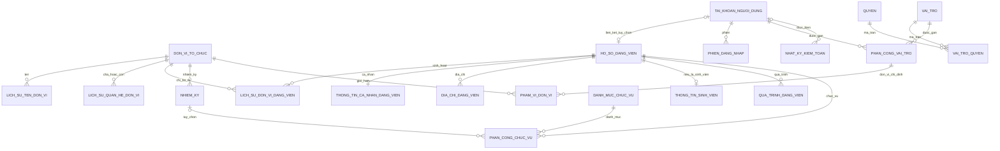

# Tổng hợp thiết kế CSDL — Hệ thống Quản lý Đảng viên PTIT

**Trạng thái:** Đã tạo Prisma schema và áp dụng migration nền, bảo vệ audit, cùng `20261101000000_hieu_luc_ngay_gio_va_sua_loai_don_vi` cho database phát triển. Nhật ký kiểm toán có trigger chặn UPDATE/DELETE. Tài liệu này là data dictionary tương ứng. Database chưa có dữ liệu PTIT; các danh mục/nghiệp vụ còn chờ chốt không được seed tự suy đoán.

## 1. Phạm vi và quy ước

- 20 bảng trong catalog dưới đây bao phủ tài khoản/phiên, tổ chức, hồ sơ/sinh viên, chức vụ/nhiệm kỳ, RBAC và audit.
- Không có bảng/mô-đun cấp ủy hoặc chi ủy.
- Tên bảng/cột tiếng Việt không dấu, `snake_case`; tên thư mục/file mã nguồn tiếng Anh theo TypeScript/NestJS.
- Prisma Client dùng model/enum tiếng Việt không dấu PascalCase và trường/quan hệ tiếng Việt không dấu camelCase; tên vật lý PostgreSQL vẫn là bảng/cột snake_case qua @@map/@map.
- PK dùng UUID. FK tham chiếu UUID. Thời điểm dùng `timestamptz`; ngày nghiệp vụ dùng `date`; trường mô tả dài dùng `text`; các mã/nhãn có giới hạn dùng `varchar(n)`.
- Các enum nghiệp vụ chưa có danh mục được xác nhận thì ghi `enum (giá trị cần chốt)`; không tạo danh sách Chi bộ, Tổ, chức vụ hay trạng thái sinh viên thực tế.
- Các bảng có thể thay đổi đều có `ngay_tao timestamptz NOT NULL` và `ngay_cap_nhat timestamptz NOT NULL` trừ bảng lịch sử/audit chỉ ghi thêm, được ghi riêng.
- Xóa hẳn được phép sau khi xử lý các bản ghi đang tham chiếu. FK `RESTRICT` ngăn xóa khi còn phụ thuộc; không tự động cascade xóa lịch sử.

## 2. Sơ đồ quan hệ tổng thể

## 3. Catalog bảng, trường và khóa

### A. Cơ sở dữ liệu tài khoản

#### 1. `tai_khoan_nguoi_dung`

| Trường | Kiểu | Khóa / quy tắc |
|---|---|---|
| `ma_tai_khoan` | UUID | PK |
| `ten_dang_nhap` | varchar(100) | NOT NULL, UNIQUE; chuẩn hóa trước khi lưu |
| `email` | varchar(254) | NULL, UNIQUE khi có; chuẩn hóa trước khi lưu |
| `mat_khau_bam` | text | NOT NULL cho xác thực nội bộ; chỉ lưu hash |
| `trang_thai` | enum | NOT NULL; giá trị trạng thái cần chốt |
| `so_lan_dang_nhap_that_bai` | integer | NOT NULL DEFAULT 0, CHECK >= 0 |
| `khoa_den` | timestamptz | NULL |
| `doi_mat_khau_lan_dau` | boolean | NOT NULL DEFAULT true |
| `dang_nhap_cuoi_luc` | timestamptz | NULL |
| `ngay_tao`, `ngay_cap_nhat` | timestamptz | NOT NULL |

**Index:** UNIQUE `ten_dang_nhap`; UNIQUE `email` (PostgreSQL cho phép nhiều NULL); index `(trang_thai)`.

Quyết định đã duyệt: đăng nhập nội bộ, quản trị viên quản lý tài khoản, không tự đăng ký; SSO là phần mở rộng sau.

#### 2. `phien_dang_nhap`

| Trường | Kiểu | Khóa / quy tắc |
|---|---|---|
| `ma_phien` | UUID | PK |
| `ma_tai_khoan` | UUID | FK → `tai_khoan_nguoi_dung.ma_tai_khoan`, NOT NULL, ON DELETE RESTRICT |
| `ma_lam_moi_bam` | text | NOT NULL; hash, không lưu token gốc |
| `ngay_tao` | timestamptz | NOT NULL |
| `het_han_luc` | timestamptz | NOT NULL |
| `thu_hoi_luc` | timestamptz | NULL |
| `dia_chi_ip` | inet | NULL; chỉ lưu nếu cần vận hành/an ninh |
| `thiet_bi` | text | NULL; giới hạn độ dài khi ghi |

**Index:** `(ma_tai_khoan, het_han_luc)`; `(ma_tai_khoan, thu_hoi_luc)`.

### B. Cây tổ chức và lịch sử

#### 3. `don_vi_to_chuc`

`ma_don_vi UUID PK`; `ma_dinh_danh varchar(50) NULL UNIQUE`; `loai_don_vi enum NOT NULL` (`DANG_UY`, `CHI_BO`, `TO`); `trang_thai enum NOT NULL`; `ngay_tao`, `ngay_cap_nhat timestamptz NOT NULL`.

**Quy tắc:** một Đảng ủy gốc; quan hệ hợp lệ Đảng ủy → Chi bộ → Tổ tùy chọn; Chi bộ có 0..n Tổ. Không hard-code tên/số lượng. Tối đa một Đảng ủy gốc đang hoạt động. Đơn vị tạo nhầm được sửa loại nếu các quan hệ và lịch sử sau khi sửa vẫn hợp lệ. Có thể xóa hẳn đơn vị sau khi xử lý tham chiếu; khóa ngoại chặn xóa khi còn dữ liệu liên quan, không tự xóa dây chuyền.

**Index/ràng buộc:** UNIQUE nullable `ma_dinh_danh`; index `(loai_don_vi, trang_thai)`. Tính đúng của một nút gốc được kiểm soát khi khởi tạo/cập nhật.

#### 4. `lich_su_ten_don_vi`

`ma_lich_su_ten UUID PK`; `ma_don_vi UUID FK → don_vi_to_chuc NOT NULL`; `ten_don_vi varchar(200) NOT NULL`; `ngay_hieu_luc_tu date NOT NULL`; `ngay_hieu_luc_den date NULL`; `nguoi_ghi_nhan UUID FK → tai_khoan_nguoi_dung NULL`; `ngay_tao timestamptz NOT NULL`.

**Index/ràng buộc:** index `(ma_don_vi, ngay_hieu_luc_tu)`; UNIQUE có điều kiện `ma_don_vi` khi `ngay_hieu_luc_den IS NULL`; CHECK ngày kết thúc >= ngày bắt đầu.

#### 5. `lich_su_quan_he_don_vi`

`ma_lich_su_quan_he UUID PK`; `ma_don_vi_cha UUID FK → don_vi_to_chuc NOT NULL`; `ma_don_vi_con UUID FK → don_vi_to_chuc NOT NULL`; `ngay_hieu_luc_tu timestamptz NOT NULL`; `ngay_hieu_luc_den timestamptz NULL`; `nguoi_ghi_nhan UUID FK NULL`; `ngay_tao timestamptz NOT NULL`.

**Index/ràng buộc:** index `(ma_don_vi_cha, ngay_hieu_luc_tu)`; index `(ma_don_vi_con, ngay_hieu_luc_tu)`; UNIQUE có điều kiện `ma_don_vi_con` khi còn hiện hành; CHECK cha != con và thời gian hợp lệ. Khoảng hiệu lực dùng dạng `[bắt đầu, kết thúc)`; ngày kết thúc nhập theo lịch được tính hết ngày đó theo giờ `Asia/Ho_Chi_Minh`, còn ngày giờ kết thúc có hiệu lực đến đúng thời điểm đã nhập. Quan hệ của cùng đơn vị con không được chồng lấn. Sai tầng được CSDL kiểm tra; chu trình và độ sâu tối đa 3 tầng cần dịch vụ/transaction kiểm tra.

### C. Hồ sơ đảng viên và sinh viên

#### 6. `ho_so_dang_vien`

`ma_ho_so UUID PK`; `ma_ho_so_noi_bo varchar(50) NOT NULL UNIQUE`; `so_phieu_ly_lich varchar(50) NULL UNIQUE`; `so_the_dang_vien varchar(50) NULL UNIQUE`; `ho_va_ten varchar(200) NOT NULL`; `trang_thai enum NOT NULL (giá trị cần chốt)`; `ma_tai_khoan UUID NULL UNIQUE FK → tai_khoan_nguoi_dung`; `ngay_tao`, `ngay_cap_nhat timestamptz NOT NULL`.

Một tài khoản liên kết tối đa một hồ sơ; tài khoản/hồ sơ đều có thể chưa được liên kết. Mã hồ sơ nội bộ không phải số thẻ Đảng hay CCCD.

**Index:** UNIQUE `ma_ho_so_noi_bo`; UNIQUE nullable `ma_tai_khoan`; index `(trang_thai)`; index tra cứu họ tên cần chọn theo chiến lược tìm kiếm đã duyệt.

#### 7. `thong_tin_ca_nhan_dang_vien`

Quan hệ 1:1; `ma_ho_so UUID PK/FK → ho_so_dang_vien`.

| Trường | Kiểu | Ghi chú |
|---|---|---|
| `ngay_sinh` | date NULL | Có bắt buộc hay không cần biểu mẫu xác nhận |
| `gioi_tinh` | enum/varchar NULL | Giá trị danh mục cần chốt |
| `so_cccd` | varchar(12) NULL | CCCD lưu dạng rõ theo quyết định sản phẩm 2026-11-03; unique toàn hệ thống |
| `ngay_cap_cccd` | date NULL | Ngày cấp CCCD |
| `noi_cap_cccd` | varchar(250) NULL | Nơi cấp CCCD |
| `quoc_tich` | varchar(100) NULL | Danh mục chuẩn hóa có thể bổ sung sau |
| `dan_toc`, `ton_giao` | varchar(100) NULL | Chỉ thu thập theo biểu mẫu/mục đích được duyệt |
| `so_dien_thoai` | varchar(30) NULL | Không dùng làm định danh duy nhất |
| `email_lien_he` | varchar(254) NULL | Không dùng làm định danh duy nhất |
| `ngay_tao`, `ngay_cap_nhat` | timestamptz | NOT NULL |

CCCD unique trên toàn bảng; khi tạo tài khoản đăng nhập đồng thời thì CCCD bắt buộc và phải có đúng 12 chữ số. Không ghi CCCD vào log/audit hoặc dữ liệu xuất; tầng ứng dụng không mã hóa CCCD. Giới hạn quyền truy cập database và backup. Không có hộ chiếu.

#### 8. `dia_chi_dang_vien`

`ma_dia_chi UUID PK`; `ma_ho_so UUID FK → ho_so_dang_vien NOT NULL`; `loai_dia_chi enum NOT NULL` (`NOI_SINH`, `QUE_QUAN`, `THUONG_TRU`); `phan_loai_noi_sinh enum NULL` (`TRONG_NUOC`, `NUOC_NGOAI`, chỉ cho nơi sinh); `quoc_gia varchar(100) NULL`; `tinh_thanh_pho varchar(150) NULL`; `quan_huyen varchar(150) NULL`; `xa_phuong varchar(150) NULL`; `dia_chi_chi_tiet varchar(500) NULL`; `ngay_tao`, `ngay_cap_nhat timestamptz NOT NULL`.

**Index/ràng buộc:** UNIQUE `(ma_ho_so, loai_dia_chi)`; index `ma_ho_so`. Không có mã bưu chính. Mã địa giới chuẩn hóa chờ nguồn chính thức.

#### 9. `thong_tin_sinh_vien`

Quan hệ 1:1 tùy chọn; `ma_ho_so UUID PK/FK → ho_so_dang_vien`.

| Trường | Kiểu | Khóa / ghi chú |
|---|---|---|
| `ma_sinh_vien` | varchar(50) | NOT NULL, UNIQUE sau chuẩn hóa |
| `trang_thai_hoc_tap` | varchar(50) | NULL hoặc NOT NULL cần chốt; danh mục nguồn chưa biết |
| `khoa_hoc` | varchar(50) NULL | Mã khóa từ nguồn, ví dụ `D23CQ`; không suy ra từ năm |
| `don_vi_phu_trach` | varchar(200) NULL | Tên/mã theo nguồn được duyệt |
| `chuong_trinh_dao_tao` | varchar(250) NULL | Chương trình |
| `nganh` | varchar(200) NULL | Ngành |
| `chuyen_nganh` | varchar(200) NULL | Chuyên ngành |
| `lop_hanh_chinh` | varchar(100) NULL | Mã/tên lớp hành chính |
| `ma_nguon_du_lieu` | varchar(80) NULL | Dự phòng liên thông |
| `ma_ban_ghi_nguon` | varchar(120) NULL | Định danh record tại nguồn |
| `dong_bo_cuoi_luc` | timestamptz NULL | Đồng bộ gần nhất |
| `ngay_tao`, `ngay_cap_nhat` | timestamptz | NOT NULL |

**Index:** UNIQUE `ma_sinh_vien`; index cho khóa/lớp/ngành chỉ thêm khi có truy vấn tương ứng. **Chi bộ khóa** không lưu lặp ở đây: lấy từ Chi bộ sinh hoạt hiện hành trong bảng 11, hiển thị mã/tên ví dụ `D25`. Nếu đó là phân loại riêng khác đơn vị sinh hoạt, phải duyệt quan hệ riêng.

Quy trình phát hiện trùng bắt buộc trước khi tạo/import: so khớp MSV chuẩn hóa và CCCD bằng HMAC đối chiếu (không unique để có thể phát hiện ứng viên), sau đó dùng họ tên/ngày sinh hoặc thông tin liên quan để hỗ trợ xác minh. UNIQUE MSV là ràng buộc cuối cùng chống tạo trùng. Kết quả cần người có quyền xác minh; không tự gộp hồ sơ.

#### 10. `qua_trinh_dang_vien`

`ma_qua_trinh UUID PK`; `ma_ho_so UUID FK NOT NULL`; `loai_su_kien enum (cần chốt)`; `ngay_su_kien date NOT NULL`; `so_quyet_dinh varchar(100) NULL`; `ngay_quyet_dinh date NULL`; `noi_dung text NULL`; `nguoi_ghi_nhan UUID FK → tai_khoan_nguoi_dung`; `ngay_tao timestamptz NOT NULL`.

Index `(ma_ho_so, ngay_su_kien)`. Loại sự kiện/trường chi tiết cần theo biểu mẫu chính thức; không lưu tự do bằng JSON nếu cần báo cáo/kiểm tra.

#### 11. `lich_su_don_vi_dang_vien`

`ma_lich_su UUID PK`; `ma_ho_so UUID FK NOT NULL`; `ma_chi_bo UUID FK → don_vi_to_chuc NOT NULL`; `ma_to UUID FK → don_vi_to_chuc NULL`; `ngay_hieu_luc_tu timestamptz NOT NULL`; `ngay_hieu_luc_den timestamptz NULL`; `ly_do_chuyen text NULL`; `nguoi_ghi_nhan UUID FK`; `ngay_tao timestamptz NOT NULL`.

**Index/ràng buộc:** index `(ma_ho_so, ngay_hieu_luc_tu)`; UNIQUE có điều kiện `ma_ho_so` khi ngày kết thúc NULL (tối đa một dòng hiện hành); index `(ma_chi_bo, ngay_hieu_luc_tu)`; CHECK thời gian hợp lệ. Khoảng hiệu lực dùng `[bắt đầu, kết thúc)` và quy đổi ngày kết thúc theo `Asia/Ho_Chi_Minh` đến nửa đêm ngày liền sau để tính hết ngày đã chọn. Không cho phép khoảng sinh hoạt của cùng hồ sơ chồng lấn. Tổ phải là con của chính Chi bộ trong cùng khoảng hiệu lực. Chuyển đơn vị đóng dòng cũ + tạo dòng mới trong một transaction có khóa/kiểm tra đồng thời phù hợp; chỉ commit nếu không có khoảng thời gian xung đột. Không nhập hồi tố/ngày tương lai theo mặc định đã duyệt.

### D. Chức vụ và nhiệm kỳ

#### 12. `danh_muc_chuc_vu`

`ma_chuc_vu UUID PK`; `ma_chuc_vu_noi_bo varchar(50) NULL UNIQUE`; `ten_chuc_vu varchar(200) NOT NULL`; `mo_ta text NULL`; `trang_thai enum NOT NULL`; `ngay_tao`, `ngay_cap_nhat timestamptz NOT NULL`.

Không seed chức vụ thực tế chưa được cung cấp. Index trạng thái.

#### 13. `nhiem_ky`

`ma_nhiem_ky UUID PK`; `ma_don_vi UUID FK → don_vi_to_chuc NOT NULL`; `ten_nhiem_ky varchar(150) NOT NULL`; `ngay_bat_dau date NOT NULL`; `ngay_ket_thuc date NOT NULL`; `trang_thai enum NOT NULL`; `ngay_tao`, `ngay_cap_nhat timestamptz NOT NULL`.

Index `(ma_don_vi, ngay_bat_dau, ngay_ket_thuc)`. Không tự áp đặt nhiệm kỳ liên tục/không chồng lấn.

#### 14. `phan_cong_chuc_vu`

`ma_phan_cong UUID PK`; `ma_ho_so UUID FK NOT NULL`; `ma_chuc_vu UUID FK NOT NULL`; `ma_don_vi UUID FK NOT NULL`; `ma_nhiem_ky UUID FK NULL`; `ngay_hieu_luc_tu date NOT NULL`; `ngay_hieu_luc_den date NULL`; `so_quyet_dinh varchar(100) NULL`; `ghi_chu text NULL`; `nguoi_ghi_nhan UUID FK`; `ngay_tao timestamptz NOT NULL`.

Index `(ma_ho_so, ngay_hieu_luc_tu)`, `(ma_don_vi, ngay_hieu_luc_tu)`, `(ma_chuc_vu, ngay_hieu_luc_tu)`. Backend xác minh hồ sơ, chức vụ, đơn vị và nhiệm kỳ hợp lệ; nếu có nhiệm kỳ thì đơn vị của nhiệm kỳ phải khớp đơn vị phân công và khoảng phân công phải nằm trong khoảng nhiệm kỳ. Cho phép nhiều phân công đồng thời; chưa đặt giới hạn số người/chức vụ.

### E. RBAC và phạm vi

#### 15. `vai_tro`

`ma_vai_tro UUID PK`; `ma_vai_tro_noi_bo varchar(80) NOT NULL UNIQUE`; `ten_vai_tro varchar(150) NOT NULL`; `mo_ta text NULL`; `la_vai_tro_he_thong boolean NOT NULL DEFAULT false`; `trang_thai enum NOT NULL`; `ngay_tao`, `ngay_cap_nhat timestamptz NOT NULL`.

#### 16. `quyen`

`ma_quyen UUID PK`; `ma_quyen_noi_bo varchar(120) NOT NULL UNIQUE`; `ten_quyen varchar(150) NOT NULL`; `mo_ta text NULL`; `phan_loai_du_lieu enum NULL`; `ngay_tao timestamptz NOT NULL`.

Mã quyền được xác định theo chức năng/module, ví dụ `TO_CHUC.XEM`; danh mục cụ thể chưa được điền.

#### 17. `vai_tro_quyen`

`ma_vai_tro UUID FK → vai_tro`; `ma_quyen UUID FK → quyen`; `nguoi_ghi_nhan UUID FK → tai_khoan_nguoi_dung`; `ngay_tao timestamptz NOT NULL`.

**PK ghép:** `(ma_vai_tro, ma_quyen)`. Ma trận nhiều-nhiều; Role có nhiều Permission.

#### 18. `phan_cong_vai_tro`

`ma_phan_cong UUID PK`; `ma_tai_khoan UUID FK NOT NULL`; `ma_vai_tro UUID FK NOT NULL`; `loai_pham_vi enum NOT NULL`; `ma_don_vi_goc UUID FK → don_vi_to_chuc NULL`; `ngay_hieu_luc_tu timestamptz NOT NULL`; `ngay_hieu_luc_den timestamptz NULL`; `nguoi_cap UUID FK NOT NULL`; `nguoi_thu_hoi UUID FK NULL`; `ngay_thu_hoi timestamptz NULL`; `ly_do text NULL`; `ngay_tao timestamptz NOT NULL`.

Giá trị scope: `CA_NHAN`, `CAY_DON_VI`, `DON_VI_CHI_DINH`, `TOAN_HE_THONG`. CHECK điều kiện cột: SELF/GLOBAL không có đơn vị gốc; SUBTREE bắt buộc đơn vị gốc; CUSTOM dùng bảng 19. Có thể có nhiều assignment đồng thời; không unique theo tài khoản-vai trò. Index `(ma_tai_khoan, ngay_hieu_luc_tu, ngay_hieu_luc_den)`, `(ma_vai_tro)`, `(ma_don_vi_goc)`.

Mọi API nghiệp vụ bắt buộc kiểm tra quyền thao tác và scope đối với đối tượng cụ thể. Người cấp assignment phải có quyền quản lý/cấp quyền tương ứng; Role, Permission và Scope được cấp không vượt quá quyền và phạm vi được ủy quyền cho chính người cấp. Không tin Role/Scope do Frontend gửi; thiếu quyền hoặc không rõ thẩm quyền thì từ chối.

#### 19. `pham_vi_don_vi`

`ma_phan_cong UUID FK → phan_cong_vai_tro`; `ma_don_vi UUID FK → don_vi_to_chuc`; `ngay_tao timestamptz NOT NULL`.

**PK ghép:** `(ma_phan_cong, ma_don_vi)`. Chỉ dùng khi assignment có scope `DON_VI_CHI_DINH`; Backend kiểm tra tính nhất quán.

### F. Nhật ký kiểm toán

#### 20. `nhat_ky_kiem_toan`

`ma_nhat_ky UUID PK`; `ma_nguoi_thuc_hien UUID FK → tai_khoan_nguoi_dung NULL` (NULL cho tác vụ hệ thống/ẩn danh); `hanh_dong varchar(120) NOT NULL`; `loai_doi_tuong varchar(120) NOT NULL`; `ma_doi_tuong UUID NULL`; `ket_qua enum NOT NULL`; `ly_do text NULL`; `du_lieu_truoc jsonb NULL`; `du_lieu_sau jsonb NULL`; `ma_tuong_quan varchar(80) NOT NULL`; `dia_chi_ip inet NULL`; `thoi_diem timestamptz NOT NULL`.

**Index:** `(ma_nguoi_thuc_hien, thoi_diem)`, `(loai_doi_tuong, ma_doi_tuong, thoi_diem)`, `(ma_tuong_quan)`. Append-only; JSON trước/sau đã lọc. Không log credential, token, CCCD/MSV đầy đủ hoặc toàn bộ hồ sơ.

Quyền xem audit riêng, chỉ cấp cho vai trò được ủy quyền và giới hạn theo phạm vi công việc; truy cập audit cũng được ghi audit. Cần bảo vệ bản sao lưu và kho nhật ký, hạn chế quyền DB, giám sát truy cập; thời hạn lưu cụ thể chờ chính sách PTIT.

Khi xác minh hồ sơ trùng, audit chỉ ghi các ID hồ sơ liên quan, loại dấu hiệu khớp (CCCD/MSV/thông tin khác), người xác minh, thời điểm và kết luận. Không ghi giá trị CCCD/MSV vào `du_lieu_truoc`, `du_lieu_sau` hoặc nội dung log. Quyền audit và thời hạn lưu chi tiết phải theo chính sách PTIT.

## 3.7. Phân loại sinh viên/cán bộ/giảng viên

`thong_tin_sinh_vien` là extension tùy chọn. Cách phân loại đầy đủ đối tượng (sinh viên, cán bộ, giảng viên hoặc nhóm khác) còn cần chốt; chưa thêm enum phân loại vào `ho_so_dang_vien` và chưa tạo bảng cán bộ. Hồ sơ không có extension sinh viên không mặc nhiên bị gán loại khác.

## 4. Quan hệ và quy tắc khóa tổng hợp

- Tổ chức: mỗi đơn vị con có tối đa một cha hiện hành; lưu lịch sử đổi tên/đổi cha; cấm sai loại cha-con, chu trình và độ sâu trên ba tầng.
- Đảng viên: một hồ sơ có tối đa một Chi bộ hiện hành và không quá một Tổ thuộc Chi bộ đó. Một hồ sơ có thể chưa có tài khoản; mỗi tài khoản/hồ sơ liên kết tối đa một-một.
- Sinh viên: một hồ sơ có tối đa một phần mở rộng sinh viên; mã sinh viên duy nhất; Chi bộ khóa lấy từ liên kết sinh hoạt hiện hành (ví dụ hiển thị `D25`), không nhân bản FK trong bảng sinh viên.
- Chức vụ: một hồ sơ có thể có nhiều assignment đồng thời; nhiệm kỳ được gắn tùy chọn; không có giới hạn chưa được duyệt.
- RBAC: mỗi Role có nhiều Permission qua ma trận; tài khoản có nhiều Role Assignment; mỗi assignment tự chứa scope, không trộn Permission/Scope từ assignment khác; mặc định từ chối.
- Xóa đơn vị: cho phép xóa hẳn nếu đã xử lý các bản ghi đang tham chiếu; FK dùng RESTRICT và không cascade xóa lịch sử. Sửa loại đơn vị được phép nếu các quan hệ cha-con và lịch sử sinh hoạt sau khi sửa vẫn hợp lệ.

## 4.1. Ma trận điều chỉnh và mức độ

| STT | Nội dung | Đề xuất đã đưa vào thiết kế | Mức độ |
|---:|---|---|---|
| 1 | Lịch sử sinh hoạt Đảng | Cấm khoảng thời gian chồng lấn; chuyển Chi bộ/Tổ trong transaction và kiểm tra đồng thời trước khi commit | Bắt buộc |
| 2 | Lịch sử cây tổ chức | Tối đa một cha tại cùng thời điểm; cấm chu trình, sai tầng và quá 3 tầng | Bắt buộc |
| 3 | Phân quyền | Mỗi API kiểm tra Permission + Scope; người cấp không được cấp quyền/phạm vi vượt thẩm quyền mình | Bắt buộc |
| 4 | Hồ sơ trùng | Dò CCCD/MSV và dấu hiệu liên quan; người có quyền xác minh; không tự gộp; audit kết quả nhưng không lộ định danh | Bắt buộc |
| 5 | Chức vụ/nhiệm kỳ | Kiểm tra hồ sơ, chức vụ, đơn vị, nhiệm kỳ và thời gian; nhiệm kỳ tùy chọn theo mặc định đã duyệt | Nên làm |
| 6 | Sinh viên/cán bộ/giảng viên | Thông tin sinh viên là extension tùy chọn; cách phân loại còn chờ chốt; chưa tạo bảng cán bộ | Cần chốt |
| 7 | Audit | Không ghi dữ liệu nhạy cảm đầy đủ; quyền xem riêng, audit lượt truy cập, bảo vệ nơi lưu và backup; retention theo chính sách PTIT | Bắt buộc |

## 5. Các mục không thuộc schema MVP mặc định

Chỉ tạo sau khi có nhu cầu/biểu mẫu và duyệt riêng: `qua_trinh_cong_tac`, `qua_trinh_dao_tao`, `khen_thuong_dang_vien`, `ky_luat_dang_vien`, `nguoi_than_dang_vien`, `tep_dinh_kem_ho_so`, bảng đồng bộ/tích hợp nguồn. Không thu thập dữ liệu thân nhân, không lưu tệp scan hoặc trường cá nhân khác khi chưa duyệt mục đích, quyền truy cập, bảo vệ và thời hạn lưu.

## 6. Trình tự mở rộng sau schema nền

1. Schema 20 bảng đã được triển khai trong migration nền hiện tại.
2. Triển khai API tổ chức và lịch sử; kiểm thử cây, loại quan hệ, giao dịch chuyển đơn vị và đơn vị gốc.
3. Triển khai Role/Permission/Assignment/Scope và audit; kiểm thử từng API, phạm vi và từ chối mặc định.
4. Hoàn thiện hồ sơ đảng viên/sinh viên sau khi chốt danh mục/trường bắt buộc; các bảng đã có trong schema nhưng không được seed dữ liệu giả định.
5. Các bảng lịch sử mở rộng và liên thông hệ thống học vụ làm sau khi có yêu cầu, nguồn dữ liệu và quyền tích hợp.

**Còn cần chốt trước API/seed nghiệp vụ:** trạng thái hồ sơ/tài khoản/chức vụ, tính bắt buộc trường nhạy cảm, danh mục giới tính/trạng thái sinh viên/sự kiện Đảng, quy trình xác minh hồ sơ trùng, chuẩn mã địa chỉ, phân loại cán bộ/giảng viên và bootstrap quản trị đầu tiên. Các giá trị thực tế phải lấy từ nguồn PTIT được xác nhận, không tự tạo. Một số quy tắc như quyền cấp vượt thẩm quyền, quy trình xác minh trùng và chính sách lưu audit cần được thực thi ở lớp Backend khi xây module.
