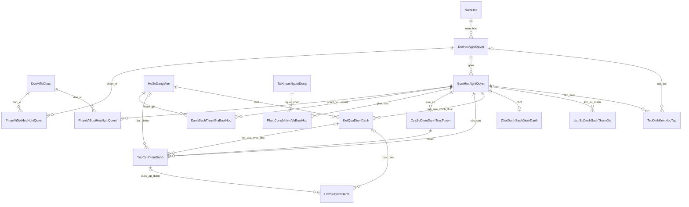

# Đặc tả thống nhất nghiệp vụ và kỹ thuật — Học tập nghị quyết và Điểm danh

**Bản chuẩn duy nhất.** Tài liệu này hợp nhất và thay thế hai tài liệu nghiệp vụ/kỹ thuật trước đây. Phần I ghi nghiệp vụ; Phần II ghi thiết kế kỹ thuật và quyết định triển khai. Các nội dung chưa được quyết định được đánh dấu riêng.

# Phần I — Thiết kế nghiệp vụ

# Thiết kế nghiệp vụ: Học tập nghị quyết và điểm danh

**Trạng thái:** Quyết định nghiệp vụ đã chốt; Backend Prompt 3.3.1–3.3.7 đã triển khai; Frontend còn ở giai đoạn sau.  
**Ngày cập nhật:** 12-11-2026

> Đây là tài liệu chuẩn về nghiệp vụ và thiết kế. Trạng thái triển khai thực tế được cập nhật ở mục 28–31 và 35–37 cùng `docs/SESSION_HANDOFF.md`; code/schema/migration hiện tại là căn cứ cho phần đã triển khai. Các điểm còn chờ duyệt được nêu riêng.

## 1. Tóm tắt

- Mô hình đề xuất: **Đợt học → Buổi học → Danh sách tham gia được chụp tại thời điểm xác nhận → Yêu cầu điểm danh → Kết quả chính thức → Lịch sử**.
- Mỗi Đảng viên tối đa một kết quả chính thức/buổi. Yêu cầu đang chờ không làm đổi kết quả chính thức.
- Trạng thái đợt, buổi, cửa sổ điểm danh, yêu cầu và kết quả là các vòng đời tách biệt.
- Phân công phụ trách là giao việc, không cấp Permission. API quản trị kiểm tra Permission + Scope trên Assignment đang hoạt động.
- Không suy diễn vắng mặt từ việc không quét QR. Form công khai tạo yêu cầu cần đối chiếu; không tạo hồ sơ mới và không tự chứng minh danh tính/sự hiện diện.
- Module thuộc nhóm Quản lý Đảng viên. Frontend hiện có Quản lý đợt học và route placeholder Thống kê và báo cáo; Quản lý buổi học vẫn chờ Prompt 3.4.2.

## 2. Hiện trạng đã kiểm chứng

### Có thể tái sử dụng

| Năng lực | Hiện trạng và giới hạn |
|---|---|
| Hồ sơ Đảng viên | Model HoSoDangVien có mã hồ sơ, họ tên, trạng thái, ngày vào Đảng/chính thức và liên kết tài khoản tùy chọn. API có danh sách, chi tiết, hồ sơ của tôi, kiểm tra quyền/phạm vi. Dùng hồ sơ làm định danh; họ tên không phải khóa duy nhất. |
| Lịch sử sinh hoạt | LichSuDonViDangVien liên kết hồ sơ với Chi bộ/Tổ tùy chọn theo thời gian hiệu lực. Dùng làm đầu vào dựng danh sách, nhưng phải snapshot đơn vị/tên tại mốc chốt để bảo toàn báo cáo lịch sử. |
| Cây tổ chức | DonViToChuc, LichSuQuanHeDonVi, LichSuTenDonVi; có API cây/danh sách và OrganizationUnitPicker. Tái sử dụng UUID, quan hệ và bộ chọn; không hard-code tên đơn vị. |
| Năm học | Bắt buộc chọn bản ghi `NamHoc` hiện có khi tạo đợt; không suy từ ngày. Module school-years có API/danh mục và Permission `NAM_HOC_*`. Quan hệ FK tới NamHoc được đề xuất ở phần kỹ thuật. |
| RBAC | Role–Permission–Assignment–Scope; phiên lưu maPhanCongVaiTroDangHoatDong. PhanQuyenService lọc Assignment hiệu lực được chọn và kiểm tra Permission + Scope trên cùng Assignment. Không cộng quyền giữa Assignment, không mặc định người tạo/phụ trách toàn quyền. |
| Audit | NhatKyKiemToan ghi người, hành động, đối tượng, kết quả, before/after, mã tương quan, IP và thời điểm. Module system-logs có API riêng. Cần thêm lịch sử miền dễ hiểu; không ghi CCCD, QR token hay input form nhạy cảm vào audit. |
| Ngày giờ | Có DatePicker, DateTimePicker, DateRangePicker, DateTimeRangePicker; quy ước date-only yyyy-MM-dd và local datetime yyyy-MM-dd'T'HH:mm. |
| UI | Có PageContainer (AdminLayout đã bọc), PageHeader, StatisticCard, DataTable, Table primitives, StandardSheet, Dialog, Empty/Loading state, OrganizationUnitPicker và chart primitive. Tái sử dụng; không bọc PageContainer lần nữa. Không thấy StarCard tổng quát riêng; hiện có StatisticCard và thẻ tổng hợp luồng Excel. |
| Excel | Backend data-transfer xử lý workbook; feature sở hữu mapping, validation, quyền, preview/xác nhận và audit. Báo cáo Excel sau này thuộc feature; module chung không ghi bảng nghiệp vụ. |

### Đã có nhưng không phải điểm danh

- ThongTinDaoTaoDang lưu đào tạo/bồi dưỡng Đảng của cá nhân, không phải mô hình nhiều buổi/danh sách/điểm danh/phê duyệt.
- DotCapNhatHoSo và YeuCauCapNhatHoSo là luồng cập nhật hồ sơ; không tái sử dụng hoặc đổi nghĩa.
- Nhật ký audit không thay lịch sử miền điểm danh.
- NamHoc là danh mục độc lập, chưa có FK nghiệp vụ.

### Còn thiếu

Tại thời điểm rà soát ban đầu, chưa có module đợt/buổi hoặc danh mục nghiệp vụ dùng chung. Prompt 3.3.1 đã triển khai API quản lý đợt/buổi; danh sách snapshot, QR, form công khai, yêu cầu xử lý, kết quả, chốt và thống kê vẫn thuộc các bước tiếp theo. Chưa có cơ chế chống gửi lặp/chống lạm dụng cho form công khai. Công thức tham gia toàn đợt, điều kiện chốt và cập nhật danh sách sau khi mở điểm danh đã được chốt tại tài liệu này; chi tiết triển khai CSDL/API còn cần nghiên cứu.

navigation.config.ts có mục “Học tập nghị quyết (Đang phát triển)” disabled, không có path; docs/sidebar-module-conventions.md xác nhận chưa có route/chức năng. Trang thống kê chuyên biệt có thể thuộc feature, nhưng vị trí so với nhóm Báo cáo cần chốt.

## 3. Mô hình nghiệp vụ

1. **Đợt học:** chương trình/chủ đề, năm học, đơn vị tổ chức, phạm vi và thời gian tổng thể.
2. **Buổi học:** lần tổ chức cụ thể, thời gian/địa điểm, đối tượng, cấu hình điểm danh, phụ trách và duyệt riêng.
3. **Danh sách tham gia:** hồ sơ thuộc diện đã xác nhận; mỗi dòng có snapshot Chi bộ/Tổ/tên đơn vị/mốc chụp. Ngoại lệ lưu người thao tác và audit.
4. **Yêu cầu:** đề nghị tạo mới hoặc thay đổi kết quả, trạng thái xử lý, người/thời điểm gửi. Đề xuất chỉ một yêu cầu chờ xung đột trên cùng kết quả.
5. **Kết quả chính thức:** trạng thái được công nhận của cặp buổi–hồ sơ; một kết quả duy nhất. Chưa điểm danh có thể là trạng thái hiển thị khi chưa có bản ghi.
6. **Lịch sử:** thay đổi chính thức và yêu cầu được duyệt/từ chối hoặc ghi trực tiếp; lưu người, thời điểm, before/after. Không lưu nguồn QR/form/thủ công trong kết quả chính thức.

Quy tắc: buổi thuộc một đợt; danh sách được snapshot khi xác nhận; chuyển tổ chức sau đó không viết lại lịch sử; yêu cầu chờ không phải kết quả; không tự đánh dấu vắng khi cửa sổ đóng; người tạo/phụ trách không có quyền ngầm.

## 4. Quy trình

**Tạo đợt Nháp → Hoàn thiện phạm vi/thông tin → Tạo buổi → Xác nhận danh sách và snapshot → Mở nhận điểm danh → QR/Form/Thủ công → Xác minh nếu cần → Duyệt nếu bật → Kết quả chính thức → Đóng online → Xử lý tồn đọng/thủ công → Kết thúc buổi → Chốt danh sách → Điều chỉnh theo quyền → Lịch sử/audit.**

### Tạo đợt và buổi

1. Kiểm tra Assignment hiện hành và quyền.
2. Tạo đợt Nháp, mã sinh ở server; chọn năm học từ danh mục, đơn vị/phạm vi, mô tả, tài liệu, phụ trách, thời gian.
3. Kiểm tra Scope và ngày. Kết thúc/hủy bằng thao tác rõ; ngày không đảo trạng thái kết thúc/hủy.
4. Tạo buổi; lưu người tạo riêng người phụ trách. Phạm vi buổi kế thừa hoặc hẹp hơn phạm vi đợt.
5. Dựng danh sách ứng viên từ hồ sơ và lịch sử sinh hoạt; xem trước, tìm kiếm/lọc, thêm ngoại lệ theo quyền.
6. Xác nhận snapshot danh sách và tổ chức. Sau khi mở điểm danh, người có Permission + Scope vẫn được bổ sung hồ sơ thiếu hoặc loại hồ sơ đưa nhầm theo các điều kiện tại Mục 6 và 9; mọi thay đổi cập nhật số lượng dự kiến, thống kê và lịch sử.
7. Cấu hình kênh/cửa sổ/chu kỳ/duyệt; khóa cấu hình duyệt từ lần nhận yêu cầu đầu tiên.

### QR động

1. Người có Permission mở cửa sổ; Backend kiểm tra quyền và Scope.
2. Màn hình hiển thị QR đổi theo chu kỳ 15/30/60 giây; mã gắn với buổi/cửa sổ, chứa token ngẫu nhiên ngắn hạn và không có PII.
3. Đảng viên đã đăng nhập: Backend lấy hồ sơ từ liên kết tài khoản trong phiên, không tin mã hồ sơ do client gửi.
4. Chưa đăng nhập: chỉ mở biểu mẫu công khai nếu buổi cho phép. QR không tự chứng minh người quét là Đảng viên hoặc đang có mặt.
5. Backend kiểm tra mã còn hạn, cửa sổ còn mở, hồ sơ/danh sách và yêu cầu/kết quả hiện có, đồng thời chống gửi lặp.
6. Kết quả hợp lệ được xử lý theo cấu hình phê duyệt. Không ghi nhận Có mặt chỉ từ việc quét QR nếu nghiệp vụ yêu cầu bước xác minh/phê duyệt.

### Form công khai

Người chưa đăng nhập mở biểu mẫu bằng QR hoặc đường dẫn công khai độc lập với QR. Họ nhập **họ và tên, Chi bộ, năm sinh** (bắt buộc) và **số CCCD** (không bắt buộc, hỗ trợ đối chiếu). CCCD yêu cầu được lưu plaintext trong `YeuCauDiemDanh.cccd` theo quyết định Prompt 3.3.13.2. API công khai chỉ trả xác nhận chung, không trả CCCD; API nội bộ chỉ trả đầy đủ khi có `HO_SO_CA_NHAN_XEM` và Scope hợp lệ. CCCD không xuất hiện trong audit, log hoặc lỗi. Không ghi đè hồ sơ Đảng viên và không tự tạo hồ sơ mới.

1. Người tham gia mở form bằng QR **hoặc** đường dẫn độc lập được chia sẻ bởi người có quyền. Form vẫn hoạt động khi QR tắt nếu biểu mẫu công khai được bật; hai kênh có token riêng và có thể thu hồi riêng.
2. Người tham gia gửi form khi cửa sổ thực tế còn mở. Backend xác thực dữ liệu và đối chiếu với hồ sơ Đảng viên hiện có; không tạo hồ sơ mới, không trả dữ liệu hồ sơ hay số CCCD trong lỗi.
3. Trước khi hồ sơ được xác minh, Backend chống gửi lặp bằng idempotency và fingerprint HMAC có thời hạn từ các trường định danh chuẩn hóa; CCCD được lưu như chuỗi plaintext 12 chữ số trong cột riêng. Khi yêu cầu kết thúc, xóa các fingerprint HMAC; dữ liệu biểu mẫu đã gửi vẫn được giữ. Khi đã ghép hồ sơ, unique pending theo buổi–hồ sơ chặn yêu cầu xung đột.
4. Mọi yêu cầu từ form công khai chuyển sang **Chờ xác minh**, kể cả khi khớp duy nhất; khớp tự động không tự chứng minh danh tính hoặc sự hiện diện.
5. Người có quyền xác minh xử lý yêu cầu. Nếu không hợp lệ, từ chối. Nếu hợp lệ và buổi không yêu cầu phê duyệt, ghi nhận kết quả **Có mặt**. Nếu buổi yêu cầu phê duyệt, chuyển sang **Chờ phê duyệt**.
6. Khi bị từ chối, không tạo/cập nhật kết quả chính thức. Khi được ghi Có mặt hoặc được duyệt, cập nhật kết quả và nhật ký theo đúng quyền.
7. Cửa sổ đã đóng/hết hạn thì từ chối submit trước khi xử lý dữ liệu form. Không trả phản hồi làm lộ hồ sơ nào tồn tại.

### Thủ công, xác minh, duyệt

- Cần Permission + Scope; nhiệm vụ phụ trách là gate bổ sung nếu policy yêu cầu.
- Xem danh sách snapshot, lọc trong Scope, cập nhật từng người/hàng loạt; trả trạng thái từng dòng.
- Bật duyệt: yêu cầu riêng từng người; tắt: cập nhật trực tiếp và lưu lịch sử.
- Cửa sổ online đóng vẫn cho thao tác thủ công.
- Xác minh chỉ liên kết hồ sơ hiện có. Bật duyệt thì chuyển chờ duyệt; tắt duyệt chỉ cập nhật chính thức nếu policy cho phép.
- Người duyệt có Permission riêng; không mặc định người gửi/phụ trách được duyệt.
- Duyệt yêu cầu mới tạo kết quả; duyệt điều chỉnh thay kết quả và lưu before/after. Từ chối giữ kết quả cũ.
- Xử lý đúng một lần; yêu cầu stale trả xung đột.

### Đóng, kết thúc và chốt

- **Đóng trực tuyến:** vô hiệu QR/form và ngừng nhận yêu cầu mới; vẫn xử lý yêu cầu đang chờ và điểm danh thủ công.
- **Kết thúc buổi:** xác nhận hoạt động đã kết thúc; không đồng nghĩa đóng điểm danh trực tuyến hoặc chốt.
- **Chốt danh sách:** Backend kiểm tra yêu cầu Chờ xác minh và Chờ phê duyệt. Nếu còn yêu cầu, không cho chốt, hiển thị số lượng chưa xử lý và thông báo cần xử lý trước. Không tự duyệt/từ chối.
- Chỉ chốt khi không còn yêu cầu đang chờ. Lưu người chốt, thời điểm chốt và trạng thái danh sách.
- Sau chốt vẫn được điều chỉnh theo quyền và cấu hình phê duyệt. Bật duyệt thì tạo yêu cầu, giữ nguyên kết quả chính thức cũ trong khi chờ; tắt duyệt thì cập nhật trực tiếp. Không bắt nhập lý do điều chỉnh; tự lưu nhật ký xử lý.

## 5. Ma trận vai trò – chức năng

| Chức năng | Quản lý đợt | Tạo/quản lý buổi | Phụ trách điểm danh | Xác minh/duyệt/chốt | Đảng viên đăng nhập | Chưa đăng nhập |
|---|---|---|---|---|---|---|
| Xem đợt/buổi | Theo quyền/Scope | Theo quyền/Scope | Buổi được giao + Scope | Theo quyền/Scope | Buổi của mình | Form qua QR |
| Tạo/sửa/kết thúc đợt | Permission từng thao tác | Không mặc nhiên | Không | Không mặc nhiên | Không | Không |
| Tạo/sửa/cấu hình buổi | Khi được cấp | Permission + Scope | Không mặc nhiên | Không mặc nhiên | Không | Không |
| Chốt danh sách | Theo quyền và không còn yêu cầu chờ | Theo quyền và không còn yêu cầu chờ | Được giao + quyền; không còn yêu cầu chờ | Theo quyền; không còn yêu cầu chờ | Không | Không |
| Mở/đóng/QR | Không mặc nhiên | Không mặc nhiên | Được giao + Permission | Theo Permission | Quét khi mở | Gửi khi form mở |
| Ghi thủ công | Không mặc nhiên | Không mặc nhiên | Được giao + Permission | Theo Permission | Không tự sửa | Không |
| Xác minh/duyệt | Không mặc nhiên | Không mặc nhiên | Không mặc nhiên | Permission riêng | Theo dõi mình | Không tra cứu dữ liệu |
| Chốt/điều chỉnh/xuất | Quyền riêng; chốt chỉ khi hết yêu cầu chờ | Quyền riêng; chốt chỉ khi hết yêu cầu chờ | Chỉ nếu được cấp; chốt chỉ khi hết yêu cầu chờ | Quyền riêng; chốt chỉ khi hết yêu cầu chờ | Lịch sử mình nếu duyệt | Không |

Permission + Scope luôn bắt buộc; nhiệm vụ là điều kiện bổ sung. Người tạo không có đặc quyền. Mất quyền thì request kế tiếp bị từ chối, dữ liệu đã nhận vẫn giữ. Giao việc không cấp Permission/Scope. Tách quyền xem, thủ công, xác minh, duyệt, chốt, thống kê và xuất.

Scope áp dụng trên từng hồ sơ/đơn vị thuộc `CAY_DON_VI`, `DON_VI_CHI_DINH` hoặc `TOAN_HE_THONG`; `CA_NHAN` chỉ truy cập hồ sơ gắn với chính tài khoản. Trong buổi liên đơn vị, người thao tác chỉ xem/điểm danh/xác minh/duyệt/điều chỉnh/xuất/thống kê dữ liệu thuộc Scope được cấp; không truy cập dữ liệu ngoài phạm vi. Chốt toàn bộ buổi yêu cầu Permission chốt và Scope bao phủ toàn bộ danh sách; Scope một phần bị từ chối, không chốt một phần. Backend xác minh Assignment đang hoạt động.

## 6. Trường và cấu hình

### Đợt học

| Trường | Quy tắc |
|---|---|
| Mã đợt | Server sinh duy nhất; định dạng cần chốt; không dùng làm căn cứ quyền. |
| Tên | Bắt buộc. |
| Năm học | Bắt buộc chọn một `NamHoc` tồn tại; Backend kiểm tra FK và quyền xem danh mục; không suy từ ngày. |
| Đơn vị tổ chức/phạm vi | Từ cây và trong Scope; không hard-code; snapshot tên khi cần. |
| Nội dung/mô tả | Tùy chọn. |
| Tài liệu | Tùy chọn; kho riêng, loại/dung lượng/quyền/retention cần duyệt; không dùng bảng tài liệu hồ sơ. |
| Người phụ trách | Tài khoản hợp lệ; không cấp quyền; chốt một hay nhiều người. |
| Thời gian dự kiến | Bắt buộc, giờ địa phương có offset khi gửi API, bắt đầu < kết thúc; đây là giờ lịch, không phải timestamp điểm danh thực tế. |
| Trạng thái | Nháp, Sắp diễn ra, Đang diễn ra, Đã kết thúc, Đã hủy. Kết thúc/hủy không tự đổi theo ngày. |
| Người/thời điểm tạo | Server ghi, audit. |

### Buổi học

Tên, đợt cha, thời gian bắt đầu/kết thúc (bắt đầu < kết thúc), địa điểm, nội dung, tài liệu, người tạo, người phụ trách, quy tắc phạm vi, danh sách snapshot và trạng thái. Mã do server sinh. Hiện chưa xác minh danh mục địa điểm; online/hybrid cần loại địa điểm/URL. Đề xuất trạng thái: Nháp, Đã lên lịch, Đang diễn ra, Đã kết thúc, Đã hủy; cần duyệt danh mục/chuyển trạng thái.

### Cấu hình điểm danh

| Cấu hình | Mặc định đầu vào | Quy tắc |
|---|---|---|
| Online | Bật | Nếu tắt, QR/form đóng; thủ công còn dùng được. |
| QR | Bật | QR động theo buổi/cửa sổ, không PII. |
| Form | Bật | Dùng đồng thời với QR được phép. |
| Chưa đăng nhập | Bật | Không đồng nghĩa auto-approve; cần anti-abuse/PII. |
| Mở/đóng | Người có quyền cấu hình thời điểm dự kiến; server ghi thời điểm thực tế | Lưu riêng giờ mở/đóng dự kiến và `moLucThucTe`/`dongLucThucTe` do Backend ghi. Mở < đóng dự kiến; không ghi đè giờ cấu hình bằng giờ thực. Đóng thủ công vô hiệu ngay. |
| Chu kỳ QR | 15 giây | Chọn 15/30/60; chỉ áp dụng token QR động, không làm đổi link độc lập của biểu mẫu. |
| Biểu mẫu độc lập | Bật/tắt riêng QR | Đường dẫn công khai có token mục đích riêng, không cần quét QR; token gắn buổi/cửa sổ, có thể thu hồi độc lập và hết hạn khi cửa sổ đóng. |
| Phê duyệt | Tắt | Khóa từ lần nhận đầu; không đổi sau khi bắt đầu. |
| Thay đổi danh sách sau khi mở điểm danh | Cho phép khi có Permission + Scope phù hợp | Bổ sung hồ sơ thiếu: kiểm tra hồ sơ/phạm vi, không trùng; cập nhật số lượng dự kiến và lịch sử. Loại hồ sơ đưa nhầm: nếu đã có yêu cầu/kết quả thì phải xử lý dữ liệu liên quan trước khi loại; không xóa vật lý request/result/history. Sau loại hợp lệ, chuyển khỏi diện tham gia và không tính vào mẫu số; cập nhật thống kê. Snapshot tổ chức tại buổi được giữ nguyên. |

Thời gian dự kiến của buổi/cửa sổ là cấu hình. Thời điểm mở/đóng thực tế và thời điểm Backend nhận điểm danh được lưu riêng bằng timestamp do máy chủ tạo; không lấy thời điểm từ thiết bị người dùng, không ghi đè thời gian cấu hình và không suy trạng thái “Đi muộn”. Hết giờ cấu hình làm cửa sổ hết hiệu lực dù chưa có thao tác đóng thực tế; khi đó hiển thị hết hạn theo lịch, không giả lập thời điểm đóng.

### Phê duyệt

Bật/tắt theo buổi; khi bật, yêu cầu mới, thủ công và điều chỉnh sau chốt đều qua duyệt. Một cấp. Người duyệt có Permission + Scope; nhiệm vụ có thể là điều kiện bổ sung. Từ chối không bắt buộc lý do, có thể nhập ghi chú; lưu người/thời điểm/trạng thái. Điều chỉnh chờ duyệt giữ kết quả cũ.

## 7. Trạng thái

| Đối tượng | Trạng thái và quy tắc |
|---|---|
| Đợt | NHAP → SAP_DIEN_RA → DANG_DIEN_RA → DA_KET_THUC; có thể DA_HUY theo quyền. Các trạng thái theo ngày có thể là dẫn xuất; kết thúc/hủy tường minh và không tự đảo. Đề xuất chỉ kết thúc khi mọi buổi xong/hủy. |
| Buổi | NHAP → DA_LEN_LICH → DANG_DIEN_RA → DA_KET_THUC; DA_HUY riêng. Kết thúc không đồng nghĩa cửa sổ đóng/chốt. |
| Cửa sổ | CHUA_MO → DANG_MO → DA_DONG. Đóng theo giờ hoặc thủ công; đề xuất không mở lại nếu chưa có policy. |
| Kết quả chính thức | Chưa điểm danh, Có mặt, Vắng có phép, Vắng không phép. Không tự đánh dấu vắng. |
| Yêu cầu | Chờ xác minh, Chờ phê duyệt, Đã duyệt, Đã từ chối. Tách biệt hoàn toàn với kết quả chính thức. |
| Danh sách | Chưa chốt → Đã chốt; chỉ chốt khi không còn yêu cầu Chờ xác minh/Chờ phê duyệt. Khi bị chặn, hiển thị số lượng và yêu cầu xử lý; không tự duyệt/từ chối. Lưu người chốt, thời điểm và trạng thái danh sách. Sau chốt sửa theo quyền/cấu hình duyệt, giữ lịch sử. |

## 8. Thống kê

Chỉ sử dụng kết quả điểm danh chính thức. Yêu cầu Chờ xác minh hoặc Chờ phê duyệt không được tính là Có mặt. Các kết quả chính thức chỉ gồm Chưa điểm danh, Có mặt, Vắng có phép, Vắng không phép.

Với từng buổi, N là số Đảng viên đang thuộc diện phải tham gia (`TRONG_DANH_SACH`) theo danh sách dự kiến hợp lệ; người đã được loại hợp lệ không tính vào mẫu số. C là số Đảng viên trong N có kết quả chính thức Có mặt. **Tỷ lệ tham gia buổi = C / N × 100%.** Nếu N bằng 0, hiển thị “—”. Số người là số hồ sơ duy nhất; số lượt tham gia là tổng theo từng buổi.

Mức độ tham gia toàn đợt được tính riêng cho từng Đảng viên trên các buổi mà người đó thuộc diện phải tham gia. Tập buổi xét chỉ gồm buổi không hủy; mẫu số toàn đợt chỉ gồm người có ít nhất một buổi phải tham gia:
- **Tham gia đầy đủ:** có kết quả Có mặt ở tất cả buổi thuộc diện phải tham gia.
- **Tham gia chưa đầy đủ:** có mặt ít nhất một buổi nhưng không có mặt ở tất cả buổi thuộc diện.
- **Không tham gia:** không có kết quả Có mặt ở bất kỳ buổi nào thuộc diện.
- Buổi đã hủy không tính vào số buổi phải tham gia.
- Vắng có phép không chuyển thành Có mặt; Chưa điểm danh không tự thành Vắng không phép.
- Chỉ sử dụng kết quả chính thức. Yêu cầu đang chờ xác minh/phê duyệt không tính Có mặt.
- Đảng viên không thuộc diện buổi nào trong đợt bị loại khỏi mẫu số đánh giá mức độ tham gia.
- Các chỉ số được tính lại khi kết quả chính thức hoặc danh sách dự kiến thay đổi hợp lệ.

Sáu biểu đồ đã quy hoạch và nguyên tắc tính:
1. **Tỷ lệ tham gia học tập:** tổng số lượt Đảng viên Có mặt chia tổng lượt Đảng viên thuộc diện phải tham gia ở các buổi không bị hủy.
2. **Kết quả điểm danh theo Chi bộ:** số người theo từng kết quả chính thức, nhóm theo Chi bộ snapshot; Chưa điểm danh là nhóm riêng, không đồng nhất với Vắng không phép.
3. **Tỷ lệ tham gia theo từng buổi:** số Có mặt / tổng số thuộc diện phải tham gia của buổi × 100%.
4. **Xu hướng tham gia qua các đợt:** dùng cùng công thức tỷ lệ lượt Có mặt / lượt thuộc diện như biểu đồ 1; loại buổi hủy.
5. **Trạng thái điểm danh theo Chi bộ:** số Có mặt, Chưa điểm danh, Vắng có phép, Vắng không phép theo Chi bộ snapshot.
6. **Mức độ tham gia toàn đợt:** số và tỷ lệ người Tham gia đầy đủ, Tham gia chưa đầy đủ, Không tham gia; mẫu số chỉ gồm Đảng viên có ít nhất một buổi thuộc diện phải tham gia.

Các biểu đồ phân biệt số người duy nhất và số lượt. Kết quả chính thức và danh sách dự kiến thay đổi hợp lệ làm cập nhật lại chỉ số; yêu cầu chờ không tính vào số liệu chính thức.

## 9. Ngoại lệ

| Tình huống | Xử lý |
|---|---|
| Trùng điểm danh | Unique buổi–hồ sơ; idempotency hoặc trả xung đột/kết quả hiện có. |
| QR hết hạn/sai buổi | Từ chối, không ghi. |
| Form hết hạn/đóng | Từ chối trước đối chiếu. |
| Loại khỏi danh sách | Chỉ loại hồ sơ đưa vào nhầm khi chưa có yêu cầu hoặc kết quả. Nếu đã phát sinh, không xóa trực tiếp; cảnh báo và yêu cầu xử lý dữ liệu liên quan trước. Không xóa âm thầm lịch sử; sau thay đổi hợp lệ cập nhật số lượng và thống kê. |
| Không khớp/nhiều hồ sơ | Chờ xác minh, không tạo hồ sơ/không tiết lộ ứng viên. |
| Đã có kết quả | Không ghi đè; workflow điều chỉnh. |
| Chuyển Chi bộ | Báo cáo dùng snapshot từng buổi; số người/lượt tách riêng. |
| Mất Permission/Scope/Assignment | Request kế tiếp từ chối; dữ liệu/yêu cầu giữ. |
| Mất nhiệm vụ | Chặn thao tác nếu nhiệm vụ là gate; quyết định cửa sổ có tự đóng không. |
| Cập nhật đồng thời | Version/concurrency; thao tác stale tải lại; audit đúng before/after. |
| Nhiều yêu cầu chờ | Đề xuất một yêu cầu chờ/kết quả; request xung đột trả rõ. |
| Chốt khi còn yêu cầu chờ | Không cho chốt; hiển thị số lượng Chờ xác minh/Chờ phê duyệt và thông báo xử lý trước. Không tự duyệt/từ chối. |
| Từ chối | Giữ kết quả cũ; ghi người/thời điểm/lý do nếu policy yêu cầu. |
| Sửa sau chốt | Bật duyệt tạo yêu cầu; tắt cập nhật trực tiếp; luôn lịch sử. |
| Hủy sau điểm danh | Không xóa; quy tắc loại mẫu số phải công bố. |
| Bổ sung sau khi mở điểm danh | Cho phép theo Permission + Scope; xác minh hồ sơ/phạm vi, ngăn trùng trong buổi, cập nhật số lượng dự kiến, thống kê và lịch sử. |
| Lạm dụng form | Rate limit, anti-bot, không tiết lộ hồ sơ, không log PII. |
| Tệp không hợp lệ | Whitelist, size/content validation, kho riêng, không link công khai. |

## 10. Giao diện và quy hoạch Sidebar

Trong phân hệ Quản lý Đảng viên có hai nhóm Sidebar độc lập:

1. **Học tập nghị quyết:** Quản lý đợt học; Quản lý buổi học (ba tab Buổi học & điểm danh, Yêu cầu phê duyệt, Biểu mẫu công khai); Thống kê và báo cáo.
2. **Học tập của tôi:** Lịch học và Lịch sử tham gia.

Quản lý đợt học là trang độc lập. Quản lý buổi học tích hợp các thao tác điểm danh, không có mục Sidebar Quản lý điểm danh riêng và không có tab thống kê thứ tư. Trong giai đoạn hiện tại, trang Quản lý buổi học mở được tại `/hoc-tap-nghi-quyet/buoi` theo Permission `HOC_TAP_NGHI_QUYET_BUOI_XEM`, nhưng chỉ là placeholder; nghiệp vụ của trang thuộc Prompt 3.4.2. Thống kê và báo cáo có route placeholder “Đang phát triển” theo Permission `HOC_TAP_NGHI_QUYET_THONG_KE_XEM`. Chức năng Lịch học/Lịch sử tham gia chưa triển khai Frontend. Không dùng API thống kê Backend để tự hiển thị dashboard trước giai đoạn được duyệt.

Người chưa đăng nhập chỉ vào biểu mẫu qua QR/liên kết buổi; không thêm Sidebar riêng cho luồng công khai.

Dùng PageHeader, Card/Table, StatisticCard; bảng rộng cuộn ngang trong Card; StandardSheet/Dialog; danh mục năm học/đơn vị từ API; shared date-time picker. Điểm danh tách cửa sổ, QR, snapshot, yêu cầu và kết quả; biểu diễn riêng trạng thái lỗi/loading/rỗng/không quyền. Form công khai tối thiểu PII. Dùng token màu hiện có, không tạo bảng màu riêng.

## 11. Kết nối nghiệp vụ với thiết kế kỹ thuật

Phần kỹ thuật bên dưới hiện thực 13 model và 52 API đề xuất, ma trận Permission–Scope đầy đủ, luồng QR/form, kiểm soát dữ liệu, transaction, audit và thống kê. Phần I tiếp tục là căn cứ nghiệp vụ; các quyết định triển khai chưa thể tự chốt được liệt kê ở phần cuối của Phần II.

## 12. Các bước sau khi duyệt

1. Chốt chính sách, phạm vi, PII, trạng thái, danh sách, quyền, báo cáo.
2. Lập ERD, từ điển, ràng buộc, snapshot/lịch sử/retention, ma trận Permission–API–Scope.
3. Đặc tả API, QR/form, anti-abuse, transaction, idempotency, concurrency và audit.
4. Thiết kế UI theo design system, luồng vai trò, mobile/QR, trạng thái và accessibility.
5. Chỉ sau duyệt mới triển khai. Migration sau này phải áp dụng PostgreSQL phát triển và ghi kết quả SESSION_HANDOFF.md; không áp dụng production.

## 13. Nguồn đã đối chiếu

AGENTS.md, docs/SESSION_HANDOFF.md, docs/AI_CONTEXT.md, docs/sidebar-module-conventions.md, docs/architecture.md; backend/prisma/schema.prisma; Backend modules member-profiles, organizations, school-years, authorization, auth, system-logs, data-transfer; frontend/src/core/config/navigation.config.ts, frontend/src/core/auth/, các feature tương ứng và frontend/src/shared/components/.

**Kết luận ban đầu:** nền tảng hồ sơ, tổ chức, RBAC, audit, năm học và UI dùng chung có thể tái sử dụng. Từ Prompt 3.3.1 đến 3.3.4 Backend đã triển khai đợt/buổi, danh mục, roster/phân công và tiếp nhận/xử lý yêu cầu điểm danh. Các bước còn lại được cập nhật tại mục 28–31.

# Phần II — Thiết kế kỹ thuật chi tiết

Phần này đặc tả kỹ thuật cho nghiệp vụ ở Phần I. Các quy tắc nghiệp vụ đã duyệt là căn cứ; các mục đầu tiên được lập trước khi code và mô hình/API từng phần đã triển khai được đánh dấu tại mục 28–31. Với phần đã triển khai, schema và Backend hiện tại là căn cứ vận hành.

## 14. Phạm vi và căn cứ kỹ thuật

Nội dung đối chiếu ban đầu được giữ để truy vết quyết định; phần triển khai sau đó được ghi tại mục 28–31. Các ràng buộc nghiệp vụ còn mở chỉ áp dụng khi chưa có quyết định mới hơn.

## 15. Đối chiếu repository và chốt mô hình

Tại thời điểm rà soát ban đầu đã đối chiếu `backend/prisma/schema.prisma`, `docs/AI_CONTEXT.md`, `docs/architecture.md`, `docs/sidebar-module-conventions.md`, `docs/SESSION_HANDOFF.md`, `backend/src/modules/authorization/permission-catalog.ts` và module authorization/member-profiles/school-years/data-transfer. Schema nền có hồ sơ, tổ chức, năm học, tài khoản, RBAC và audit; các model/module học tập nghị quyết và Permission catalog được bổ sung ở các Prompt sau và liệt kê trong handoff. Tên model/trường dùng tiếng Việt không dấu, giữ `@map/@@map` snake_case; quan hệ FK theo quy ước `onDelete: Restrict`, `onUpdate: Cascade`.

Không tìm thấy bộ đếm/rate limiter đa instance hoặc cấu hình triển khai reverse proxy/gateway trong repository được rà soát. Backend hiện được cấu hình lắng nghe địa chỉ/cổng qua môi trường (mặc định `127.0.0.1:3001`); điều này không xác định được công nghệ ingress ở môi trường thật. `backend/package.json` không có Redis hay thư viện throttler. Do đó lựa chọn rate limit phụ thuộc hạ tầng triển khai, không tuyên bố sẵn có.

**Số model mới đề xuất: 13.** Không cần tách thêm bảng yêu cầu điều chỉnh: dùng `YeuCauDiemDanh.loaiYeuCau` để phân biệt `TAO_MOI/DIEU_CHINH`; cùng một bảng giữ trạng thái chờ/từ chối/duyệt và kết quả dự kiến. Không lưu riêng bảng thống kê hoặc cấu hình dùng chung khi cấu hình chỉ thuộc từng buổi. Lịch sử danh sách và lịch sử kết quả vẫn tách vì có vòng đời, khóa truy vấn và dữ liệu khác nhau. Tệp dùng một bảng chủ sở hữu XOR đợt/buổi để tránh hai bảng metadata gần như trùng lặp.

## 16. ERD quan hệ đã hoàn thiện

`YeuCauDiemDanh` giữ `hoSoDangVienId` nullable cho tới khi xác minh ghép hồ sơ; yêu cầu công khai chưa xác minh không tạo kết quả. Sau xác minh, liên kết tới hồ sơ, kiểm tra roster đang thuộc diện tham gia và không có yêu cầu chờ xung đột. `KetQuaDiemDanh` là trạng thái chính thức duy nhất. `ketQuaDuKien` của request chỉ là đề nghị, không được đọc vào truy vấn thống kê. Khi duyệt, một transaction cập nhật kết quả chính thức, đổi trạng thái request, tạo `LichSuDiemDanh` có FK tới request; khi từ chối chỉ đổi request/ghi người-thời điểm/ghi chú, không sửa kết quả. Với request điều chỉnh, `ketQuaHienTaiId` trỏ kết quả chính thức tại lúc tạo và `versionKetQuaLucTao` phát hiện kết quả đã đổi trong lúc chờ. Nếu không còn khớp thì duyệt bị từ chối với xung đột, người duyệt phải lập đề nghị mới.

Chống hai request chờ xung đột bằng unique partial index trên `(ma_buoi, ma_ho_so)` với trạng thái `CHO_XAC_MINH` hoặc `CHO_PHE_DUYET` và `ma_ho_so IS NOT NULL`. Tạo yêu cầu mới hay điều chỉnh đều đi qua cùng ràng buộc. PostgreSQL partial index được thêm trong migration SQL tương lai vì Prisma không khai báo trực tiếp predicate này. Hàng loạt phải kiểm tra va chạm mọi dòng và insert requests trong một transaction; unique index là chốt race condition cuối.

## 17. Từ điển dữ liệu chi tiết đề xuất

Quy ước chung: mọi model có `ma String @id @default(uuid()) @db.Uuid`, ánh xạ cột UUID tương ứng; thời điểm tạo/cập nhật dùng `DateTime @default(now()) @db.Timestamptz(6)`, cột thời điểm sửa có `@updatedAt`; actor FK `String? @db.Uuid` nếu tác nhân có thể là hệ thống, còn actor bắt buộc thì non-null. Các FK dùng `onDelete: Restrict, onUpdate: Cascade`. Mọi FK/index bên dưới phải được giữ cùng lịch sử nghiệp vụ. Loại chuỗi trạng thái nên là Prisma enum map sang PostgreSQL enum ở migration; danh mục sự kiện/nhiệm vụ không được hard-code trong UI.

Ký hiệu: **NN** bắt buộc, **NULL** tùy chọn; `—` không có mặc định DB. Tên DB dưới đây là đề xuất snake_case, cần chốt trong migration; không dùng trường `nguonDiemDanh` ở kết quả.

### 17.1 `DotHocNghiQuyet`

| Trường Prisma (PostgreSQL) | Kiểu / bắt buộc / mặc định | Ý nghĩa, FK, kiểm tra, index và lịch sử |
|---|---|---|
| `ma (ma_dot)` | `String` / NN / UUID | PK. |
| `maDot (ma_dot_nghi_quyet)` | `String @db.VarChar(50)` / NN / — | Mã nghiệp vụ duy nhất; trim, không rỗng. Unique. |
| `ten (ten_dot)` | `String @db.VarChar(200)` / NN / — | Tên hiển thị; trim, không rỗng. |
| `moTa (mo_ta)` | `String? @db.VarChar(2000)` / NULL / null | Mô tả. |
| `maNamHoc (ma_nam_hoc)` | `String @db.Uuid` / NN / — | FK `NamHoc.ma`, Restrict. Bắt buộc chọn năm học đã tồn tại; không suy năm học từ ngày. Index cùng trạng thái/thời gian. |
| `ngayBatDau (ngay_bat_dau)` / `ngayKetThuc (ngay_ket_thuc)` | `DateTime @db.Timestamptz(6)` / NN / — | Thời gian hiệu lực; bắt đầu < kết thúc. |
| `trangThai (trang_thai)` | enum / NN / `NHAP` | `NHAP`, `SAP_DIEN_RA`, `DANG_DIEN_RA`, `DA_KET_THUC`, `DA_HUY`; mốc ngày không tự chuyển kết thúc/hủy. Không xóa vật lý. |
| `maNguoiTao (ma_nguoi_tao)` / `maNguoiCapNhat (ma_nguoi_cap_nhat)` | UUID / NN, NULL / — | FK tài khoản; actor tạo bắt buộc, cập nhật có thể NULL nếu chưa có thay đổi. |
| `ngayTao`, `ngayCapNhat` | `Timestamptz(6)` / NN / now | `ngayCapNhat @updatedAt`. Audit mọi tạo/sửa/kết thúc/hủy. |

### 17.2 `PhamViDotHocNghiQuyet`

| Trường | Kiểu / bắt buộc / mặc định | Quy tắc |
|---|---|---|
| `maDot`, `maDonVi` | UUID / NN / — | FK đợt và đơn vị, Restrict; PK ghép `(maDot, maDonVi)`, unique đồng thời là index truy vấn theo đợt. |
| `maNguoiThem` | UUID / NN / — | FK tài khoản. |
| `ngayTao` | `Timestamptz(6)` / NN / now | Dòng phạm vi không sửa âm thầm; thay đổi ghi audit. |

### 17.3 `BuoiHocNghiQuyet`

| Trường | Kiểu / bắt buộc / mặc định | Ý nghĩa / quy tắc |
|---|---|---|
| `ma` | UUID / NN / uuid | PK. |
| `maDot` | UUID / NN | FK đợt, Restrict; index `(maDot, batDauLuc)`. |
| `maBuoi` | varchar(50) / NN | Mã duy nhất trong đợt; unique `(maDot, maBuoi)`. |
| `ten` | varchar(200) / NN | Tên buổi không rỗng. |
| `hinhThuc` | varchar(50) / NN | Mã danh mục động/được duyệt; không tạo bảng danh mục trừ khi nghiệp vụ yêu cầu quản trị độc lập. |
| `diaDiem` | varchar(500) / NULL | Phòng/đường dẫn/địa điểm. |
| `batDauLuc`, `ketThucLuc` | `Timestamptz(6)` / NN | Thời gian buổi dự kiến (configured); bắt đầu < kết thúc. Không dùng làm thời điểm điểm danh thực tế. |
| `yeuCauPheDuyet` | Boolean / NN / false | Khóa cấu hình sau khi phát sinh request; đổi cần audit và kiểm tra không có request chờ. |
| `trangThai` | enum / NN / `NHAP` | `NHAP`, `DA_LEN_LICH`, `DANG_DIEN_RA`, `DA_KET_THUC`, `DA_HUY`; chốt là trạng thái riêng ở `ChotDanhSachDiemDanh`, không gộp vòng đời buổi. |
| `maNguoiTao`, `maNguoiCapNhat` | UUID / NN, NULL | FK tài khoản. |
| `ngayTao`, `ngayCapNhat` | `Timestamptz(6)` / NN / now | `@updatedAt`; ghi audit khi sửa/kết thúc. |

### 17.4 `PhamViBuoiHocNghiQuyet`

| Trường | Kiểu / bắt buộc / mặc định | Quy tắc |
|---|---|---|
| `maBuoi`, `maDonVi` | UUID / NN | FK buổi/đơn vị; PK ghép `(maBuoi, maDonVi)`; index `(maDonVi, maBuoi)`. |
| `maNguoiThem`, `ngayTao` | UUID / NN; `Timestamptz(6)` / NN / now | Actor FK; thay đổi phạm vi có audit; sau khi roster được xác nhận chỉ thay đổi theo luồng nghiệp vụ có kiểm tra. |

### 17.5 `DanhSachThamGiaBuoiHoc`

| Trường | Kiểu / bắt buộc / mặc định | Quy tắc |
|---|---|---|
| `ma` | UUID / NN / uuid | PK. |
| `maBuoi`, `maHoSo` | UUID / NN | FK buổi/hồ sơ; unique `(maBuoi, maHoSo)`. |
| `trangThai` | enum / NN / `TRONG_DANH_SACH` | `TRONG_DANH_SACH` được tính mẫu số; `DA_LOAI` không tính mẫu số. Không xóa vật lý. |
| `maChiBoSnapshot`, `tenChiBoSnapshot` | UUID, varchar(200) / NN | Đơn vị chi bộ và tên hiệu lực tại thời điểm snapshot; FK đơn vị Restrict, tên là snapshot bất biến. Dùng cho báo cáo lịch sử kể cả khi hồ sơ chuyển chi bộ. |
| `maToSnapshot`, `tenToSnapshot` | UUID, varchar(200) / NULL | Tổ tùy chọn lúc snapshot; FK Restrict. |
| `maNguoiThem`, `themLuc` | UUID / NN; timestamp / NN / now | FK actor; ghi lịch sử `THEM`. |
| `maNguoiLoai`, `loaiLuc` | UUID / NULL; timestamp / NULL | FK actor; cùng null khi đang tham gia, cùng có giá trị khi đã loại; CHECK tương quan. |
| `maNguoiKhoiPhuc`, `khoiPhucLuc` | UUID / NULL; timestamp / NULL | Actor/thời điểm gần nhất khôi phục; không thay lịch sử cũ, ghi thêm dòng lịch sử. |
| `ngayTao`, `ngayCapNhat` | timestamp / NN / now | index `(maBuoi, trangThai, maChiBoSnapshot)` và `(maHoSo, maBuoi)`. |

### 17.6 `PhanCongNhiemVuBuoiHoc`

| Trường | Kiểu / bắt buộc / mặc định | Quy tắc |
|---|---|---|
| `ma` | UUID / NN / uuid | PK. |
| `maBuoi`, `maTaiKhoan` | UUID / NN | FK buổi và tài khoản. |
| `nhiemVu` | enum / NN | `QUAN_LY_DIEM_DANH`, `XAC_MINH`, `PHE_DUYET`, `CHOT_DANH_SACH`; không phải Permission và không tự cấp quyền. |
| `maNguoiGiao` | UUID / NN | FK tài khoản giao việc. |
| `hieuLucTu`, `hieuLucDen` | timestamp / NN, NULL | Bắt đầu <= kết thúc nếu có. |
| `ngayTao` | timestamp / NN / now | Unique partial phân công còn hiệu lực `(maBuoi, maTaiKhoan, nhiemVu)`; index `(maTaiKhoan, hieuLucTu, hieuLucDen)`. |

### 17.7 `CuaSoDiemDanhTrucTuyen`

| Trường | Kiểu / bắt buộc / mặc định | Quy tắc |
|---|---|---|
| `ma`, `maBuoi` | UUID / NN | PK; FK buổi. Mỗi lần mở tạo một dòng cửa sổ mới để giữ lịch sử nonce/thời gian; partial unique chỉ cho một cửa sổ đang mở mỗi buổi. |
| `choPhepQr`, `choPhepBieuMau`, `choPhepKhongDangNhap` | Boolean / NN / true | Giá trị đầu vào theo business doc; không thay Permission quản trị. Tắt kênh là thao tác có audit. |
| `chuKyQrGiay` | SmallInt / NN / 15 | CHECK thuộc `{15,30,60}`. |
| `maPhienQr` | UUID / NN / uuid | Nonce phiên QR unique; đóng làm nonce mất hiệu lực, lần mở sau tạo row/nonce mới. |
| `phienBanLienKetBieuMau` | Int / NN / 1 | Phiên bản HMAC link biểu mẫu; tăng để thu hồi link cũ, độc lập `maPhienQr`. CHECK >= 1. |
| `hetHanLienKetBieuMauLuc` | `DateTime? @db.Timestamptz(6)` / NULL | Hạn token form; không vượt giờ đóng dự kiến. Nếu NULL thì theo hạn cửa sổ. Backend còn kiểm tra cửa sổ đã đóng thực tế. |
| `moTheoKeHoachLuc`, `dongTheoKeHoachLuc` | `DateTime @db.Timestamptz(6)` / NN | Thời điểm cấu hình để mở/đóng; mở < đóng. Không bị ghi đè bằng giờ thực tế. |
| `moLucThucTe`, `dongLucThucTe` | `DateTime? @db.Timestamptz(6)` / NULL | Thời điểm Backend thực sự mở/đóng, server-generated, không nhận từ client. Cặp actor/thời điểm nhất quán. |
| `maNguoiMo`, `maNguoiDong` | UUID / NULL | FK actor thực hiện; có thời điểm thực tế thì actor tương ứng bắt buộc. |
| `maNguoiTao`, `ngayTao`, `ngayCapNhat` | UUID, timestamp / NN | FK, default now, updatedAt; index `(maBuoi, moLucThucTe, dongLucThucTe)`; partial unique một cửa sổ đang mở theo buổi. Audit mọi mở/đóng. Không lưu token. |

### 17.8 `YeuCauDiemDanh`

| Trường | Kiểu / bắt buộc / mặc định | Quy tắc |
|---|---|---|
| `ma` | UUID / NN / uuid | PK. |
| `maBuoi` | UUID / NN | FK buổi; index `(maBuoi, trangThai, guiLuc)`. |
| `maCuaSo` | UUID / NULL | FK cửa sổ nếu gửi qua cửa sổ trực tuyến; request thủ công không bắt buộc. |
| `maHoSo` | UUID / NULL | FK hồ sơ sau khi ghép; null khi chưa xác minh. Index kết hợp buổi/hồ sơ. |
| `loaiYeuCau` | enum / NN | `TAO_MOI` hoặc `DIEU_CHINH`. |
| `maKetQuaHienTai` | UUID / NULL | FK tới kết quả chính thức được nhắm tới; bắt buộc với điều chỉnh sau xác minh. |
| `versionKetQuaLucTao` | Int / NULL | Phiên bản chính thức lúc lập yêu cầu điều chỉnh; CHECK >= 1. |
| `ketQuaDuKien` | enum / NN | Một trong `CO_MAT`, `VANG_CO_PHEP`, `VANG_KHONG_PHEP`; không có `DI_MUON`. Chỉ đề xuất, không chính thức trước duyệt. |
| `trangThai` | enum / NN / `CHO_XAC_MINH` | `CHO_XAC_MINH`, `CHO_PHE_DUYET`, `DA_DUYET`, `TU_CHOI`. Request thủ công đã xác minh có thể tạo `CHO_PHE_DUYET` khi bật phê duyệt. |
| `hoVaTenDoiChieu`, `maDonViDoiChieu`, `tenDonViDoiChieu`, `namSinhDoiChieu` | varchar/UUID/SmallInt / NN tối thiểu | Dữ liệu tự khai được giữ sau khi xử lý theo quyết định Prompt 3.3.4; không dùng làm nguồn thống kê hoặc ghi đè hồ sơ chính thức. |
| `cccd` | varchar(12) / NULL | CCCD tự khai tùy chọn, lưu plaintext để giữ số 0 đầu; CHECK chỉ cho phép NULL hoặc đúng 12 chữ số. API công khai không trả lại; nội bộ kiểm tra Permission/Scope trước khi trả đầy đủ. |
| `guiLuc` | timestamp / NN / now | Thời điểm Backend thực nhận request (actual); server-generated, không nhận timestamp client. |
| `maNguoiXacMinh`, `xacMinhLuc` | UUID, timestamp / NULL | FK actor; cặp đồng thời null/không null. |
| `maNguoiXuLy`, `xuLyLuc` | UUID, timestamp / NULL | FK người duyệt/từ chối; cặp bắt buộc với trạng thái kết thúc. |
| `ghiChuTuChoi` | varchar(1000) / NULL | Không bắt buộc; ghi chú tùy chọn khi từ chối. Không bắt buộc lý do điều chỉnh. |
| `idempotencyHash` | varchar(64) / NULL | Hash HMAC của `Idempotency-Key`; partial unique `(maBuoi, idempotencyHash)` khi khác null; không lưu khóa/token thô. Sau retention cấu hình tập trung thì xóa fingerprint/key hash hoặc lưu tombstone tối thiểu theo chính sách. |
| `dauVanTayCoBanBam` | `String? @db.VarChar(64)` / NULL | HMAC-SHA256 trên họ tên chuẩn hóa + UUID Chi bộ + năm sinh + mã buổi; index `(maBuoi, dauVanTayCoBanBam, trangThai)` cho request chờ. Không unique vì có thể trùng tên/năm sinh hợp lệ. Xóa/redact sau khi request kết thúc. |
| `dauVanTayCccdBam` | `String? @db.VarChar(64)` / NULL | HMAC-SHA256 có pepper dùng chung các instance trên CCCD chuẩn hóa + mã buổi; partial unique `(maBuoi, phienBanKhoaBam, dauVanTayCccdBam)` khi request đang chờ và fingerprint khác null; service dò thêm các key version còn hiệu lực. Không lưu CCCD thuần hay HMAC không khóa; xóa/redact khi request kết thúc. |
| `phienBanKhoaBam` | `String? @db.VarChar(40)` / NULL | ID phiên bản pepper dùng để tạo fingerprints; null với request nội bộ không có fingerprint. Không chứa secret. Backend so candidate với toàn bộ key versions còn hiệu lực trong thời gian request pending. Chỉ gỡ key cũ khi không còn pending fingerprint dùng version đó. |
| `ngayTao`, `ngayCapNhat` | timestamp / NN / now | updatedAt; lịch sử trạng thái được ghi audit và event fields hiện tại. |

CHECK logic: `TAO_MOI` không được trỏ kết quả hiện tại; `DIEU_CHINH` phải có `maHoSo`, kết quả mục tiêu và phiên bản; `DA_DUYET/TU_CHOI` phải có actor/thời điểm xử lý; `CHO_XAC_MINH` chưa có kết quả chính thức được ghi bởi request. CCCD plaintext được giữ cùng dữ liệu yêu cầu sau khi xử lý; API công khai không trả trường này.

Trước khi xác minh hồ sơ, tạo `dauVanTayCoBanBam` bằng HMAC-SHA256 với secret server-side trên `maBuoi + tenDaChuanHoa + maChiBo + namSinh`; chuẩn Unicode NFC, trim, gộp whitespace, chuẩn hóa hoa/thường nhưng không bỏ dấu. Nếu có CCCD thì tạo fingerprint HMAC riêng `dauVanTayCccdBam`; giá trị CCCD được lưu plaintext trong cột nghiệp vụ. HMAC secret/version phải giống nhau giữa mọi Backend instance. Khi rotate, giữ các key cũ để so candidate với pending rows theo `phienBanKhoaBam`; chỉ ngừng hỗ trợ version cũ sau khi các fingerprint pending dùng version đó đã được xóa. Mọi fingerprint được xóa/redact khi request vào trạng thái kết thúc; chúng không dùng làm audit hoặc dữ liệu phân tích.

Khi nhận `POST /cong-khai/yeu-cau`, bắt buộc có `Idempotency-Key` ngẫu nhiên cho lần submit; hash bằng HMAC và lưu unique theo buổi trong thời gian retention cấu hình tập trung. Cùng key và cùng payload trả phản hồi 202 tổng quát, không tạo row mới; cùng key với payload khác trả lỗi 409 chung và không tiết lộ request. Trong transaction, lấy PostgreSQL advisory lock theo `(maBuoi, dauVanTayCoBanBam)` để chống hai instance cùng vượt kiểm tra, rồi dò request `CHO_XAC_MINH/CHO_PHE_DUYET`:

- Cùng fingerprint cơ bản và hai CCCD đều được nhập, fingerprint CCCD khác nhau: cho phép hai request riêng để xử lý trường hợp trùng họ tên/năm sinh/chi bộ.
- Cùng fingerprint cơ bản và fingerprint CCCD giống nhau, hoặc một request không có CCCD: xem là request có khả năng gửi trùng; không tạo bản ghi mới, trả HTTP 202 cùng cấu trúc/body tổng quát như request mới nhưng receipt mới không liên kết tới request cũ. Có thể có false-positive với hai người trùng thông tin bắt buộc; người gửi có thể cung cấp CCCD tùy chọn để phân biệt hoặc liên hệ cán bộ xác minh qua kênh riêng. Không tiết lộ hồ sơ nào tồn tại.
- Cùng fingerprint CCCD dù fingerprint cơ bản khác: partial unique index cho các request đang chờ chặn bản ghi thứ hai.
- Sau khi ghép `maHoSo`, partial unique index `(maBuoi, maHoSo)` cho trạng thái chờ là chốt cuối; nếu hai request khác fingerprint cùng xác minh thành một hồ sơ thì một transaction thành công, request còn lại nhận xử lý duplicate nội bộ nhưng không tiết lộ ra công khai.

Fingerprint cơ bản không được unique toàn cục vì tên trùng là hợp lệ; khóa advisory + so sánh fingerprints CCCD xử lý kiểm tra tuần tự. Nếu không có CCCD và thông tin bắt buộc giống hệt nhau thì hệ thống ưu tiên không tạo request thứ hai, chấp nhận khả năng phải chuyển trường hợp trùng hợp lệ sang cán bộ xác minh.

### 17.9 `KetQuaDiemDanh`

| Trường | Kiểu / bắt buộc / mặc định | Quy tắc |
|---|---|---|
| `ma` | UUID / NN / uuid | PK. |
| `maBuoi`, `maHoSo` | UUID / NN | FK buổi/hồ sơ, unique `(maBuoi, maHoSo)`; phải có roster đang thuộc diện tham gia tại thời điểm ghi. |
| `trangThai` | enum / NN | Chỉ `CO_MAT`, `VANG_CO_PHEP`, `VANG_KHONG_PHEP`. Không có trạng thái chưa điểm danh trong bảng; không có trường nguồn. |
| `version` | Int / NN / 1 | Tăng mỗi lần cập nhật chính thức; optimistic concurrency. |
| `ghiNhanLuc` | `DateTime @db.Timestamptz(6)` / NN / now | Thời điểm Backend ghi trạng thái chính thức lần gần nhất; server-generated, không nhận timestamp client. |
| `thoiDiemCoMat` | `DateTime? @db.Timestamptz(6)` / NULL | Thời điểm thực tế được báo là Có mặt; chỉ có khi trạng thái hiện tại là `CO_MAT`. Request được duyệt dùng `YeuCauDiemDanh.guiLuc`; ghi trực tiếp dùng thời điểm server nhận API. Thời điểm duyệt nằm riêng tại request. Không suy từ giờ cấu hình; lưu before/after cùng lịch sử khi điều chỉnh. |
| `maNguoiCapNhat` | UUID / NN | FK tài khoản actor cuối cập nhật. |
| `thoiDiemCapNhat` | timestamp / NN / now | Thời điểm cập nhật record; không thay cho giờ cấu hình hoặc `thoiDiemCoMat`. |
| `ghiChu` | varchar(1000) / NULL | Ghi chú nghiệp vụ không bắt buộc; không chứa CCCD/token. |
| `ngayTao` | timestamp / NN / now | Index `(maBuoi, trangThai)`, `(maHoSo, maBuoi)`. Mọi thay đổi đồng thời ghi `LichSuDiemDanh`. |

### 17.10 `ChotDanhSachDiemDanh`

| Trường | Kiểu / bắt buộc / mặc định | Quy tắc |
|---|---|---|
| `ma`, `maBuoi` | UUID / NN; `maBuoi` unique | PK; một snapshot chốt duy nhất cho buổi. Không mở lại/chốt lần hai nếu policy mở lại chưa được duyệt. |
| `phienBan` | Int / NN / 1 | Phiên bản chốt hiện hành, giữ để phát hiện stale reads; nếu tương lai có reopen phải bổ sung lịch sử chốt append-only trước triển khai. |
| `tongThuocDien`, `tongCoMat`, `tongVangCoPhep`, `tongVangKhongPhep`, `tongChuaDiemDanh` | Int / NN / 0 | Snapshot kiểm soát; CHECK >= 0 và tổng nhóm <= tổng đang thuộc diện. Không là nguồn số liệu truy vấn hiện hành. |
| `maNguoiChot` | UUID / NN | FK tài khoản; yêu cầu Permission, Scope phủ toàn roster và nhiệm vụ chốt nếu chính sách giao việc áp dụng. |
| `chotLuc` | timestamp / NN / now | Thời điểm; unique theo phiên bản. Audit cùng transaction. |

### 17.11 `LichSuDanhSachThamGia`

| Trường | Kiểu / bắt buộc / mặc định | Quy tắc |
|---|---|---|
| `ma` | UUID / NN / uuid | PK. |
| `maBuoi`, `maHoSo` | UUID / NN | FK, index `(maBuoi, maHoSo, thoiDiem)`. |
| `hanhDong` | enum / NN | `THEM`, `LOAI`, `KHOI_PHUC`, `CAP_NHAT_SNAPSHOT`. |
| `trangThaiTruoc`, `trangThaiSau` | enum / NULL, NN | Giá trị trước/sau; khi tạo ban đầu trước là null. |
| `snapshotTruoc`, `snapshotSau` | JsonB / NULL | Chỉ đơn vị/tên chi bộ/tổ snapshot cần truy vết, không chụp PII dư thừa. |
| `maNguoiThucHien`, `thoiDiem` | UUID / NN; timestamp / NN / now | FK actor và thời điểm bất biến. |
| `maTuongQuan` | varchar(80) / NN | Liên kết audit chung. Lịch sử append-only. |

### 17.12 `LichSuDiemDanh`

| Trường | Kiểu / bắt buộc / mặc định | Quy tắc |
|---|---|---|
| `ma` | UUID / NN / uuid | PK. |
| `maBuoi`, `maHoSo` | UUID / NN | FK, index `(maBuoi, maHoSo, thoiDiem)`. |
| `maYeuCau` | UUID / NULL | FK request; unique có điều kiện để một request chỉ tạo một lần áp dụng chính thức. NULL với ghi trực tiếp. |
| `ketQuaTruoc`, `ketQuaSau` | enum / NULL, enum / NN | Lưu mọi chuyển trạng thái; lần đầu `ketQuaTruoc = null`. |
| `versionTruoc`, `versionSau` | Int / NULL, Int / NN | `versionSau = versionTruoc + 1`, lần đầu version trước null. |
| `maNguoiThucHien`, `thoiDiem` | UUID / NN; timestamp / NN / now | FK actor và thời gian bất biến. |
| `maTuongQuan` | varchar(80) / NN | Liên kết audit. Không có cột lý do bắt buộc. Append-only. |

### 17.13 `TepDinhKemHocTap`

| Trường | Kiểu / bắt buộc / mặc định | Quy tắc |
|---|---|---|
| `ma` | UUID / NN / uuid | PK. |
| `maDot` / `maBuoi` | UUID / NULL, đúng một NN | FK đợt/buổi. CHECK XOR; index từng owner. Upload chỉ khi owner chưa kết thúc/hủy; tệp lịch sử vẫn tải nếu còn hoạt động và đủ quyền. |
| `tenTepGoc` | varchar(255) / NN | Làm sạch ký tự điều khiển/path; chỉ hiển thị như attachment. |
| `khoaLuuTru` | varchar(80) / NN | UUID ngẫu nhiên + extension đã xác nhận chữ ký; unique; không chứa PII. |
| `kieuNoiDung`, `kichThuoc`, `maSha256` | varchar(100), Int, varchar(64) / NN | Chỉ PDF/JPG/JPEG/PNG; xác nhận magic bytes và MIME khớp; dung lượng 1 byte–10 MB; SHA-256 được xác minh trước khi tải. |
| `trangThai` | enum / NN / `DANG_SU_DUNG` | `DANG_SU_DUNG/DA_XOA`; xóa logic metadata, giữ bytes, history và audit; chưa có cleanup job/retention tự động. |
| `maNguoiTaiLen`, `ngayTao`, `ngayXoa`, `maNguoiXoa` | UUID/timestamp / NN, NULL | FK actor; thời điểm xóa cùng actor; tệp còn gắn owner history. Index theo owner/trạng thái. |

### 17.14 Quy tắc roster và các phương án

Mẫu số chỉ lấy `DanhSachThamGiaBuoiHoc.trangThai = TRONG_DANH_SACH`. `DA_LOAI` không tham gia mẫu số dù đã có request/kết quả lịch sử; request/kết quả/lịch sử vẫn được giữ nguyên. Loại người chưa có dữ liệu liên quan: đánh dấu `DA_LOAI` và ghi history/audit trong transaction. Nếu có request chờ: phải xử lý request (duyệt/từ chối) trước. Nếu đã có kết quả chính thức, giữ kết quả bất biến làm lịch sử; ghi liên kết/tham chiếu kết quả trong lịch sử loại, rồi đánh dấu `DA_LOAI` trong cùng transaction sau xác nhận thao tác. Kết quả cũ không còn tính vào mẫu số hay mẫu số chốt mới. Ràng buộc roster trong thời gian thao tác để tránh request mới chen vào giữa kiểm tra và loại.

Snapshot chi bộ là trường bất biến kể từ khi danh sách được xác nhận. Nếu bổ sung Đảng viên sau xác nhận, snapshot được lấy theo lịch sử sinh hoạt hiệu lực tại thời điểm thêm; thay snapshot là hành động riêng có quyền/confirmation và lưu cả trước/sau. Khôi phục đổi trạng thái sang `TRONG_DANH_SACH`, giữ snapshot lịch sử theo chính sách đã xác nhận (mặc định khôi phục snapshot gần nhất, không tự lấy chi bộ hiện tại) và ghi sự kiện `KHOI_PHUC`.

## 18. API đề xuất — tổng 52 API

Danh mục gồm 43 API nền, 7 API bổ sung từ Prompt 2.1 và 2 API cho biểu mẫu độc lập QR, tổng cộng **52 API**. Bảng ma trận tại mục 19 là inventory đầy đủ cuối cùng. Endpoint ngày giờ theo ISO-8601 có offset; mọi mutation dùng validation DTO và lỗi API hiện có. Ranh giới API không tự tạo role/quyền.

| # mới | Method và path | Mục đích |
|---:|---|---|
| 44 | `POST /dot/:dotId/ket-thuc` | Kết thúc đợt, kiểm tra buổi chưa kết thúc/chưa có trạng thái cấm theo policy. |
| 45 | `POST /buoi/:buoiId/trang-thai` với `trangThai=DA_KET_THUC` | Kết thúc buổi; đóng cửa sổ/vô hiệu link biểu mẫu; không đồng nghĩa chốt. |
| 46 | `GET /buoi/:buoiId/danh-sach/lich-su` | Xem lịch sử thêm/loại/khôi phục/snapshot theo Scope. |
| 47 | `GET /buoi/:buoiId/ket-qua/lich-su` | Xem lịch sử điều chỉnh theo Scope. |
| 48 | `POST /buoi/:buoiId/danh-sach/xac-nhan-du-kien` | Xác nhận snapshot/danh sách dự kiến trước khi mở điểm danh; idempotent theo phiên bản roster. |
| 49 | `POST /buoi/:buoiId/danh-sach/:hoSoId/khoi-phuc` | Khôi phục dòng đã loại sau khi kiểm tra Scope/trạng thái. |
| 50 | `POST /buoi/:buoiId/ket-qua/:hoSoId/dieu-chinh-sau-chot` | Không bật phê duyệt: cập nhật trực tiếp; bật phê duyệt: tạo request `DIEU_CHINH`, giữ nguyên kết quả đến khi duyệt. |
| 51 | `POST /buoi/:buoiId/bieu-mau/lien-ket` | Tạo link biểu mẫu công khai độc lập QR; tăng phiên bản để thu hồi link cũ và trả link/token mới. |
| 52 | `POST /cong-khai/cua-so/truy-cap` | Endpoint chung xác minh QR hoặc link form theo purpose; chỉ trả metadata tối thiểu nếu cửa sổ/kênh tương ứng còn hoạt động. |

`POST /buoi/:buoiId/ket-qua/lo` giữ nguyên URL. Khi `yeuCauPheDuyet=false`, tạo toàn bộ kết quả + lịch sử + audit atomically. Khi bật, tạo toàn bộ request `DIEU_CHINH` hoặc `TAO_MOI` ở trạng thái `CHO_PHE_DUYET` + audit, không sửa kết quả; API duyệt hiện có áp dụng từng request. Một dòng sai, ngoài Scope, trùng, không thuộc roster, hoặc xung đột version làm rollback mọi dòng; response nêu index/dòng, mã hồ sơ nội bộ và mã lỗi, nhưng chỉ trả các dòng trong Scope của actor.

Kết thúc buổi khác với chốt: kết thúc đóng kênh gửi mới, cho phép xử lý request còn tồn; chốt chỉ xảy ra khi không còn `CHO_XAC_MINH` và `CHO_PHE_DUYET`. Không tự chốt khi kết thúc.

## 19. Ma trận Permission – API – Scope – nhiệm vụ – phản hồi – audit

**Quy tắc chung:** mọi API nội bộ yêu cầu phiên hợp lệ, Permission tương ứng trên Assignment được phiên chọn, kiểm tra Scope tại service trên từng tài nguyên/đơn vị trong transaction phù hợp. Không có quyền suy từ người tạo hoặc người được giao việc. Điều kiện phân công dưới đây là nhiệm vụ nghiệp vụ bổ sung khi chính sách buổi yêu cầu; nó không thay Permission. Audit mutation ghi actor, action, object UUID, result, correlation ID, IP, time và before/after tối thiểu; không ghi CCCD, QR/token hoặc nội dung tệp. API GET audit nghiệp vụ chỉ ghi nhận nếu chính sách audit truy cập được duyệt; các GET công khai không ghi dữ liệu nhận dạng.

Hiện `PhanQuyenService.layDonViTrongPhamVi/kiemTra` nhận `maHoSo` và suy đơn vị sinh hoạt hiện tại; Scope `CAY_DON_VI` được tính theo cây đơn vị hiệu lực hiện tại. Vì module này phải giữ báo cáo theo snapshot buổi, service mới phải kiểm tra Permission trên đúng Assignment phiên đang chọn nhưng truyền `maChiBoSnapshot` làm resource unit để lọc hàng lịch sử; không dùng vị trí hiện tại của hồ sơ để viết lại lịch sử. Mặc định đề xuất giữ quy tắc cây tổ chức hiện tại của hệ thống cho `CAY_DON_VI`; nếu cần quyền theo cây tổ chức lịch sử tại ngày buổi học thì phải chốt policy và triển khai resolver rõ ràng, không suy từ code hiện có.

Permission ký hiệu trong ma trận là bí danh nghiệp vụ; sau Prompt 3.2 chúng được ánh xạ sang mã catalog chính thức. `XEM_DOT/TAO_DOT/SUA_DOT/HUY_DOT` lần lượt dùng `HOC_TAP_NGHI_QUYET_DOT_XEM/TAO/SUA/KET_THUC`; `XEM_BUOI/TAO_BUOI/SUA_BUOI/GIAO_NHIEM_VU` dùng `HOC_TAP_NGHI_QUYET_BUOI_XEM/TAO/SUA` và `HOC_TAP_NGHI_QUYET_PHAN_CONG_QUAN_LY`; roster dùng các quyền `HOC_TAP_NGHI_QUYET_DANH_SACH_*`, với bổ sung ngoại lệ dùng `HOC_TAP_NGHI_QUYET_NGOAI_LE_BO_SUNG`. `MO_CUA_SO/DONG_CUA_SO` dùng quyền gộp `HOC_TAP_NGHI_QUYET_DIEM_DANH_DONG_MO`; tự điểm danh dùng `HOC_TAP_NGHI_QUYET_TU_DIEM_DANH` và Assignment `CA_NHAN`; xem request/kết quả dùng `...DIEM_DANH_XEM`; xác minh, duyệt/từ chối, ghi thủ công, chốt và sửa sau chốt lần lượt dùng các quyền cùng hậu tố `XAC_MINH/PHE_DUYET/THU_CONG/CHOT/DIEU_CHINH`. `XEM_THONG_KE/XUAT_DU_LIEU` dùng `HOC_TAP_NGHI_QUYET_THONG_KE_XEM/BAO_CAO_XUAT`. Tải tệp được tách tối thiểu thành `HOC_TAP_TEP_TAI_LEN`, `HOC_TAP_TEP_TAI_XUONG`, `HOC_TAP_TEP_XOA`; tạo link công khai dùng `TAO_LIEN_KET_BIEU_MAU`; lịch cá nhân dùng `HOC_TAP_NGHI_QUYET_CA_NHAN_XEM` với Scope `CA_NHAN`. Các Permission chỉ chuyển `DA_CO_API` sau khi endpoint thật đã kiểm tra xác thực + Permission + Scope.

Catalog và giao diện Ma trận hiện chỉ hỗ trợ một cấp `maNhom/tenNhom`, chưa hỗ trợ nhóm cha–con. Vì vậy các nhóm module hiển thị thành các nhóm phẳng; không thay đổi UI Ma trận trong Prompt 3.2. Scope không được lưu/gán trong metadata Permission: nó tiếp tục thuộc Assignment và được kiểm tra độc lập. Scope tổ chức của các quyền vận hành là `CAY_DON_VI`, `DON_VI_CHI_DINH`, `TOAN_HE_THONG` theo Assignment được chọn; riêng quyền xem lịch cá nhân dùng `CA_NHAN`. **Mọi dữ liệu trả về, kể cả số đếm/thống kê/tệp/export, phải lọc Scope trước khi trả hoặc tổng hợp.**

| # / API | Permission | Scope và điều kiện phân công | Dữ liệu trả về | Audit |
|---|---|---|---|---|
| 1 `GET /dot` | `XEM_DOT` | Scope trên phạm vi đợt/đơn vị; chỉ đợt có ít nhất một đơn vị được phép. | Đợt đã lọc. | Không mutation; access logging không PII. |
| 2 `POST /dot` | `TAO_DOT` | Scope bao phủ mọi đơn vị gán cho đợt; không cần nhiệm vụ buổi. | Đợt vừa tạo. | Có, create. |
| 3 `GET /dot/:id` | `XEM_DOT`; `TAI_TEP` nếu trả metadata tệp | Kiểm mọi `PhamViDot`; không rò tên/số đơn vị ngoài Scope. Chỉ include metadata attachment khi Permission và Scope tệp cũng hợp lệ. | Chi tiết đã lọc hoặc 404; tệp ẩn nếu thiếu quyền tải tệp. | Không mutation. |
| 4 `PATCH /dot/:id` | `SUA_DOT` | Scope bao phủ toàn bộ đơn vị đợt. | Bản mới. | Có, before/after. |
| 5 `POST /dot/:id/huy` | `HUY_DOT` | Scope phủ toàn đợt; điều kiện trạng thái. | Trạng thái hủy. | Có. |
| 6 `GET /dot/:id/buoi` | `XEM_BUOI` | Chỉ trả buổi trong phạm vi đơn vị được cấp. | Trang buổi đã lọc. | Không mutation. |
| 7 `POST /dot/:id/buoi` | `TAO_BUOI` | Scope phủ mọi đơn vị buổi. | Buổi tạo. | Có. |
| 8 `GET /buoi/:id` | `XEM_BUOI`; `TAI_TEP` nếu trả metadata tệp | Scope của buổi; metadata tệp chỉ kèm nếu Permission/Scope owner hợp lệ; không đủ quyền trả 404/403 theo chính sách chống dò UUID. | Chi tiết trong Scope; ẩn metadata tệp khi thiếu quyền. | Không mutation. |
| 9 `PATCH /buoi/:id` | `SUA_BUOI` | Scope toàn buổi; khi đã xác nhận/đã mở hạn chế trường theo trạng thái. | Buổi cập nhật. | Có. |
| 10 `GET/POST /buoi/:id/phan-cong`, `PATCH/DELETE /buoi/:id/phan-cong/:maPhanCong` | `HOC_TAP_NGHI_QUYET_PHAN_CONG_QUAN_LY` | Scope toàn buổi; quản lý từng phân công; thu hồi giữ lịch sử và không ảnh hưởng phân công khác. Không tự cấp Permission. | Danh sách hoặc bản ghi phân công. | Có audit; chống trùng phân công đang hiệu lực. |
| 11 `GET /buoi/:id/danh-sach` | `QUAN_LY_DANH_SACH` | Scope từng snapshot chi bộ; chỉ dòng trong phạm vi. Nhiệm vụ quản lý nếu được policy bật. | Dòng roster đã lọc. | Không mutation. |
| 12 `POST /buoi/:id/danh-sach/khoi-tao` và `POST /buoi/:id/danh-sach` | `DANH_SACH_QUAN_LY` cho khởi tạo; `NGOAI_LE_BO_SUNG` cho thêm ngoại lệ | Khởi tạo idempotent chỉ thêm hồ sơ đủ điều kiện còn thiếu; không xóa/khôi phục/ghi đè. Thêm ngoại lệ phải có Scope bao phủ buổi và đơn vị sinh hoạt. | Số dòng khởi tạo hoặc roster ngoại lệ. | Transaction, unique roster, audit và lịch sử. |
| 13 `DELETE /buoi/:id/danh-sach/:hoSo` | `QUAN_LY_DANH_SACH` | Scope hồ sơ; xử lý request chờ/kết quả trước, không xóa vật lý. | Trạng thái `DA_LOAI`. | Có + history. |
| 14 `POST /buoi/:id/cua-so/mo` | `MO_CUA_SO` | Scope toàn roster/buổi; duty quản lý nếu được yêu cầu. | Thời gian mở/cấu hình không chứa secret. | Có. |
| 15 `POST /buoi/:id/cua-so/dong` | `DONG_CUA_SO` | Scope buổi. | Trạng thái đóng. | Có. |
| 16 `GET /buoi/:id/qr` | `MO_CUA_SO` | Scope buổi; yêu cầu cửa sổ đang mở. | QR ngắn hạn, `Cache-Control: no-store`; chỉ người có quyền. | Không lưu token trong audit; ghi access event tối thiểu nếu cần. |
| 17 `POST /cong-khai/cua-so/truy-cap` | Không đăng nhập/Permission | Public policy: token hợp lệ, cửa sổ mở, rate limit edge; không tra hồ sơ. | Metadata buổi tối thiểu, không tiết lộ roster. | Metric tổng hợp; không body/token/IP thô lâu dài. |
| 18 `POST /cong-khai/yeu-cau` | Không đăng nhập/Permission | Public policy: nhận đúng một trong token QR hoặc token form độc lập; xác thực token/mục đích, giới hạn tốc độ/idempotency và chống trùng trước xác minh; phản hồi đồng nhất. | HTTP 202 với biên nhận ngẫu nhiên/trạng thái chung cho cả request mới và duplicate; không tiết lộ hồ sơ tồn tại. | Không PII/CCCD/token/fingerprint trong audit/log. |
| 19 `POST /buoi/:id/tu-diem-danh` | `HOC_TAP_NGHI_QUYET_TU_DIEM_DANH` | Đăng nhập; Assignment được phiên chọn còn hiệu lực có Permission này và Scope `CA_NHAN`; hồ sơ được Backend resolve qua tài khoản; roster `TRONG_DANH_SACH`; QR hợp lệ và cửa sổ thực tế đang mở. Không nhận mã hồ sơ client. | Kết quả `CO_MAT` hoặc yêu cầu `CHO_PHE_DUYET` của chính hồ sơ. | Transaction; unique result/pending request; cùng QR gửi lại không tạo trùng; audit không chứa token/PII. |
| 20 `GET /buoi/:id/ket-qua` | `HOC_TAP_NGHI_QUYET_DIEM_DANH_XEM` | Scope roster theo snapshot Chi bộ; chỉ dòng đang `TRONG_DANH_SACH`. | Kết quả chính thức hoặc `CHUA_DIEM_DANH`; không lộ CCCD. | Không mutation. |
| 21 `PUT /buoi/:id/ket-qua/:hoSo` | `HOC_TAP_NGHI_QUYET_DIEM_DANH_THU_CONG` | Permission + Assignment hiệu lực + Scope snapshot, roster hiện hành, buổi được phép và chưa chốt. Duty không thay Permission. Phê duyệt bật thì chỉ tạo request. | Trạng thái ghi trực tiếp hoặc request `CHO_PHE_DUYET`; kết quả cũ không bị thay trước duyệt. | History + audit hoặc request audit; no-op không ghi. |
| 22 `POST /buoi/:id/ket-qua/lo` | `HOC_TAP_NGHI_QUYET_DIEM_DANH_THU_CONG` | Mọi dòng qua cùng kiểm tra hồ sơ/Scope/trạng thái/version/pending; all-or-nothing Serializable. | Toàn bộ kết quả/request thành công hoặc rollback lô. | Khóa buổi, history/audit cùng transaction. |
| 23 `GET /buoi/:id/yeu-cau` | `XEM_YEU_CAU` | Scope theo hồ sơ đã ghép; request chưa ghép chỉ người có duty xác minh trong Scope buổi. | Yêu cầu đã lọc, che CCCD. | Không mutation. |
| 24 `POST /yeu-cau/:id/xac-minh` | `XAC_MINH_YEU_CAU` | Scope theo Chi bộ khai báo và snapshot hồ sơ; Permission + Assignment bắt buộc, duty không bắt buộc. Hồ sơ phải đang hoạt động, thuộc roster và khớp dữ liệu đối chiếu. | Chuyển `CHO_PHE_DUYET`, hoặc từ chối dữ liệu không hợp lệ; khi tắt phê duyệt ghi kết quả chính thức theo policy. | Có actor/time; không ghi CCCD/token. |
| 25 `POST /yeu-cau/:id/duyet` | `DUYET_YEU_CAU` | Scope hồ sơ; duty `PHE_DUYET` nếu áp dụng; không cho người duyệt khác Scope. | Request đã duyệt + kết quả chính thức. | Có + lịch sử atomically. |
| 26 `POST /yeu-cau/:id/tu-choi` | `TU_CHOI_YEU_CAU` | Scope hồ sơ/buổi; duty phù hợp; ghi chú tùy chọn. | Request bị từ chối. | Có actor/time/ghi chú tùy chọn, không sửa kết quả. |
| 27 `GET /buoi/:id/chot/kiem-tra` | `CHOT_DANH_SACH` | Scope phải phủ roster; nếu partial trả lỗi không tiết lộ số ngoài Scope. | Tổng request chờ trong tập được phép, điều kiện chốt. | Không mutation. |
| 28 `POST /buoi/:id/chot` | `CHOT_DANH_SACH` | Scope bao phủ toàn roster; duty chốt nếu policy bật; không request chờ xác minh/phê duyệt. | Snapshot, người/thời điểm. | Có transaction. |
| 29 `GET /buoi/:id/chot` | `CHOT_DANH_SACH` | Scope toàn roster. | Snapshot chốt. | Không mutation. |
| 30 `GET /thong-ke/dot/:id` | `XEM_THONG_KE` | Scope áp trước aggregate; chỉ nhóm/bucket không thể suy ngoài phạm vi. | Tổng hợp đã lọc. | Không mutation. |
| 31 `GET /thong-ke/buoi/:id` | `XEM_THONG_KE` | Scope trên roster. | Count/rate trên roster scoped. | Không mutation. |
| 32 `GET /thong-ke/theo-chi-bo` | `XEM_THONG_KE` | Scope từng chi bộ; nhóm theo snapshot, bỏ nhóm ngoài Scope. | Người/lượt được phân biệt. | Không mutation. |
| 33 `GET /thong-ke/xu-huong` | `XEM_THONG_KE` | Scope từng buổi/roster trước tổng hợp. | Kỳ và tỷ lệ scoped. | Không mutation. |
| 34 `GET /thong-ke/muc-do-tham-gia` | `XEM_THONG_KE` | Chỉ hồ sơ có buổi áp dụng trong Scope actor. | Nhóm mức độ scoped. | Không mutation. |
| 35 `GET /ca-nhan/lich` | `XEM_CA_NHAN` | `CA_NHAN`, resolve hồ sơ qua tài khoản hiện tại; không nhận `maHoSo` client. | Lịch bản thân. | Không mutation. |
| 36 `GET /ca-nhan/buoi/:id` | `XEM_CA_NHAN` | `CA_NHAN`, xác nhận buổi áp dụng cho hồ sơ của chính actor. | Chi tiết cá nhân, không roster người khác. | Không mutation. |
| 37 `GET /ca-nhan/lich-su` | `XEM_CA_NHAN` | `CA_NHAN`; không dùng UUID hồ sơ client. | Lịch sử bản thân. | Không mutation. |
| 38 `GET /xuat/cau-hinh` | `XUAT_DU_LIEU` | Trả cột được phép theo Permission và Scope; không đưa PII nhạy cảm. | Metadata trường xuất. | Không mutation. |
| 39 `POST /xuat` | `XUAT_DU_LIEU` | Lọc Scope từng dòng và field-level Permission trước tạo workbook. | File workbook scoped. | Có actor/filter/count/field keys; không cell values. |
| 40 `POST /dot/:id/tep` | `HOC_TAP_TEP_TAI_LEN` | Scope của Assignment đang chọn phải bao phủ toàn phạm vi đợt; owner chưa kết thúc/hủy. | Metadata an toàn, không trả khóa/hash. | Có actor/owner/size/MIME; không bytes/key/path. |
| 41 `POST /buoi/:id/tep` | `HOC_TAP_TEP_TAI_LEN` | Scope Assignment bao phủ phạm vi buổi và đợt cha; owner chưa kết thúc/hủy. | Metadata an toàn, không trả khóa/hash. | Có. |
| 42 `GET /tep/:id` | `HOC_TAP_TEP_TAI_XUONG` | Resolve owner và Scope trên Assignment phiên hiện hành; thiếu quyền/ngoài Scope trả lỗi không tiết lộ UUID hợp lệ. | Streaming với `private,no-store,nosniff`, attachment và MIME đã xác nhận. | Không audit download mới; không log bytes/key/path. |
| 43 `DELETE /tep/:id` | `HOC_TAP_TEP_XOA` | Scope owner trên Assignment phiên hiện hành; không phụ thuộc người upload. | Metadata trạng thái `DA_XOA`; thao tác lặp trả trạng thái hiện hành. | Có actor/time/trạng thái trước-sau; giữ bytes, history và audit. |
| 44 `POST /dot/:id/ket-thuc` | `HOC_TAP_NGHI_QUYET_DOT_KET_THUC` | Scope toàn đợt; kiểm tra điều kiện kết thúc theo trạng thái các buổi. | Đợt đã kết thúc. | Có. |
| 45 `POST /buoi/:id/trang-thai` với `trangThai=DA_KET_THUC` | `HOC_TAP_NGHI_QUYET_BUOI_QUAN_LY` | Scope toàn buổi; kiểm tra chuyển trạng thái; đóng cửa sổ và vô hiệu link form trong cùng luồng nghiệp vụ. Không tạo route kết thúc trùng. | Buổi đã kết thúc. | Có. |
| 46 `GET /buoi/:id/danh-sach/lich-su` | `QUAN_LY_DANH_SACH` | Scope theo snapshot của hồ sơ ở từng event; không lộ tên/đơn vị ngoài Scope. | Lịch sử roster scoped. | Không mutation. |
| 47 `GET /buoi/:id/ket-qua/lich-su` | `XEM_KET_QUA` | Scope từng hồ sơ, gồm history sau chốt. | Lịch sử result scoped. | Không mutation. |
| 48 `POST /buoi/:id/danh-sach/xac-nhan-du-kien` | `QUAN_LY_DANH_SACH` | Scope bao phủ roster toàn buổi; nhiệm vụ quản lý nếu policy bật; optimistic version roster. | Phiên bản/số lượng roster đang thuộc diện. | Có actor/time/version; không lưu PII thừa. |
| 49 `POST /buoi/:id/danh-sach/:hoSo/khoi-phuc` | `QUAN_LY_DANH_SACH` | Scope hồ sơ; không trùng, buổi cho phép, kiểm tra request/kết quả. | Roster `TRONG_DANH_SACH`. | Có + history. |
| 50 `POST /buoi/:id/ket-qua/:hoSo/dieu-chinh-sau-chot` | `SUA_SAU_CHOT` | Scope hồ sơ; bật duyệt thì duty approver khác với người đề nghị nếu chính sách tách nhiệm vụ; không yêu cầu lý do. | Kết quả mới trực tiếp hoặc request chờ, tùy cờ duyệt. | Có + history/request; không bắt buộc reason. |
| 51 `POST /buoi/:id/bieu-mau/lien-ket` | `TAO_LIEN_KET_BIEU_MAU` | Assignment đang hoạt động, Scope toàn buổi, cửa sổ thực tế mở, biểu mẫu và khách công khai đang bật; duty quản lý nếu chính sách buổi yêu cầu. | URL HTTPS một lần có token form; không gồm PII; token cũ bị thu hồi do tăng version. | Có actor/buổi/version/expiry, không ghi URL/token. |
| 52 `POST /cong-khai/cua-so/truy-cap` | Không đăng nhập/Permission | Endpoint chung cho QR và form; kiểm purpose, chữ ký, version/bucket, cửa sổ thực tế và kênh tương ứng; rate limit. | Tên buổi và metadata/field tối thiểu; không roster, không trả kết quả xác minh. | Metric tổng hợp; không body/token/IP thô. |

Public endpoint 17, 18, 52 không có Permission phiên người dùng, nhưng phải xác minh token/cửa sổ và rate limit; không cho biết hồ sơ tồn tại. `/cong-khai/cua-so/truy-cap` nhận token QR hoặc form và phân biệt purpose/version. QR endpoint 16 là nội bộ; QR và link form độc lập đều gửi yêu cầu công khai qua endpoint 18. API #19 là luồng riêng cho tài khoản đã đăng nhập, dùng hồ sơ tự resolve và Permission `CA_NHAN`.

## 20. Luồng điểm danh, QR và biểu mẫu công khai

### 20.1 Điểm danh thủ công và xử lý request

Với `PUT .../ket-qua/:hoSoId`, service xác minh trước: phiên/Assignment hiện hành, Permission và Scope, buổi không bị hủy, hồ sơ đang thuộc roster, trạng thái hợp lệ, phiên bản. Nếu phê duyệt tắt: upsert kết quả chính thức, tăng version, ghi `LichSuDiemDanh` và audit trong một transaction. Nếu bật: tạo `YeuCauDiemDanh` với `loaiYeuCau=TAO_MOI` hoặc `DIEU_CHINH`, `ketQuaDuKien`, liên kết kết quả hiện hành/version khi là điều chỉnh, trạng thái `CHO_PHE_DUYET`; kết quả chính thức không đổi. Unique partial index chặn request chờ thứ hai.

Phê duyệt request thủ công dùng endpoint 25 hiện có; không cần endpoint “duyệt hàng loạt” riêng. Với thao tác batch, tạo nhiều request chờ nguyên tử; duyệt từng request để bảo đảm actor, Scope, xung đột version và audit rõ từng hồ sơ. Không bắt buộc lý do điều chỉnh; ghi chú từ chối tùy chọn. Từ chối không sửa/xóa kết quả hiện hành.

Sau chốt: không bật phê duyệt thì endpoint 50 sửa trực tiếp, ghi lịch sử/audit. Bật phê duyệt thì tạo request điều chỉnh, giữ nguyên trạng thái cũ đến khi duyệt; duyệt kiểm tra version vẫn khớp. Không yêu cầu lý do. Hành vi mở lại buổi/chốt chưa được tự suy ra; cần policy cụ thể trước khi triển khai.

### 20.2 QR động và trình duyệt điện thoại

1. Quản lý đăng nhập, gọi `GET /buoi/:id/qr`; Backend kiểm Permission, Assignment đang hoạt động, Scope toàn buổi và `choPhepQr`. Cửa sổ phải được mở thực tế (`moLucThucTe` do server ghi) và chưa đóng thực tế. Giao diện polling theo chu kỳ cài đặt, không cache response.
2. Backend ký token HMAC-SHA256 ngắn hạn chứa `maCuaSo`, `maPhienQr`, thời điểm hết hạn/bucket và nonce; không chứa UUID hồ sơ, tên hoặc CCCD. Bí mật ký đến từ secret manager/environment quản lý, giống nhau giữa các instance, có version/rotation; không lưu token/audit.
3. QR mã hóa URL trang công khai HTTPS, ví dụ `https://<host>/diem-danh?c=<maCuaSo>#t=<token>`. Fragment không gửi trong HTTP request/referrer tự động; frontend đọc fragment ngay, xóa khỏi address bar bằng `history.replaceState`, đặt `Referrer-Policy: no-referrer`, `Cache-Control: no-store`, không ghi analytics/session replay và gửi token trong HTTPS POST body, không query string.
4. Trang gọi `POST /cong-khai/cua-so/truy-cap` để kiểm token QR/cửa sổ; API chỉ trả tên buổi, thời hạn còn lại và trường nhập được cấu hình. Không trả roster. Token hết hạn nhận mã lỗi chung `QR_HET_HAN`; frontend xin QR mới từ màn hình quản lý hoặc yêu cầu người vận hành hiển thị lại, người dùng gửi lại biểu mẫu sau xác minh.
5. Khi gửi form, Backend kiểm HMAC, nonce/phiên, cửa sổ vẫn mở, bucket thời gian và idempotency; khóa/đọc trạng thái cửa sổ trong transaction. Đóng cửa sổ đổi phiên nonce và commit; request đồng thời chỉ được chấp nhận nếu transaction thắng trước thao tác đóng theo thứ tự khóa. Request sau đóng bị từ chối.
6. Nhiều người hợp lệ cùng quét token trong cửa sổ được phép: QR dùng chung theo thiết kế. Unique pending `(buoi, hoSo)` và idempotency ngăn ghi trùng cùng người; token không phải vé một lần cho toàn buổi. Không thể ngăn chia sẻ ảnh QR hoặc chứng minh hiện diện vật lý chỉ bằng QR động.

### 20.3 Biểu mẫu công khai độc lập với QR

`choPhepBieuMau` và `choPhepQr` là hai cờ độc lập. Nếu bật biểu mẫu công khai, người quản lý có Permission/Scope gọi `POST /buoi/:id/bieu-mau/lien-ket`; Backend phát token HMAC mục đích `form` gắn `maCuaSo`, `phienBanLienKetBieuMau`, hạn dùng và purpose. Endpoint tăng version để link cũ mất hiệu lực, trả URL một lần để người quản lý sao chép/chia sẻ qua kênh phù hợp. Link không chứa dữ liệu hồ sơ; không tái sử dụng token QR, không cần quét QR.

URL dùng trang HTTPS riêng, ví dụ `https://<host>/diem-danh/cong-khai#f=<token-form>`. Frontend đọc token fragment, xóa khỏi thanh địa chỉ bằng `history.replaceState`, dùng `Referrer-Policy: no-referrer`, `Cache-Control: no-store`, tắt analytics/session replay và gửi token trong HTTPS request body. Trình duyệt mở link gọi endpoint chung `POST /cong-khai/cua-so/truy-cap`; Backend kiểm HMAC, version hiện hành, mục đích form, `choPhepBieuMau`, `choPhepKhongDangNhap`, cửa sổ đã mở thực tế và chưa đóng/hết giờ dự kiến. Chỉ trả tên buổi và schema nhập tối thiểu; không trả hồ sơ khớp, request hay trạng thái duyệt.

Nút phát hành lại link tăng `phienBanLienKetBieuMau`; các link cũ lập tức sai version. Đóng cửa sổ hoặc tắt form cũng vô hiệu link. Token QR và token form có mục đích/version độc lập; tắt QR không làm hỏng form link còn hiệu lực và ngược lại. Cả hai kênh gửi vào cùng API `POST /cong-khai/yeu-cau` bằng đúng token tương ứng, cùng workflow xác minh, chống trùng và response công khai chung. Link chia sẻ không chứng minh hiện diện vật lý.

### 20.4 Giờ cấu hình và thời điểm thực tế

- `BuoiHocNghiQuyet.batDauLuc/ketThucLuc` là lịch dự kiến của buổi.
- `CuaSoDiemDanhTrucTuyen.moTheoKeHoachLuc/dongTheoKeHoachLuc` là lịch cấu hình cửa sổ. `moLucThucTe/dongLucThucTe` chỉ do Backend ghi khi API mở/đóng thực sự chạy; không lấy từ timestamp client và không ghi đè lịch cấu hình.
- Cửa sổ được coi là nhận yêu cầu khi đã mở thực tế, chưa đóng thực tế và giờ server còn trước giờ đóng cấu hình. Khi hết hạn tự nhiên nhưng chưa có thao tác đóng, trạng thái hiển thị là “Hết hạn theo lịch”; không giả lập `dongLucThucTe`. Nếu cần ghi thời điểm hệ thống tự đóng, phải có scheduled worker và ghi đúng thời điểm worker thực thi.
- `YeuCauDiemDanh.guiLuc` là lúc Backend nhận đề nghị; `xacMinhLuc/xuLyLuc` là lúc xác minh/duyệt thực tế; `KetQuaDiemDanh.ghiNhanLuc` là lúc trạng thái chính thức được cập nhật. `thoiDiemCoMat` lấy `guiLuc` của request được duyệt hoặc thời điểm server nhận ghi trực tiếp, không lấy giờ duyệt muộn hơn. Không chấp nhận ngày giờ điểm danh do client gửi, không suy “Đi muộn”, không thay giờ lịch bằng giờ thực.
- API trả các trường cấu hình và thời điểm thực tế riêng biệt, ISO-8601 có offset. Giao diện hiển thị cả hai nhãn khi có độ lệch; thống kê trạng thái không diễn giải thời điểm cấu hình thành kết quả tham dự.

### 20.5 API tự điểm danh có đăng nhập — Prompt 3.3.12

`POST /buoi/:id/tu-diem-danh` nhận body chỉ gồm `{ "token": "<QR>" }`. Endpoint yêu cầu `XacThucGuard`; Permission `HOC_TAP_NGHI_QUYET_TU_DIEM_DANH` phải có trên Assignment đang được phiên chọn, còn hiệu lực và có Scope `CA_NHAN`. Backend resolve đúng một hồ sơ liên kết với tài khoản; không nhận `maHoSo` từ client và không cho điểm danh thay người khác. Scope tổ chức không thay thế Scope cá nhân; Permission từ Assignment khác không được cộng vào.

Backend xác thực token mục đích `QR`, chữ ký, expiry, bucket, `maPhienQr`, `maCuaSo`, `maBuoi`, trạng thái buổi, cửa sổ đã mở thực tế/chưa đóng và `choPhepQr`. Luồng này không yêu cầu `choPhepKhongDangNhap`; đó là cờ riêng cho public form. Sau khi khóa buổi trong transaction Serializable, Backend kiểm tra hồ sơ hoạt động và roster `TRONG_DANH_SACH`.

Nếu chưa có kết quả và không bật duyệt, ghi `CO_MAT`, `KetQuaDiemDanh`, `LichSuDiemDanh` và audit trong cùng transaction. Nếu bật duyệt, tạo `YeuCauDiemDanh` trạng thái `CHO_PHE_DUYET`; không tạo/cập nhật kết quả chính thức hay lịch sử kết quả trước khi được duyệt. Request công khai vẫn luôn bắt đầu ở `CHO_XAC_MINH`, không thay đổi theo API này.

Gửi lại khi kết quả hiện hành đã `CO_MAT` trả no-op thành công, không tăng version hoặc tạo history/audit mới. Request `CHO_PHE_DUYET` gắn cùng cửa sổ được trả lại như lần gửi trước; request khác đang chờ trả xung đột. Kết quả hiện hành khác `CO_MAT`, roster không hợp lệ, hồ sơ không liên kết/không hoạt động, QR sai/hết hạn/thu hồi hoặc cửa sổ/buổi không hoạt động đều bị từ chối. Ràng buộc unique của kết quả và partial unique index pending request cùng khóa buổi bảo vệ cạnh tranh; conflict serialization/unique trả lỗi để client tải lại. Audit chỉ ghi mã buổi/hồ sơ, trạng thái, actor và correlation; không ghi token, CCCD hay dữ liệu biểu mẫu.

## 21. CCCD và giới hạn gửi công khai

CCCD không bắt buộc, được lưu plaintext trong cột `cccd` của yêu cầu. API công khai không trả dữ liệu này; API nội bộ phải kiểm tra Permission/Scope và chỉ trả đủ 12 số khi được phép. Không log body/exception field hoặc audit CCCD. Không lưu hash unsalted vì không gian CCCD có thể dò ngược; HMAC fingerprint phục vụ chống gửi trùng được giữ riêng.

Do không tìm thấy cấu hình ingress hoặc rate limiter, đề xuất triển khai ưu tiên là **rate limit tại gateway/reverse proxy có bộ đếm chia sẻ toàn cluster**, áp dụng chỉ cho `POST /cong-khai/cua-so/truy-cap` và `POST /cong-khai/yeu-cau`, ví dụ ngưỡng cấu hình riêng theo IP đã HMAC hóa + mã cửa sổ + fingerprint request, burst nhỏ, cooldown ngắn. Không áp toàn bộ `/api/v1` nên không ảnh hưởng API nội bộ. Đồng thời giới hạn body size, timeout, HTTPS, concurrency, generic 429 response. NGINX local zone theo từng pod không đủ chống phân tán nhiều instance; cần ingress controller/API gateway có global/distributed counter. Nếu triển khai PTIT không có gateway hỗ trợ, phải chọn một kho đếm dùng chung đã vận hành (hoặc bảng PostgreSQL bucket có unique key và atomic upsert, TTL/cleanup được quản lý); không dùng memory từng process. Không thêm dependency trong bước tài liệu; công nghệ gateway/kho đếm là điểm cần xác nhận với hạ tầng trước khi triển khai. Rate limit bổ sung chống lặp idempotency và unique business constraints, không thay thế chúng.

## 22. Transaction và concurrency — hành vi cụ thể

| Tranh chấp | CSDL/transaction đề xuất | Kết quả khi đua |
|---|---|---|
| Hai actor ghi cùng hồ sơ/buổi | Unique `(maBuoi, maHoSo)` ở kết quả; transaction isolation `Serializable` hoặc conditional upsert + khóa buổi; version. | Một tạo thành công; actor còn lại đọc trạng thái mới hoặc 409 version/conflict. Không mất update. |
| Điểm danh lặp cùng người | Idempotency key hash và unique result pair; nếu key lặp trả cùng receipt trong TTL. | Không nhân đôi result/history. Request public có cùng hồ sơ khi pending bị partial unique chặn. |
| Hai request công khai trùng trước xác minh | HMAC fingerprints, partial unique fingerprint CCCD, unique idempotency key và PostgreSQL advisory transaction lock theo fingerprint cơ bản/buổi. | Cùng thông tin bắt buộc khi chưa có CCCD: tạo một pending; lần sau nhận cùng 202/body generic. Nếu cả hai có CCCD khác, cho phép để verifier phân biệt. Khi ghép cùng hồ sơ, unique partial `(buoi, hoSo)` chọn một request. |
| Hai người duyệt cùng request | `UPDATE ... WHERE trang_thai IN (...)` trả số row phải bằng 1; cập nhật request, result, history/audit cùng transaction. | Một duyệt thành công; người kia 409 đã được xử lý. |
| Chốt đồng thời với gửi/duyệt | Cả hai khóa hàng `BuoiHocNghiQuyet` trước request/buổi; thứ tự khóa cố định buổi → request → result; chốt đếm hai trạng thái chờ dưới lock và insert snapshot. | Hoặc request commit trước làm chốt 409, hoặc chốt trước đóng nhận yêu cầu khiến gửi 409; không chốt với request mới lẩn vào. |
| Điều chỉnh sau chốt | Lock result hoặc conditional update `version=expected`; sau chốt yêu cầu quyền riêng. | Direct update tăng version + history; conflict trả 409; nếu bật duyệt request giữ version target và không cập nhật result trước duyệt. |
| Thêm/loại/khôi phục roster đồng thời | Lock buổi, lock roster theo UUID có thứ tự; unique roster; kiểm pending request/result; transaction ghi trạng thái + history + đếm mẫu số suy ra. | Một thao tác tuần tự; duplicate là idempotent/409; không mất history. |
| Thu hồi Assignment khi request đang chạy | Kiểm tra assignment/session trước; khi yêu cầu tính bảo đảm chặt, khóa/đọc lại hàng session và assignment đến commit hoặc dùng `updatedAt/version` condition. | Nếu thu hồi commit trước transaction nghiệp vụ thì thao tác thất bại; nếu nghiệp vụ commit trước thì được xem là xảy ra trước thu hồi. Hiện authorization check chưa khóa chung với transaction nên cần bổ sung trong triển khai. |
| Batch một dòng sai | Validate tất cả DTO và từng hồ sơ/Scope trước ghi, sau đó transaction serializable; vẫn giữ DB constraints làm chốt. | Rollback mọi row; response chỉ định `index`, `maHoSo` được phép lộ và mã lỗi. Không tạo một phần history/audit. |
| Bổ sung/loại trùng | Lock buổi + unique `(buoi, hoSo)`; trạng thái `DA_LOAI` được update, không insert bản thứ hai. | Cùng UUID không sinh dòng roster trùng; khôi phục là chuyển trạng thái + history. |

Retry serialization/deadlock chỉ hữu hạn 1–2 lần với jitter; sau đó trả 409/503 correlation ID, không lặp side effect ngoài transaction. Không ghi file trong transaction DB; quy trình file có compensating cleanup theo mục 25.

## 23. Nhật ký cần ghi

Mọi mutation dưới đây ghi `NhatKyKiemToan` append-only trong cùng transaction DB với thay đổi nghiệp vụ, cùng `maTuongQuan`; tóm tắt JSON before/after chỉ dùng UUID, trạng thái, số lượng và cấu hình không nhạy cảm:

| Sự kiện | `hanhDong` gợi ý | Bản ghi nghiệp vụ đi kèm |
|---|---|---|
| Tạo/sửa/kết thúc/hủy đợt | `HOC_TAP_DOT_TAO/SUA/KET_THUC/HUY` | Dot trạng thái và audit. |
| Tạo/sửa/kết thúc buổi; xác nhận roster dự kiến | `HOC_TAP_BUOI_TAO/SUA/KET_THUC/XAC_NHAN_DANH_SACH` | Buổi/phiên bản roster và audit. |
| Mở/đóng điểm danh | `HOC_TAP_CUA_SO_MO/DONG` | Cửa sổ; không ghi token/HMAC. |
| Bổ sung/loại/khôi phục | `HOC_TAP_DANH_SACH_THEM/LOAI/KHOI_PHUC` | `LichSuDanhSachThamGia`. |
| Ghi thủ công trực tiếp/điều chỉnh | `HOC_TAP_DIEM_DANH_GHI/SUA` | `KetQuaDiemDanh` + `LichSuDiemDanh`. |
| Gửi/yêu cầu thủ công hoặc công khai | `HOC_TAP_YEU_CAU_TAO` | Request; public audit không có tên/CCCD/IP thô. Có thể chỉ metric tổng hợp. |
| Xác minh/duyệt/từ chối | `HOC_TAP_YEU_CAU_XAC_MINH/DUYET/TU_CHOI` | Request và nếu duyệt thì result/history atomically; ghi actor/time, note từ chối nếu có. |
| Chốt danh sách | `HOC_TAP_DANH_SACH_CHOT` | Snapshot chốt, actor/thời điểm/counts. |
| Điều chỉnh sau chốt | `HOC_TAP_DIEM_DANH_DIEU_CHINH_SAU_CHOT` | Result/history hoặc request; không ghi reason bắt buộc. |
| Upload/xóa/tải tệp | `HOC_TAP_TEP_TAI_LEN/XOA/TAI_XUONG` | Metadata, size/type, UUID tệp; không bytes hoặc nội dung. |

Không đưa `CCCD`, token QR, idempotency secret, tên/năm sinh từ form công khai, dữ liệu workbook hoặc nội dung file vào audit. Với form công khai, event chống lạm dụng nên dùng mã cửa sổ, kết quả chung, bucket thời gian và IP đã HMAC hóa có retention ngắn theo hạ tầng; không tạo hồ sơ audit định danh trước khi xác minh.

## 24. Công thức và đặc tả sáu biểu đồ

Định nghĩa chung: `R_b` là tập dòng roster đang `TRONG_DANH_SACH` của buổi `b`; người đã `DA_LOAI` không ở mẫu số. `A_b` là result chính thức `CO_MAT`; pending request không tính. `E_b` là các buổi chưa hủy mà hồ sơ đang thuộc diện theo roster đã xác nhận; buổi đã hủy bị loại. Mỗi báo cáo trước hết lọc tài nguyên theo Scope rồi aggregate. Số người duy nhất dùng `COUNT(DISTINCT maHoSo)`; số lượt là tổng trên các buổi, có thể tính một người nhiều lần.

| Biểu đồ | Mục đích và dữ liệu đầu vào | Công thức / bộ lọc | Scope, rỗng, cập nhật |
|---|---|---|---|
| 1. Tỷ lệ tham gia học tập | Tổng quan tỷ lệ theo đợt; kết quả chính thức và roster active của các buổi không hủy. | `100 × Σ CO_MAT / Σ roster active`; phân biệt số người duy nhất của đợt với số lượt (tổng roster theo buổi). Bộ lọc đợt, năm học, thời gian, đơn vị. | Lọc Scope theo từng buổi/chi bộ trước cộng; không cộng số liệu đã aggregate ngoài Scope. Nếu mẫu số 0 trả `null` và trạng thái “Chưa có dữ liệu”. Cập nhật theo query sau thay đổi chính thức; pending không tính. |
| 2. Kết quả theo Chi bộ | Tổng hợp kết quả trong tập buổi/kỳ lọc theo chi bộ lịch sử. Input snapshot roster active và kết quả chính thức. | Nhóm `maChiBoSnapshot`; số lượt `CO_MAT/VANG_CO_PHEP/VANG_KHONG_PHEP/CHUA_DIEM_DANH`; tỷ lệ có mặt = lượt Có mặt / lượt roster. Bộ lọc đợt/kỳ/trạng thái/đơn vị. | Snapshot tại từng buổi; người chuyển chi bộ không đổi nhóm cũ. Scope lọc trước grouping; nhóm ngoài Scope không xuất hiện. Đây là số lượt trong nhiều buổi, không phải distinct người. |
| 3. Tỷ lệ tham gia từng buổi | So buổi nào có tỷ lệ cao/thấp; input `R_b`, result chính thức. | `100 × count(CO_MAT in R_b) / count(R_b)`. Bộ lọc đợt, thời gian, chi bộ. | Scope theo từng roster; buổi hủy không tính. Mẫu số 0 `null`; cập nhật ngay sau ghi/duyệt/điều chỉnh/loại/khôi phục hợp lệ. |
| 4. Xu hướng qua các đợt | Theo dõi thời gian; input buổi/đợt không hủy, roster, official results. | Mỗi kỳ áp dụng công thức biểu đồ 1; hiển thị cả lượt tham dự và tỷ lệ, tránh so số người với số lượt. Bộ lọc năm học/kỳ/đơn vị. | Scope lọc từng đợt trước tổng hợp; kỳ rỗng `null`; đổi kết quả cập nhật lại kỳ liên quan. |
| 5. Trạng thái theo Chi bộ | Phân bố người trong một buổi cụ thể theo chi bộ snapshot và trạng thái hiện tại. Input roster active + result chính thức. | Đếm distinct member cho từng trạng thái trong một buổi; thiếu result là `CHUA_DIEM_DANH`, không suy vắng. Chọn một buổi, không cộng nhiều buổi. | Scope theo snapshot; nhóm rỗng 0; chuyển Chi bộ không đổi lịch sử. Cập nhật query. |
| 6. Mức độ tham gia toàn đợt | Phân loại đầy đủ/một phần/không tham gia; input roster active của từng buổi áp dụng. | Với mỗi hồ sơ, `E_m` = tập buổi không hủy mà hồ sơ ở roster active đã xác nhận. Loại `E_m=0`. Đầy đủ nếu có mặt mọi buổi `E_m`; một phần nếu `0 < present < |E_m|`; không tham gia nếu `present=0`. | Scope cần lọc tập buổi/hồ sơ trước phân loại; người chỉ có buổi ngoài Scope không được hiện. Rỗng nếu không ai có `E_m>0`. Thay roster/chuyển đơn vị chỉ ảnh hưởng buổi snapshot tương ứng, không sửa lịch sử buổi trước. |

**Tổng hợp theo Chi bộ toàn đợt:** KPI theo lượt được nhóm theo snapshot chi bộ từng buổi: `lượt Có mặt / lượt roster`. KPI người duy nhất theo Chi bộ cần quy tắc gán: đề xuất gán người vào chi bộ snapshot của lần xuất hiện gần nhất trong phạm vi kỳ được lọc, đồng thời trả riêng `soNguoiDuyNhat`; không cộng distinct counts qua các buổi để suy tổng toàn đợt. Người xuất hiện ở nhiều Chi bộ trong kỳ vẫn chỉ tính một lần trong tổng unique toàn đợt, nhưng có thể nằm trong từng nhóm Chi bộ ở phép đếm unique theo nhóm; do đó tổng các nhóm có thể lớn hơn unique toàn đợt. Quy tắc gán duy nhất theo chi bộ gần nhất cần xác nhận nghiệp vụ trước khi sử dụng KPI phân bổ unique.

## 25. CCCD, tệp và chính sách xóa — quyết định áp dụng/đề xuất

- Đã duyệt và triển khai: tệp dùng `KHO_TEP_RIENG`, metadata riêng `TepDinhKemHocTap`; chỉ PDF/JPG/PNG tối đa 10 MB; xác thực signature và MIME; UUID storage key; SHA-256; streaming download; xóa logic giữ metadata/history/audit và bytes. Không dùng `TaiLieuHoSoDangVien` cho học tập.
- Storage service kỹ thuật chung tái sử dụng bởi tài liệu hồ sơ và học tập; khóa/path/safe-root, ghi file exclusive với mode `0600`, bù trừ file nếu transaction metadata/audit thất bại. Lỗi upload trả mã và thông báo cụ thể để UI hiển thị Sonner theo ngữ cảnh; không có thay đổi Frontend.
- Owner cho phép upload ở `NHAP`, `SAP_DIEN_RA`, `DANG_DIEN_RA` với đợt; `NHAP`, `DA_LEN_LICH`, `DANG_DIEN_RA` với buổi, đồng thời đợt cha chưa kết thúc/hủy. Không upload mới khi owner `DA_KET_THUC/DA_HUY`. Download tệp còn hoạt động vẫn được phép theo Permission + Scope dù owner đã kết thúc/hủy.
- Xóa chỉ đổi trạng thái sang `DA_XOA`, ghi người xóa/thời điểm và audit nguyên tử; không xóa bytes, không có cleanup job hay retention mới. Cleanup bù trừ chỉ áp dụng file vừa ghi nếu tạo metadata/audit thất bại. Scope đợt/buổi không thể thay đổi sau khi có tệp, để không làm dịch chuyển phạm vi dữ liệu đã lưu.
- `KHO_TEP_RIENG` là filesystem được cấu hình. Mọi instance cần truy cập cùng storage root; các ổ đĩa cục bộ không được đồng bộ tự động. Không tích hợp cloud, antivirus mới hoặc background worker. Không cần migration: schema đã có CHECK XOR, positive size, soft-delete consistency, FK RESTRICT và unique storage key.
- CCCD không bắt buộc và không phản hồi công khai/audit. Quyết định cuối cùng là lưu plaintext trong cột riêng của yêu cầu, bảo vệ bằng Permission/Scope ở API nội bộ; không có mã hóa AES riêng hoặc lưu TTL tạm.

## 26. Tính nhất quán với quyết định nghiệp vụ và việc còn cần người dùng/hạ tầng xác nhận

### Kết quả triển khai Prompt 3.3.1 — Backend quản lý đợt/buổi

- Backend có module REST xác thực, kiểm tra Permission + Assignment + Scope ở Service, giới hạn dữ liệu theo phạm vi, giao dịch tạo/sửa phạm vi và audit đợt/buổi.
- API: `GET/POST /dot`, `GET/PATCH /dot/:id`, `POST /dot/:id/ket-thuc`, `POST /dot/:id/huy`, `GET/POST /dot/:id/buoi`, `GET/PATCH /buoi/:id`, `POST /buoi/:id/trang-thai`. Danh sách có phân trang, tìm kiếm, lọc trạng thái/năm học (đợt), sắp xếp.
- Tám Permission nhóm đợt/buổi được đánh dấu `DA_CO_API`; không gán Permission cho Role hoặc thay Assignment.
- Bảng `cau_hinh_diem_danh_buoi_hoc` lưu cấu hình dự kiến độc lập: online, QR, biểu mẫu, khách chưa đăng nhập, chu kỳ QR và giờ mở/đóng dự kiến. Tạo buổi không tạo `CuaSoDiemDanhTrucTuyen`, thời điểm thực tế, nonce QR hay liên kết biểu mẫu. API vận hành QR/form và biểu mẫu công khai bốn trường cố định thuộc Prompt sau.
- Đã bổ sung năng lực danh mục nghiệp vụ dùng chung trong Backend Cấu hình hệ thống: `NhomDanhMucNghiepVu` và `GiaTriDanhMucNghiepVu`; nhóm `HINH_THUC_BUOI_HOC_NGHI_QUYET` được tạo trong migration. Ba giá trị khởi tạo có kiểm soát: `TRUC_TIEP` (Trực tiếp, thứ tự 10), `TRUC_TUYEN` (Trực tuyến, thứ tự 20), `KET_HOP` (Kết hợp, thứ tự 30), đều hoạt động. Script chỉ thêm mã còn thiếu, chạy lại không trùng và không ghi đè nội dung người quản trị đã sửa.
- `BuoiHocNghiQuyet` giữ mã `hinhThuc` tương thích API và có FK nullable `maGiaTriHinhThuc` để giữ tham chiếu lịch sử và chặn xóa vật lý giá trị đã dùng. Không backfill/sửa buổi cũ. API tạo buổi bắt buộc mã; khi tạo hoặc đổi `hinhThuc`, Service kiểm tra giá trị và nhóm đều `DANG_HOAT_DONG` trong transaction; mã không tồn tại/ngừng hoạt động bị từ chối. Sửa trường khác không buộc giá trị lịch sử cũ phải còn hoạt động.
- Scope danh mục dùng chung: xem chấp nhận `CAY_DON_VI`, `DON_VI_CHI_DINH`, `TOAN_HE_THONG`; tạo/sửa chỉ chấp nhận `TOAN_HE_THONG` vì danh mục có hiệu lực toàn hệ thống. Người có Permission tạo buổi được đọc giá trị đang hoạt động của nhóm hình thức để lựa chọn, không cần quyền quản trị danh mục. Không tự cấp Permission hoặc đổi Role/Assignment.
- Không xây dựng UI quản lý danh mục trong Prompt này; không tạo trình tạo form hay câu hỏi động. Frontend sẽ dùng API danh mục khi được triển khai ở bước sau.
- Hủy đợt chỉ khi chưa có buổi vì chưa có quy tắc hủy dây chuyền; kết thúc đợt yêu cầu mọi buổi đã kết thúc/hủy. Đổi phạm vi đợt sau khi có buổi hoặc phạm vi buổi sau khi phát sinh roster/cửa sổ/yêu cầu bị từ chối để bảo toàn lịch sử.
- Migration `20261111120000_separate_learning_attendance_configuration` thêm bảng cấu hình riêng, không cập nhật/xóa bản ghi hiện hữu; đã áp dụng trên PostgreSQL phát triển `quan_ly_dang_vien_dev`.

**Đã duyệt và áp dụng:** tất cả thao tác đọc/ghi/duyệt/xuất/thống kê Backend kiểm tra Scope Assignment hiện hành; dữ liệu ngoài Scope không được truy cập; chốt toàn buổi cần Permission và Scope phủ roster, không chốt một phần; roster có thể thêm/loại sau mở, có lịch sử, không xóa vật lý; dòng đã loại không tính mẫu số; request có thể là tạo mới/điều chỉnh, pending không sửa kết quả; batch tất cả thành công hoặc thất bại; chốt chặn cả `CHO_XAC_MINH` và `CHO_PHE_DUYET`; sau chốt direct hay request tùy cấu hình phê duyệt, không bắt lý do; từ chối không bắt lý do; snapshot chi bộ bất biến theo từng buổi; tệp ở kho riêng; giới hạn gửi phải đa instance và chỉ endpoint công khai. Năm học bắt buộc ở mỗi đợt; giờ dự kiến tách thời điểm thực tế do Backend ghi; form công khai có link độc lập QR; chống trùng trước xác minh bằng idempotency và HMAC fingerprint tạm.

**Đã triển khai ở bước Prompt 3.1:** 13 model Prisma, enum, quan hệ, khóa ngoại, unique/index và các partial/CHECK constraint được bổ sung vào schema và migration. Migration phát triển `20261110165554_resolution_learning_module` đã áp dụng vào `quan_ly_dang_vien_dev` ngày 10-11-2026; không sửa dữ liệu hoặc bảng nghiệp vụ hiện có. Chi tiết trạng thái và sai khác schema nền được ghi trong `docs/SESSION_HANDOFF.md`.

**Đề xuất kỹ thuật chưa triển khai:** 52 API; transaction/advisory lock chống gửi đồng thời giữa instance; batch serializable all-or-nothing; soft delete tệp. Phần lưu/che CCCD và nhận yêu cầu đã triển khai ở Prompt 3.3.3–3.3.4; xóa mềm lịch sử gửi điểm danh chưa triển khai và cần duyệt schema/Permission riêng.

**Cần xác nhận trước triển khai:** (1) hạ tầng ingress/gateway nào có bộ đếm phân tán; (2) có cần giữ CCCD tạm bất đồng bộ hay memory matching đủ; nếu lưu cần duyệt KMS và TTL; (3) max size/type/retention/antivirus/shared storage của tệp; (4) quy tắc phân bổ số người duy nhất theo Chi bộ toàn đợt (đề xuất lần gần nhất); (5) retention/ẩn dữ liệu đối chiếu tên/đơn vị/năm sinh public request; (6) hành vi reopen buổi/chốt; (7) duty assignment nào bắt buộc độc lập với Permission theo quy trình; (8) múi giờ mặc định triển khai (giao diện PTIT hiện dùng giờ địa phương; API vẫn cần offset tường minh); (9) xác nhận biểu đồ 2 là lượt toàn kỳ còn biểu đồ 5 là số người của một buổi, để hai biểu đồ cùng theo Chi bộ có mục đích riêng.

## 27. Kiểm thử tương lai bổ sung

Khi triển khai cần kiểm chứng: đúng 95 người trong mẫu số sau khi loại 5/100; request tạo mới không chạm result; adjustment giữ version/result cũ khi pending; hai loại request cùng hồ sơ bị unique chặn; request pending không cho loại roster cho tới khi xử lý; sau khi xử lý request/kết quả có thể loại roster nhưng history/result vẫn tồn tại và không tính mẫu số; khôi phục giữ snapshot theo policy; phê duyệt phiên bản cũ trả conflict; batch 1 dòng lỗi rollback toàn bộ requests/results/audit; hai loại request chờ đều chặn chốt và counter chỉ scoped; chốt/QR close tranh chấp với submit; mở QR mới vô hiệu QR trước; form link hoạt động khi QR tắt, rotate link cũ vô hiệu, token không xuất hiện URL/access logs/referrer/audit; rate limit chạy xuyên instance và chỉ các route công khai; duplicate form gửi trước xác minh trả phản hồi chung và không tạo row thứ hai; các mutation audit đúng actor/time/correlation và không có CCCD/token/body; tất cả 52 endpoint có ca đủ/thiếu Scope, bao gồm Assignment cây con/đơn vị chỉ định/toàn hệ thống và cá nhân.

## 28. Trạng thái tài liệu hợp nhất

Đặc tả hợp nhất này mô tả schema module, ERD request–result–history, từ điển dữ liệu Prisma/PostgreSQL, API, Permission + Scope, QR và form độc lập, chống gửi lặp, thời điểm dự kiến/thực tế, transaction, audit và sáu biểu đồ. **Prompt 3.3.1 đã triển khai API đợt/buổi và danh mục dùng chung; Prompt 3.3.2 đã triển khai roster/phân công tại mục 29; Prompt 3.3.3 đã triển khai cửa sổ, QR và tiếp nhận trực tuyến tại mục 30; Prompt 3.3.4 đã triển khai xem/xác minh/phê duyệt/từ chối yêu cầu tại mục 31; Prompt 3.3.5 đã triển khai điểm danh thủ công tại mục 35; Prompt 3.3.6 đã triển khai chốt, snapshot và điều chỉnh tại mục 36; Prompt 3.3.7 đã triển khai thống kê tại mục 37; Prompt 3.3.8 đã triển khai các API cá nhân tại mục 38; Prompt 3.3.9 đã tích hợp xuất Excel tại mục 39.** Các Permission endpoint đã có được đánh dấu `DA_CO_API`, không tự gán vào Role. Ba giá trị hình thức ban đầu đã được nạp idempotent vào DB phát triển. Prompt 3.4.1 triển khai giao diện Quản lý đợt học với danh sách/KPI/bộ lọc/bảng toàn chiều rộng; các nghiệp vụ Frontend khác vẫn chưa triển khai.

## 29. Kết quả triển khai Prompt 3.3.2 — roster dự kiến và phân công

- API roster: `GET /buoi/:id/danh-sach` (lọc/tìm kiếm/phân trang theo snapshot đơn vị), `POST /buoi/:id/danh-sach/khoi-tao` (khởi tạo idempotent), `POST /buoi/:id/danh-sach` (bổ sung ngoại lệ theo mã hồ sơ), `DELETE /buoi/:id/danh-sach/:maHoSo` (loại mềm), `POST /buoi/:id/danh-sach/:maHoSo/khoi-phuc`, `POST /buoi/:id/danh-sach/xac-nhan-du-kien` (version optimistic), `GET /buoi/:id/danh-sach/lich-su`.
- Điều kiện khởi tạo: hồ sơ `DANG_HOAT_DONG`, tình trạng Đảng `DU_BI` hoặc `CHINH_THUC`, có sinh hoạt Chi bộ/Tổ còn hiệu lực tại thời điểm chạy; chỉ lấy người nằm trong phạm vi buổi. Khởi tạo chỉ thêm hồ sơ thiếu, không xóa/khôi phục ngoại lệ, không tạo kết quả điểm danh và không tự xác nhận. Unique `(maBuoi, maHoSo)` cùng khóa hàng buổi trong transaction ngăn trùng đồng thời.
- Bổ sung ngoại lệ ngoài phạm vi chỉ được phép khi cùng Assignment hiện hành có Permission và Scope bao phủ cả phạm vi buổi lẫn đơn vị sinh hoạt hiệu lực của hồ sơ; backend không đổi đơn vị hoặc mở rộng Scope. Loại/khôi phục có history/audit; request đang chờ chặn loại, kết quả lịch sử không bị xóa. Snapshot tên/đơn vị được giữ để truy vết.
- Xác nhận dự kiến độc lập với chốt điểm danh: thêm `phienBanDanhSach` (default 0), `phienBanDanhSachDaXacNhan`, `maNguoiXacNhanDanhSach`, `xacNhanDanhSachLuc` vào `buoi_hoc_nghi_quyet`; FK người xác nhận `ON DELETE RESTRICT`, CHECK nhất quán. Thay đổi roster tăng version và lưu history. Trạng thái đọc được suy ra là `CHUA_XAC_NHAN`, `DA_XAC_NHAN` hoặc `DA_THAY_DOI_SAU_XAC_NHAN`; xác nhận yêu cầu version mới nhất, không khóa roster sau xác nhận.
- API phân công: `GET/POST /buoi/:id/phan-cong`, `PATCH/DELETE /buoi/:id/phan-cong/:maPhanCong`. DELETE kết thúc hiệu lực, không xóa vật lý; tạo/sửa kiểm tra tài khoản hợp lệ và khoảng hiệu lực không chồng lấn. Các thao tác khóa buổi, cô lập từng phân công, ghi audit; không sửa Role, Permission, Assignment RBAC hoặc các nhiệm vụ khác.
- Permission đã triển khai kèm xác thực + Assignment + Scope: `HOC_TAP_NGHI_QUYET_DANH_SACH_XEM`, `...DANH_SACH_QUAN_LY`, `...NGOAI_LE_BO_SUNG`, `...PHAN_CONG_QUAN_LY` chuyển `DA_CO_API`. Không tự cấp Permission hoặc sửa Role/Assignment. Roster đọc theo Scope hiện có; thao tác quản lý yêu cầu Scope phủ toàn bộ buổi; ngoại lệ dùng kiểm tra Scope kép như trên.
- Migration `20261111190000_roster_confirmation_state` chỉ thêm bốn cột, FK và CHECK có default an toàn; dữ liệu cũ giữ version 0 và chưa xác nhận. Migration đã áp dụng trên DB phát triển `quan_ly_dang_vien_dev`; trạng thái 23 migration, up to date. Không có ghi/xóa dữ liệu nghiệp vụ cũ.
- Không triển khai biểu mẫu tùy chỉnh, QR/vận hành điểm danh, Frontend hoặc câu hỏi động.
- Kiểm tra: Backend typecheck, Prisma validate, `git diff --check` đạt. Full Backend (chạy loopback ngoài sandbox): 188 passed, 11 skipped; còn hai lỗi đã tồn tại trước thay đổi hiện tại: test `authorization-admin.service.spec.ts` mock sai tên hàm kiểm quyền; `rich-text-sanitizer.spec.ts` import thứ tự thiếu `reflect-metadata`. Không phát sinh lỗi mới trong full suite. Nhóm test HTTP/service/permission tập trung đạt 18/18. Chưa chạy API E2E với dữ liệu thật do không tạo fixture trong DB phát triển đang có dữ liệu.

## 30. Kết quả triển khai Prompt 3.3.3 — cửa sổ, QR và tiếp nhận công khai

- API nội bộ (phiên đăng nhập + Permission + Assignment hiệu lực + Scope phủ toàn bộ phạm vi buổi): `GET /buoi/:id/cua-so` (`HOC_TAP_NGHI_QUYET_DIEM_DANH_XEM`); `POST /buoi/:id/cua-so/mo` và `/dong` (`HOC_TAP_NGHI_QUYET_DIEM_DANH_DONG_MO`); `GET /buoi/:id/qr` cùng Permission mở/đóng; `POST /buoi/:id/bieu-mau/lien-ket` (`TAO_LIEN_KET_BIEU_MAU`). Không suy quyền từ người tạo hoặc người được phân công. Không tự gán Permission/Role/Assignment.
- API công khai không yêu cầu đăng nhập: `POST /cong-khai/cua-so/truy-cap` trả metadata tối thiểu và Chi bộ trong phạm vi buổi; `POST /cong-khai/yeu-cau` nhận đúng bốn trường cố định (Họ tên, mã Chi bộ, Năm sinh, CCCD tùy chọn) và `Idempotency-Key`, trả HTTP 202 chung. Không trả tên hồ sơ, CCCD, kết quả khớp hoặc trạng thái xác minh. Yêu cầu được lưu `CHO_XAC_MINH`, đề xuất kết quả `CO_MAT`; không tạo kết quả chính thức, không xác minh/duyệt/chốt và không thêm người ngoài roster vào roster.
- Mở cửa sổ chỉ với buổi `DANG_DIEN_RA`, cấu hình trực tuyến bật, có ít nhất một kênh bật và chưa qua giờ đóng dự kiến. Tạo một dòng `CuaSoDiemDanhTrucTuyen` snapshot cấu hình, thời điểm mở và actor do server ghi. Khóa hàng buổi + partial unique một cửa sổ hoạt động xử lý gọi đồng thời. Đóng ghi actual time/actor, tăng version link để vô hiệu link form; kết thúc/hủy buổi cũng đóng cửa sổ và vô hiệu link cùng transaction. Giờ cấu hình không bị thay bằng giờ thực tế.
- QR ký HMAC-SHA256 bằng keyring cấu hình ngoài mã nguồn, token purpose-specific gồm mã buổi/cửa sổ, nonce phiên `maPhienQr`, bucket theo chu kỳ 15/30/60 giây và thời hạn. Backend xác minh chữ ký, hạn, bucket, nonce, đúng buổi/cửa sổ, trạng thái `DANG_DIEN_RA`, cửa sổ thực tế còn mở và kênh QR bật; token cửa sổ khác/hết hạn/đã đóng bị từ chối. QR/token không mang PII; API quản lý đặt `Cache-Control: no-store`, không trả nonce riêng.
- Link biểu mẫu dùng purpose `BIEU_MAU`, version tăng mỗi lần phát hành và khi đóng cửa sổ; token bị giới hạn bởi giờ đóng dự kiến, yêu cầu form và khách không đăng nhập bật. Token form không phụ thuộc QR; tắt QR không vô hiệu form. Token QR không tiếp nhận biểu mẫu khi form bị tắt. Route link/token đặt no-store/no-referrer; middleware chỉ ghi path/status/correlation, không log body/token.
- Submission kiểm tra HMAC/key version, cửa sổ/kênh, giờ server, rate limit và idempotency trong transaction. Advisory lock HMAC theo buổi/fingerprint và khóa hàng buổi tuần tự hóa cùng danh tính; partial unique/idempotency index là chốt chống đua. Cùng fingerprint cơ bản khi thiếu CCCD hoặc CCCD trùng trả 202 chung, không tạo thêm; cùng fingerprint nhưng hai CCCD khác nhau được đưa riêng sang xác minh. Exact match duy nhất và đang thuộc roster có thể liên kết candidate, nhưng vẫn `CHO_XAC_MINH`; không khớp/nhiều ứng viên/ngoài roster không tự liên kết. CCCD lưu plaintext; API công khai không trả CCCD, API nội bộ kiểm Permission/Scope; không ghi CCCD/token vào audit/log.
- Repository chưa có gateway/rate limiter dùng chung, vì vậy dùng fallback PostgreSQL bucket chung ở middleware trước DTO validation: model `BoDemCongKhaiDiemDanh`, migration `20261111200000_attendance_public_rate_limits`, khóa HMAC trên IP tin cậy + route + phút, tự dọn bucket hết hạn; lỗi bộ đếm làm endpoint fail-closed với 503, quá hạn trả 429. Mặc định 60 lần truy cập/phút và 5 lần gửi/phút/IP; idempotency hash giữ mặc định 24 giờ; có thể chỉnh qua env. `DIA_CHI_PROXY_TIN_CAY` chỉ tin proxy khai báo, không tin `X-Forwarded-For` tùy ý. `HOC_TAP_NGHI_QUYET_HMAC_KEYS` là keyring base64url, mỗi secret tối thiểu 32 byte; giữ key phiên bản cũ đến khi hết request pending dùng key đó. Secret dev được sinh trong `backend/.env` (ignored), không lưu repository.
- Các model nghiệp vụ cửa sổ/QR/request hiện có đã đủ; ngoài bảng bucket kỹ thuật không thêm cột, không sửa dữ liệu lịch sử. Migration đã áp dụng trên `quan_ly_dang_vien_dev`; `prisma migrate status`: 24 migration, up to date. Bảng rate-limit mới tạo rỗng. Đồng bộ Permission upsert metadata 112 mã; không ghi Role, Role-Permission hoặc Assignment.
- Permission `HOC_TAP_NGHI_QUYET_DIEM_DANH_XEM`, `HOC_TAP_NGHI_QUYET_DIEM_DANH_DONG_MO`, `HOC_TAP_NGHI_QUYET_DIEM_DANH_THU_CONG`, `HOC_TAP_NGHI_QUYET_DIEM_DANH_XAC_MINH`, `HOC_TAP_NGHI_QUYET_DIEM_DANH_PHE_DUYET`, `TAO_LIEN_KET_BIEU_MAU` chuyển `DA_CO_API`; quyền chốt/điều chỉnh giữ `CHUA_CO_API`. Không thêm form builder/câu hỏi động. Không triển khai Frontend, chốt, thống kê/xuất.
- Files mới: `attendance.controller.ts`, `attendance.dto.ts`, `attendance-operations.service.ts`, `attendance-security.service.ts`, `attendance-rate-limit.middleware.ts`; migration rate limit; các test cửa sổ/QR/form/public/rate-limit/permission/config. Thay đổi cấu hình, module/service session, permission catalog/schema và hai tài liệu hợp nhất/handoff.
- Kiểm tra: typecheck, Prisma validate, migration status và `git diff --check` đạt. Test tập trung bảy file đạt 33/33; full Backend đạt 216 passed, 11 skipped và 1 failed (đúng hai tồn đọng: một failed suite sanitizer, một failed test authorization-admin). Còn đúng hai lỗi cũ: authorization-admin mock `kiemTra` trong khi service gọi `kiemTraQuanTriVienToanHeThong`; rich-text sanitizer thiếu `reflect-metadata` trước DTO. Không phát sinh lỗi mới. Chưa chạy E2E với dữ liệu nghiệp vụ thật và không tạo fixture trong DB phát triển.

## 31. Kết quả triển khai Prompt 3.3.4 — xử lý và tra cứu yêu cầu điểm danh

- API: `GET /buoi/:id/yeu-cau` lọc trạng thái/Chi bộ/từ khóa, phân trang theo Scope; `GET /yeu-cau/:id` xem chi tiết; `POST /yeu-cau/:id/xac-minh` ghép hồ sơ hiện có hoặc từ chối nội dung không hợp lệ; `POST /yeu-cau/:id/duyet`; `POST /yeu-cau/:id/tu-choi`.
- Permission xem dùng `HOC_TAP_NGHI_QUYET_DIEM_DANH_XEM`; xác minh dùng `...DIEM_DANH_XAC_MINH`; duyệt/từ chối dùng `...DIEM_DANH_PHE_DUYET`. Ba quyền kiểm tra Permission và Scope qua Assignment đang hiệu lực; nhiệm vụ phân công không bắt buộc. Không cấp Permission, sửa Role hoặc Assignment. Hai Permission xác minh/phê duyệt chuyển `DA_CO_API`.
- Xác minh chỉ chấp nhận hồ sơ đang hoạt động, `DU_BI/CHINH_THUC`, thuộc roster hiện hành, khớp họ tên/năm sinh và Chi bộ snapshot khớp đơn vị người gửi khai báo. Ngoài Scope bị từ chối. Xác minh hợp lệ chuyển sang `CHO_PHE_DUYET` nếu bật duyệt; nếu tắt duyệt, kết quả chính thức và lịch sử được ghi trong transaction. Hồ sơ không hợp lệ có thể bị từ chối bởi người xác minh. Từ chối không đổi kết quả hiện tại.
- Phê duyệt chỉ áp dụng yêu cầu `CHO_PHE_DUYET`; kiểm Scope, roster, trạng thái và xung đột version trước khi ghi kết quả. Yêu cầu `TAO_MOI` không ghi đè kết quả đã tồn tại; `DIEU_CHINH` kiểm version kết quả. Khóa row `FOR UPDATE`, transaction, unique constraints và audit hỗ trợ chống xử lý đồng thời/lặp. Cùng người xác minh và phê duyệt được phép khi có đủ Permission/Scope; hai mốc actor/time được lưu riêng.
- API danh sách/chi tiết trả CCCD plaintext đầy đủ chỉ khi caller có Permission `HO_SO_CA_NHAN_XEM`, hồ sơ liên kết và Scope bao phủ; luôn bỏ ciphertext/fingerprint/idempotency hash khỏi response. CCCD không có trong audit/log/error.
- Các migration lịch sử `20261111210000_attendance_request_cccd_encryption`, `20261112160000_expand_attendance_cccd_plaintext` và contract `20261112170000_remove_attendance_cccd_ciphertext` được giữ nguyên để tái lập lịch sử triển khai. Trạng thái schema cuối cùng chỉ có `cccd`; hai cột ciphertext/key version đã bị contract migration xóa.
- Ghi chép tại thời điểm hoàn tất Prompt 3.3.4: API xóa chưa triển khai và từng đề xuất soft-delete. Quyết định sau đó đã thay thế phương án này bằng xóa vật lý theo mục 33.
- Không triển khai chốt, điều chỉnh sau chốt, báo cáo hoặc Frontend.
- Kiểm tra: typecheck, Prisma validate, migration status (25, up to date), `git diff --check`; test tập trung 6 file 34/34. Full Backend: 228 passed, 11 skipped, còn đúng hai lỗi cũ: `authorization-admin.service.spec.ts` mock sai phương thức kiểm quyền và `rich-text-sanitizer.spec.ts` thiếu `reflect-metadata`. Không phát sinh lỗi mới. Chưa chạy E2E với dữ liệu nghiệp vụ thật.

## 32. Quyết định chính sách hiển thị CCCD toàn hệ thống — 2026-11-11

### 32.1. Chính sách được duyệt

Bỏ masking CCCD. Người đã xác thực chỉ được nhận CCCD đầy đủ khi có Permission xem hồ sơ tương ứng và Assignment Scope hiện hành bao phủ hồ sơ; không tồn tại Permission riêng `HO_SO_CCCD_XEM_DAY_DU`. Người chỉ xem hồ sơ cá nhân chỉ được xem hồ sơ liên kết với chính tài khoản. Người không có Permission xem hồ sơ hoặc chưa đăng nhập không được nhận CCCD. Nếu giá trị null, giao diện hiển thị “Chưa cập nhật”. Không trả CCCD ở API công khai.

Permission/Scope được dùng theo từng ngữ cảnh API: danh sách hồ sơ dùng `HO_SO_DANG_VIEN_XEM_DANH_SACH`; chi tiết quản lý dùng `HO_SO_DANG_VIEN_XEM_TONG_QUAN`; hồ sơ của tôi dùng `HO_SO_CA_NHAN_XEM`; lịch sử yêu cầu điểm danh dùng Permission xem yêu cầu cùng Scope của yêu cầu/buổi. Quyền sửa không thay thế Permission xem. Không tự cấp Permission, đổi Role hoặc Assignment. Mọi API tiếp tục kiểm tra Scope ở Backend. CCCD không được ghi vào URL, audit, log hoặc thông báo lỗi; giữ nguyên bảo vệ dữ liệu lưu trữ hiện có.

### 32.2. Rà soát hiện trạng và thay đổi cần triển khai

- API nội bộ danh sách/chi tiết yêu cầu điểm danh không mask CCCD. Backend chỉ giải mã và trả CCCD tự khai khi yêu cầu đã được xem theo Permission điểm danh + Scope, có hồ sơ được liên kết, đồng thời Assignment đang chọn có `HO_SO_CA_NHAN_XEM` và Scope bao phủ hồ sơ đó. Không cộng Permission/Scope từ Assignment khác. Hồ sơ chưa liên kết hoặc thiếu quyền hồ sơ trả `cccd: null`. Ciphertext, key version, HMAC và idempotency hash không được trả. API công khai không trả CCCD hồ sơ.
- `HO_SO_CA_NHAN_XEM` hiện được catalog định nghĩa là chỉ xem hồ sơ liên kết với tài khoản đang đăng nhập. `HO_SO_DANG_VIEN_XEM_DANH_SACH` và `HO_SO_DANG_VIEN_XEM_TONG_QUAN` không tự bao gồm thông tin cá nhân. Theo chính sách đã duyệt, không tự suy rộng hai Permission tổng quan/danh sách để cấp CCCD, cũng không tạo Permission CCCD riêng. Vì catalog hiện không có quyền xem thông tin cá nhân theo Scope tổ chức, các vai trò quản lý hiện chưa thể xem CCCD của hồ sơ người khác; cần quyết định riêng cách mở quyền nhóm thông tin cá nhân trước khi thay đổi. Không dùng Permission sửa làm quyền đọc.
- `backend/src/modules/member-profiles/member-profiles.service.ts` export field `soCccd` hiện gắn `HO_SO_CA_NHAN_XEM`; cần giữ Permission xuất và Scope đang có, đồng thời đánh giá quyền xem hồ sơ tương ứng cho từng hồ sơ khi xuất, không dùng quyền sửa và không mở rộng Scope.
- `backend/src/modules/accounts/accounts.service.ts` danh sách tài khoản chỉ truy vấn/trả CCCD khi có `HO_SO_CA_NHAN_XEM`; chi tiết tài khoản cũng chỉ chọn CCCD theo quyền đó sau khi kiểm quyền xem tổng quan hồ sơ. Khi thay đổi, vẫn cần Permission + Scope xem tài khoản và quyền xem hồ sơ tương ứng của hồ sơ liên kết; không làm lộ CCCD qua tài khoản không có hồ sơ hoặc ngoài Scope.
- Frontend hồ sơ: `frontend/src/features/member-profiles/pages/MemberProfilesPage.tsx` điều kiện tìm/hiển thị CCCD dùng `HO_SO_CA_NHAN_XEM`/`coQuyenXemCaNhan`; `MemberProfileDetailPage.tsx` gộp quyền xem và sửa cá nhân cho tab thông tin. `frontend/src/features/my-profile/pages/MyMemberProfilePage.tsx` cũng gộp quyền xem và sửa cá nhân. Cần hiển thị nguyên giá trị Backend cho phép, dùng “Chưa cập nhật” khi null, và không dùng quyền sửa làm điều kiện đọc CCCD. Không nới hiển thị các trường thông tin cá nhân khác.
- Frontend tài khoản: `frontend/src/features/accounts/pages/AccountsPage.tsx` và `components/AccountSheets.tsx` render CCCD/null và điều kiện `canViewPersonal`; cập nhật capability/response theo quyền xem hồ sơ đã được Backend kiểm tra, với placeholder “Chưa cập nhật”.
- Import preview `frontend/src/features/member-profiles/components/import-export/ImportDataDialog.tsx` hiển thị CCCD vừa gửi trong phiên nhập. Không có masking; khi triển khai cần xác nhận dữ liệu preview chỉ tới người có Permission nhập phù hợp và Scope như hiện hành, không biến preview thành API đọc CCCD rộng hơn.
- `frontend/src/features/my-profile/pages/MyMemberProfileUpdatePage.tsx` dùng quyền cá nhân cho biểu mẫu sửa. Không nới quyền sửa; CCCD trên biểu mẫu đọc phải theo quyền xem cá nhân. API công khai gửi điểm danh không được trả CCCD.
- Không tìm thấy `HO_SO_CCCD_XEM_DAY_DU` trong `backend/src`, `frontend/src` hoặc catalog hiện hành. Permission Catalog hiện có quyền xem danh sách/tổng quan/cá nhân tương ứng; không thêm, xóa hoặc cấp quyền CCCD riêng. `docs/THIET_KE_MA_TRAN_QUYEN.md` đã ghi quyền xem CCCD theo quyền xem hồ sơ, không cần Permission riêng.

### 32.3. Phạm vi thực hiện và lịch sử

Quyết định này là chính sách toàn hệ thống và vượt phần thay đổi Backend Prompt 3.3.4 đang nghiệm thu. Trước mắt tài liệu ghi nhận quyết định và rà soát; thay đổi API/Frontend toàn hệ thống là công việc riêng, phải triển khai và kiểm thử sau khi hoàn tất Prompt 3.3.4 hoặc được chốt phạm vi. Không thay đổi schema, dữ liệu CCCD, Role, Permission assignment, audit records hoặc API công khai trong bước rà soát này.

Các mô tả trong phần ghi chép Prompt 3.3.3–3.3.4 trước đây rằng API nội bộ chỉ trả CCCD đã che là lịch sử trạng thái. Chính sách tại mục 32 thay thế các mô tả đó. Phạm vi triển khai an toàn hiện tại bỏ masking ở API nội bộ điểm danh, giữ các cổng Permission/Scope đang có và không nới quyền thông tin cá nhân. Các trang hồ sơ/tài khoản hiện render nguyên chuỗi CCCD được Backend cấp; không có helper masking ở Frontend. Những nơi không có quyền tiếp tục không hiển thị CCCD. Quyền CCCD cho quản lý theo Scope tổ chức còn thiếu Permission phù hợp và chưa được tự tạo.

### 32.4. Cập nhật Prompt 3.3.13 — 2026-11-12

- Ghi chú lịch sử Prompt 3.3.13: khi đó helper AES-GCM vẫn đọc dữ liệu tự khai; quyết định cuối Prompt 3.3.13.2 đã loại helper/mã hóa riêng, để lại plaintext và HMAC/fingerprint phục vụ idempotency, rate limit và đối chiếu.
- API danh sách/chi tiết yêu cầu chỉ trả CCCD giải mã khi cùng Assignment đang chọn vượt qua `HO_SO_CA_NHAN_XEM` + Scope trên hồ sơ liên kết. Yêu cầu chưa liên kết/không được phép trả `null`; API công khai không đổi và không tiết lộ CCCD hồ sơ. Không CCCD nào được đưa vào audit hoặc lỗi.
- Schema hồ sơ và yêu cầu điểm danh đều dùng `String? @db.VarChar(12)` plaintext. Migrations mở rộng/contract đã áp dụng trên database phát triển; không còn cột hoặc luồng AES riêng cho CCCD. HMAC/fingerprint chống gửi trùng vẫn hoạt động.
- Catalog không có Permission CCCD riêng. `HO_SO_CA_NHAN_XEM` hiện chỉ áp dụng hồ sơ của chính tài khoản; quyền xem danh sách/tổng quan không bao gồm cá nhân. Vì Prompt 3.3.13 cấm suy rộng quyền tổng quan và cấm Permission CCCD riêng, CCCD hồ sơ của người khác vẫn bị ẩn với người quản lý cho tới khi được duyệt một chính sách Permission xem nhóm cá nhân phù hợp. Không tự cấp Role/Assignment.

### 32.5. Cập nhật Prompt 3.3.13.1 — Permission xem thông tin cá nhân trong Scope

- Dùng Permission hiện hữu `HO_SO_CA_NHAN_XEM` cho nhóm thông tin cá nhân, gồm CCCD đầy đủ; không thêm Permission CCCD riêng và không thay đổi Role, Permission grants hoặc Assignment. Catalog được sửa mô tả cũ vốn giới hạn quyền này ở hồ sơ chính chủ. API đã kiểm tra quyền theo Assignment đang chọn và Scope hồ sơ; không kết hợp Permission/Scope từ Assignment khác.
- `CAY_DON_VI`, `DON_VI_CHI_DINH`, `TOAN_HE_THONG` áp dụng theo hồ sơ nằm trong phạm vi tương ứng. `CA_NHAN` chỉ áp dụng với hồ sơ liên kết tài khoản. Quyền xem danh sách/tổng quan không thay thế `HO_SO_CA_NHAN_XEM`; quyền sửa không thay thế quyền đọc.
- Danh sách/chi tiết hồ sơ, danh sách/chi tiết tài khoản, export hồ sơ và API nội bộ yêu cầu điểm danh dùng cùng Permission xem cá nhân + Scope cho CCCD. API xuất Excel học tập dùng Permission này riêng cho trường CCCD/ngày sinh và lọc từng dòng theo Scope; trường không được phép không được đưa vào workbook. Frontend dùng cờ Backend `coQuyenXemCccd`/`coQuyenXemCaNhan` để hiện CCCD nguyên vẹn hoặc báo trạng thái thiếu quyền; không suy quyền từ UI.
- Không sync Permission metadata xuống database phát triển và không thêm grant. API công khai không trả CCCD hồ sơ; audit/log không ghi CCCD. Ghi chú này phản ánh trạng thái trước Prompt 3.3.13.2; trạng thái schema cuối cùng và migration hoàn tất được cập nhật ở phần cuối tài liệu.

## 33. Xóa vật lý yêu cầu điểm danh — 2026-11-11

- Quyết định được duyệt: xóa vật lý `YeuCauDiemDanh` và dữ liệu biểu mẫu tự khai, không xóa hồ sơ Đảng viên, roster, `KetQuaDiemDanh`, `LichSuDiemDanh` hoặc audit. Áp dụng cho `CHO_XAC_MINH`, `CHO_PHE_DUYET`, `TU_CHOI`, `DA_DUYET`. Với yêu cầu đã duyệt, kết quả hiện hành tiếp tục được tính trong thống kê; xóa request không tạo hoặc điều chỉnh kết quả.
- Schema: thêm `LichSuDiemDanh.maYeuCauNguon` nullable UUID không FK; backfill từ `maYeuCau`; đổi FK `maYeuCau` sang `ON DELETE SET NULL`. Khi tạo history từ request, lưu mã vào cả FK và mã nguồn. Không dùng `CASCADE`. Audit có tham chiếu tổng quát `loaiDoiTuong/maDoiTuong`, không FK tới request và được giữ nguyên.
- Migration `20261111230000_delete_attendance_requests` đã áp dụng vào PostgreSQL phát triển `quan_ly_dang_vien_dev` tại `127.0.0.1:55432`. Trước migration, database có 0 request, 0 history, 0 audit đối tượng yêu cầu; vì vậy không có dữ liệu lịch sử cần backfill trên môi trường này. Migration vẫn backfill theo cột cũ để bảo toàn dữ liệu ở môi trường có history. Sau migration FK thực tế xác nhận `ON DELETE SET NULL`; request/history/audit vẫn 0.
- API `DELETE /yeu-cau/:id` yêu cầu Permission riêng `HOC_TAP_NGHI_QUYET_YEU_CAU_DIEM_DANH_XOA`, Assignment hiệu lực và Scope bao phủ đơn vị khai báo trong buổi. Endpoint khóa row trong transaction, audit metadata tối thiểu rồi xóa request; audit không ghi CCCD, hồ sơ liên kết hoặc dữ liệu tự khai. Xác minh/phê duyệt cùng khóa nên thao tác đồng thời được tuần tự hóa. Không tự cấp Permission hoặc đổi Role/Assignment. Metadata Permission đã sync vào DB; truy vấn xác nhận 0 Role grant.
- Test tập trung service/controller/Permission Catalog đạt 23/23. Backend typecheck, Prisma validate, migration deploy/status, `git diff --check` đạt. Toàn bộ Backend: 234 passed, 11 skipped; hai lỗi tồn tại trước thay đổi này: mock sai phương thức trong `authorization-admin.service.spec.ts` và thiếu `reflect-metadata` trong `rich-text-sanitizer.spec.ts`.

## 34. Điều chỉnh kết quả về Chưa điểm danh — nghiệp vụ đã duyệt

- Được phép điều chỉnh từ `CO_MAT`, `VANG_CO_PHEP` hoặc `VANG_KHONG_PHEP` về `CHUA_DIEM_DANH`, giữ hồ sơ và roster; cập nhật thống kê theo trạng thái hiện hành; lưu lịch sử/audit đầy đủ người thực hiện và thời điểm. Nếu bật phê duyệt, thao tác phải chờ phê duyệt; nếu tắt, người có Permission + Scope phù hợp được ghi trực tiếp. Cho phép điều chỉnh sau khi chốt theo policy đã duyệt; không bắt buộc lý do.
- `CHUA_DIEM_DANH` nghĩa là không có kết quả chính thức đang hiệu lực, không phải enum kết quả. Sau Prompt 3.3.6, row `KetQuaDiemDanh` được giữ để bảo toàn khóa duy nhất nhưng `trangThai = NULL` biểu thị chưa có kết quả hiện hành; `LichSuDiemDanh.ketQuaSau = NULL` ghi trạng thái sau điều chỉnh. Không xóa row kết quả hay lịch sử.
- Đã triển khai trong Prompt 3.3.6 bằng null trạng thái trên row kết quả hiện hành, null `ketQuaSau` trong lịch sử và nullable `ketQuaDuKien` cho request `DIEU_CHINH`; không thêm enum `CHUA_DIEM_DANH`. Snapshot chốt riêng giữ nguyên kết quả tại thời điểm chốt; mọi điều chỉnh sau đó ghi history/audit và không sửa snapshot.

## 35. Kết quả triển khai Prompt 3.3.5 — điểm danh thủ công

- API mới: `GET /buoi/:id/ket-qua` (Permission `HOC_TAP_NGHI_QUYET_DIEM_DANH_XEM`) trả roster đang hiệu lực, kết quả hiện hành hoặc `CHUA_DIEM_DANH`, có lọc Chi bộ và phân trang theo Scope; `PUT /buoi/:id/ket-qua/:hoSo` và `POST /buoi/:id/ket-qua/lo` (Permission `HOC_TAP_NGHI_QUYET_DIEM_DANH_THU_CONG`). Backend kiểm Assignment đang hiệu lực, Permission, Scope và roster snapshot; thao tác không cần duty assignment và không cấp quyền/đổi Role/Assignment.
- Chỉ ghi khi buổi `DANG_DIEN_RA` hoặc `DA_KET_THUC` chưa có chốt. `DA_HUY`, trạng thái trước khi diễn ra và đã chốt bị từ chối. Đóng QR/form không tham gia điều kiện. Mỗi hồ sơ phải thuộc roster `TRONG_DANH_SACH`; yêu cầu chờ liên kết hoặc yêu cầu công khai có thể trùng danh tính sẽ chặn ghi. So sánh version bắt buộc khi cập nhật kết quả hiện có. Gửi lại trạng thái hiện hành là no-op không tăng version, không ghi history/audit.
- Khi không yêu cầu phê duyệt, Backend cập nhật/tạo kết quả chính thức và thêm `LichSuDiemDanh` + audit trong cùng transaction. Khi yêu cầu phê duyệt, chỉ tạo `YeuCauDiemDanh` `CHO_PHE_DUYET` dạng `TAO_MOI`/`DIEU_CHINH`; không ghi kết quả/history chính thức. Batch chạy Serializable, khóa hàng buổi dùng chung với tiếp nhận công khai, kiểm tra từng dòng và transaction rollback toàn bộ nếu một dòng lỗi.
- Migration `20261111233000_manual_attendance_nullable_birth_year` chỉ bỏ `NOT NULL` của `yeu_cau_diem_danh.nam_sinh_doi_chieu`; không backfill/update dữ liệu. `YeuCauDiemDanh.namSinhDoiChieu` nullable để request thủ công lưu `NULL` khi hồ sơ thực sự không có ngày sinh; nếu ngày sinh có thì snapshot năm thực tế. Biểu mẫu công khai vẫn yêu cầu `namSinh` qua DTO/validation Backend và luồng xác minh tiếp tục đối chiếu năm với ngày sinh hồ sơ.
- Permission `HOC_TAP_NGHI_QUYET_DIEM_DANH_THU_CONG` chuyển `DA_CO_API`; quyền xem đã `DA_CO_API`. Không tự gán Permission. Không thêm model/enum hoặc cấu trúc nghiệp vụ mới. Không triển khai chốt, điều chỉnh sau chốt, Frontend.
- Kiểm thử: service manual 8 test (bao gồm DOB null/thực tế, chờ phê duyệt, Scope, pending, no-op, buổi kết thúc/hủy, năm sinh công khai bắt buộc); Permission Catalog 2 test; controller integration 6 test sau khi chạy cho phép HTTP loopback. Toàn bộ đạt. Prisma validate, Client generate, Backend typecheck, migration deploy/status (27 migrations, up to date) đạt. Migration đã áp dụng trên DB phát triển `quan_ly_dang_vien_dev` tại `127.0.0.1:55432`; chỉ thay đổi nullability, không thay dữ liệu nghiệp vụ, Role, Role-Permission hoặc Assignment. Hai lỗi toàn suite từng được ghi nhận ở mục 33 (authorization-admin mock và sanitizer `Reflect.getMetadata`) không thuộc các test tập trung lần này và chưa được sửa.
- Files bổ sung/sửa: `attendance-manual.dto.ts`, `attendance-manual.service.ts`, controller/module/Permission Catalog/schema; test service, cập nhật test controller và Permission Catalog; migration; tài liệu hợp nhất và handoff.

## 36. Kết quả triển khai Prompt 3.3.6 — chốt và điều chỉnh điểm danh

- API: `GET /buoi/:id/chot/kiem-tra`, `POST /buoi/:id/chot`, `GET /buoi/:id/chot`, `GET /buoi/:id/ket-qua/lich-su`; điều chỉnh sau chốt dùng `POST /buoi/:id/ket-qua/:hoSo/dieu-chinh-sau-chot`. API ghi trước chốt và endpoint duyệt/từ chối đã có được mở rộng xử lý `CHUA_DIEM_DANH` theo chính sách đã duyệt.
- Kiểm tra chốt yêu cầu buổi `DA_KET_THUC`, chưa hủy/chốt, không còn request `CHO_XAC_MINH`/`CHO_PHE_DUYET`, Permission `HOC_TAP_NGHI_QUYET_DIEM_DANH_CHOT` và Scope bao phủ toàn bộ roster đang hiệu lực. Preview trả số liệu server tính và HMAC phiên bản dữ liệu; xác nhận stale bị từ chối. Transaction Serializable khóa theo buổi; mỗi buổi chốt một lần. Thành viên chưa có kết quả hoặc result null chuyển thành `VANG_KHONG_PHEP`; kết quả hiện hành khác được giữ nguyên.
- Snapshot bất biến theo hồ sơ, Chi bộ snapshot, trạng thái và version tại thời điểm chốt, có actor/thời điểm trên header. `ChiTietChotDanhSachDiemDanh` tham chiếu FK RESTRICT; điều chỉnh sau chốt không sửa snapshot. API history lọc theo Scope trên đơn vị snapshot. Lịch sử/audit không lưu CCCD.
- Chuyển về `CHUA_DIEM_DANH` đặt `KetQuaDiemDanh.trangThai = NULL`, xóa thời điểm có mặt và tăng version; giữ row để bảo toàn unique. `LichSuDiemDanh.ketQuaSau = NULL`. Khi phê duyệt bật, request `DIEU_CHINH.ketQuaDuKien = NULL` giữ kết quả hiện tại tới khi duyệt; tạo mới không cho target null. No-op không tăng version, history hay audit. Điều chỉnh sau chốt dùng Permission riêng `HOC_TAP_NGHI_QUYET_DIEM_DANH_DIEU_CHINH`.
- Migration `20261112000000_attendance_finalization_adjustments` chỉ nới nullability ba cột `ket_qua_diem_danh.trang_thai`, `lich_su_diem_danh.ket_qua_sau`, `yeu_cau_diem_danh.ket_qua_du_kien`, cập nhật CHECK constraint và tạo bảng snapshot mới với FK RESTRICT. Không backfill, xóa hoặc sửa dữ liệu nghiệp vụ cũ, Role, Permission assignment hoặc Assignment. Đã áp dụng vào DB phát triển `quan_ly_dang_vien_dev` tại `127.0.0.1:55432`.
- Permission chốt và điều chỉnh sau chốt chuyển `DA_CO_API` sau khi API có xác thực Permission + Scope; không tự cấp quyền. Không triển khai Frontend, thống kê/xuất hoặc mở lại chốt.
- Kiểm thử tập trung: 34 service/catalog tests và 6 HTTP integration tests đạt; Prisma validate, typecheck và `git diff --check` đạt. Toàn bộ suite: 238 đạt, 11 bỏ qua, 14 lỗi khi chạy sandbox: 12 lỗi loopback (integration riêng chạy ngoài sandbox đạt), authorization-admin mock và sanitizer `Reflect.getMetadata` (hai lỗi đã ghi nhận trước đó). Không sửa các lỗi ngoài phạm vi.

## 37. Kết quả triển khai Prompt 3.3.7 — API thống kê

- Hoàn thành năm API: `GET /thong-ke/dot/:id`, `/thong-ke/buoi/:id`, `/thong-ke/theo-chi-bo`, `/thong-ke/xu-huong`, `/thong-ke/muc-do-tham-gia`, dưới base `/api/v1`. Tất cả yêu cầu xác thực và `HOC_TAP_NGHI_QUYET_THONG_KE_XEM` trên Assignment hiện hành. Scope được giải từ phiên đang chọn; `TOAN_HE_THONG`, `CAY_DON_VI`, `DON_VI_CHI_DINH` giới hạn đúng các đơn vị Assignment đó trả về; `CA_NHAN` bị từ chối, không mở rộng thành Scope tổ chức. Lọc `maChiBo` ngoài Scope trả `CHI_BO_NGOAI_PHAM_VI`.
- Bộ lọc ở API theo đợt: `maChiBo`, `tuLuc`, `denLuc`; theo buổi không cần query; theo Chi bộ/xu hướng nhận `maNamHoc`, `maDot`, `maChiBo`, `tuLuc`, `denLuc`; mức độ tham gia yêu cầu `maDot`, hỗ trợ `maChiBo`. Thời gian theo ISO-8601 có offset, `tuLuc <= denLuc`, áp dụng theo khoảng chồng lấn. Client không thể gửi Scope để mở rộng dữ liệu.
- Thống kê dùng kết quả chính thức hiện hành, không đọc request chờ hay snapshot chốt. PostgreSQL tổng hợp theo roster `TRONG_DANH_SACH`, Chi bộ snapshot và buổi không `DA_HUY`; không trả hồ sơ hay CCCD. Không có row kết quả và row có `trangThai = NULL` đều tính `CHUA_DIEM_DANH`. Điều chỉnh sau chốt được phản ánh qua kết quả hiện hành; snapshot chốt giữ nguyên. Mẫu số 0 trả `tyLeThamGia: null`, `trangThaiDuLieu: CHUA_CO_DU_LIEU`.
- Đợt trả tổng buổi thuộc Scope, lượt, người duy nhất toàn đợt, bốn trạng thái và tỷ lệ `100 × lượt CO_MAT / tổng lượt roster`. Buổi trả trạng thái vòng đời, mẫu số roster scoped, bốn trạng thái và tỷ lệ. Theo Chi bộ trả số lượt theo `maChiBoSnapshot`, tên snapshot và tỷ lệ. Không triển khai KPI distinct người phân bổ theo Chi bộ vì quy tắc phân bổ còn chờ duyệt. Xu hướng nhóm theo đợt, trả lượt dự kiến/có mặt/tỷ lệ và cả kỳ thật có mẫu số 0 với tỷ lệ null. Mức độ tham gia đếm hồ sơ duy nhất có ít nhất một buổi áp dụng trong Scope: đầy đủ nếu có mặt mọi buổi roster, một phần nếu có mặt một phần, chưa tham gia nếu không có mặt.
- Không đổi Prisma schema, migration hoặc database. Tái sử dụng index roster `(maBuoi,trangThai,maChiBoSnapshot)`, kết quả `(maBuoi,trangThai)`, roster `(maHoSo,maBuoi)`, đợt `(maNamHoc,trangThai)` và buổi `(maDot,batDauLuc)`. Permission thống kê chuyển `DA_CO_API`; quyền xuất giữ nguyên, không tự cấp Permission cho Role/tài khoản.
- Kiểm thử: service/Permission 10/10; HTTP integration 1/1; PostgreSQL read-only smoke 1/1 trên `quan_ly_dang_vien_dev`, không tạo fixture; Prisma validate, typecheck và `git diff --check` đạt. Toàn Backend: 260 đạt, 12 bỏ qua, 2 lỗi nền đã ghi nhận ở `authorization-admin.service.spec.ts` và `rich-text-sanitizer.spec.ts`. Không triển khai Frontend, export, cache, bảng lưu thống kê hoặc KPI distinct theo Chi bộ.

## 38. Prompt 3.3.8 — API lịch học và lịch sử tham gia cá nhân

- API dưới `/api/v1`: `GET /ca-nhan/lich`, `GET /ca-nhan/buoi/:id`, `GET /ca-nhan/lich-su`. Cả ba yêu cầu xác thực, Permission `HOC_TAP_NGHI_QUYET_CA_NHAN_XEM` và Scope `CA_NHAN` trên đúng Assignment đang được phiên chọn. Không dùng Permission quản lý làm quyền thay thế, không cộng Permission/Scope qua Assignment khác; không thay đổi Role/grant/Assignment. Catalog đánh dấu Permission `DA_CO_API`.
- Backend resolve hồ sơ chỉ từ FK duy nhất `HoSoDangVien.maTaiKhoan = actor.maTaiKhoan`; không nhận `maHoSo` từ client. Thiếu liên kết trả `TAI_KHOAN_CHUA_LIEN_KET_HO_SO`; liên kết không duy nhất trả lỗi an toàn. Schema hiện có đủ, không migration và không sửa dữ liệu phát triển.
- Lịch chỉ lấy roster `TRONG_DANH_SACH`, buổi theo trạng thái nghiệp vụ đã lưu (`DA_LEN_LICH`, `DANG_DIEN_RA`, `DA_KET_THUC`), không tính trạng thái từ giờ dự kiến và không trả buổi hủy trong lịch hiện hành. Hỗ trợ lọc loại trạng thái, khoảng thời gian có timezone, đợt/năm học và phân trang.
- Lịch sử gồm mọi buổi hồ sơ còn liên kết roster, và gồm `DA_LOAI` khi có row kết quả chính thức hoặc `LichSuDiemDanh`; roster đã loại không có result/history bị loại khỏi response. Không loại buổi chỉ vì `DA_HUY` nếu có tham gia lịch sử hợp lệ. Kết quả đọc từ row `KetQuaDiemDanh` hiện hành, null/vắng row trả `CHUA_DIEM_DANH`; không đọc request chờ hoặc snapshot chốt, nên xóa request nguồn không làm mất kết quả. Lịch sử kết quả chỉ được dùng để xác định dấu vết hợp lệ và không trả nội dung cho người dùng. Không thay đổi dữ liệu khi đọc.
- Chi tiết UUID kiểm tra trước có roster hiện hành hoặc roster lịch sử với result/history hợp lệ; ngoài phạm vi trả lỗi không tiết lộ buổi. Response không chứa CCCD, mã hồ sơ, roster người khác, request, QR/form token, ghi chú nội bộ, audit hoặc lịch sử thay đổi chi tiết. Kết quả cá nhân null trả `CHUA_DIEM_DANH`.
- Sidebar đã duyệt được ghi nhận cho giai đoạn Frontend sau: hai nhóm độc lập “Học tập nghị quyết” (quản lý đợt, buổi, điểm danh, thống kê/báo cáo) và “Học tập của tôi” (lịch học, lịch sử tham gia); tên thư mục cha mở/thu gọn nhóm. Prompt này không sửa Frontend.
- Kiểm thử: authorization, catalog, personal service and HTTP contract focused tests 33/33 (HTTP loopback passed 1/1 outside sandbox). Backend typecheck passed. Full Backend: 269 passed, 12 skipped, two pre-existing failures remain: the wrong Permission mock in `authorization-admin.service.spec.ts`, and missing `reflect-metadata` causing `Reflect.getMetadata` in `rich-text-sanitizer.spec.ts`. Neither was changed. No migration or database write.

## 39. Prompt 3.3.9 — Xuất Excel kết quả điểm danh

- Tích hợp đúng API inventory: `GET /api/v1/xuat/cau-hinh` và `POST /api/v1/xuat`. Dùng `DataTransferModule/DataTransferService` sẵn có để tạo/ghi ExcelJS workbook; không tạo module nhập/xuất, workbook engine, bảng cấu hình, migration hoặc endpoint xuất hồ sơ mới. API xuất hồ sơ hiện hành không đổi.
- Một báo cáo: chi tiết kết quả điểm danh cho một buổi (`maBuoi` là UUID nội bộ bắt buộc), mỗi dòng một roster row. Field keys theo danh mục metadata: `stt`, `maHoSoNoiBo`, `hoVaTen`, `chiBoSnapshot`, `toSnapshot`, `dotHoc`, `namHoc`, `buoiHoc`, `hinhThuc`, `thoiGianDuKien`, `diaDiem`, `trangThaiBuoi`, `trangThaiRoster`, `ketQuaDiemDanh`, `thoiDiemCoMat`, `soCccd`, `ngaySinh`. Client chỉ chọn key đã đăng ký, giữ thứ tự đã chọn; không gửi tên cột SQL.
- Bộ lọc thực tế: chọn buổi; `baoGomBuoiDaHuy` mặc định false. Buổi `DA_HUY` bị từ chối nếu không bật bộ lọc, khi bật sẽ hiển thị nhãn `Đã hủy`; không sửa trạng thái buổi. Các roster row `TRONG_DANH_SACH` và `DA_LOAI` đều được giữ với trạng thái riêng. Kết quả null hoặc vắng row thành `Chưa điểm danh`; dùng `KetQuaDiemDanh` hiện hành, không dùng request/snapshot chốt. Dữ liệu thời gian có kế hoạch và thời điểm có mặt được phân biệt; timestamp xuất ISO-8601 UTC, ngày sinh dạng Excel date-only.
- Bắt buộc đăng nhập, `HOC_TAP_NGHI_QUYET_BAO_CAO_XUAT` và Assignment hiện hành; Scope `CA_NHAN` bị từ chối. Quyền xem roster là quyền nền của tập dòng. Field metadata và từng giá trị áp Permission tương ứng: roster (`...DANH_SACH_XEM`), đợt (`...DOT_XEM`), buổi (`...BUOI_XEM`), kết quả (`...DIEM_DANH_XEM`), CCCD/ngày sinh (`HO_SO_CA_NHAN_XEM`). Scope dùng chính Assignment phiên hiện hành; roster query được lọc tại CSDL theo Chi bộ/Tổ snapshot, không tải tập ngoài Scope. Dữ liệu cá nhân chỉ truy vấn với hồ sơ có sinh hoạt hiệu lực trong Scope field permission. Giá trị field không thuộc Scope được để trống; không có CCCD mã hóa, fingerprint, request pending, token, audit hoặc snapshot chốt trong workbook.
- Workbook dùng sheet `Kết quả điểm danh`, header theo field đã chọn, số hồ sơ/CCCD định dạng text để giữ số 0 đầu; ngày sinh `dd/mm/yyyy`; timestamp là ISO-8601 dạng text; tiếng Việt được giữ nguyên. Tải xuống `.xlsx` với `private, no-store` và MIME chuẩn.
- `DataTransferService.sanitizeCellValue` bổ sung sanitizer dùng chung để escape tiền tố công thức trực tiếp hoặc bị che bởi khoảng trắng/control characters. Xuất hồ sơ hiện có được chuyển sang gọi helper; không thay đổi danh mục, hợp đồng hoặc dữ liệu nghiệp vụ của xuất hồ sơ. Audit `HOC_TAP_NGHI_QUYET_XUAT_DU_LIEU` chỉ ghi actor, loại đối tượng buổi, mã tương quan, `maBuoi`, bộ lọc, field keys và số dòng; không ghi CCCD, họ tên hoặc cell values. Permission `HOC_TAP_NGHI_QUYET_BAO_CAO_XUAT` đặt `DA_CO_API`; không cấp Permission vào Role.
- Schema/database không đổi, không migration; audit là write nghiệp vụ bắt buộc. Kiểm thử: service workbook 5 test, sanitizer và xuất hồ sơ regression, permission catalog; tập trung 42/42. HTTP integration 1/1 chạy ngoài sandbox đạt. Prisma validate, Backend typecheck và `git diff --check` đạt. Full Backend: 284 passed, 12 skipped; hai lỗi tồn tại từ trước vẫn còn: `authorization-admin.service.spec.ts` mock sai phương thức Permission và `rich-text-sanitizer.spec.ts` thiếu `reflect-metadata`. Không xử lý export E2E qua browser, không Frontend/import và không tạo fixture DB.

## 40. Prompt 3.3.10 — API tệp đính kèm học tập nghị quyết

- Hoàn thành bốn API inventory dưới `/api/v1`: `POST /dot/:id/tep`, `POST /buoi/:id/tep`, `GET /tep/:id`, `DELETE /tep/:id`. Không có API liệt kê riêng. `GET /dot/:id` và `GET /buoi/:id` chỉ trả metadata tệp `DANG_SU_DUNG` khi Assignment đang chọn đồng thời có `HOC_TAP_TEP_TAI_XUONG` và Scope bao phủ toàn owner; thiếu quyền tệp chỉ ẩn `tepDinhKem`, không chặn quyền xem thông tin đợt/buổi. Metadata không trả `khoaLuuTru`, hash hay đường dẫn.
- Upload yêu cầu `HOC_TAP_TEP_TAI_LEN`, session/Assignment hiện hành và Scope bao phủ toàn phạm vi owner. Upload buổi còn yêu cầu Scope bao phủ cả phạm vi đợt cha. Không cộng dồn Assignment. Buổi nhận tệp tại `NHAP`, `DA_LEN_LICH`, `DANG_DIEN_RA`; đợt nhận tệp tại `NHAP`, `SAP_DIEN_RA`, `DANG_DIEN_RA`; đợt cha của buổi cũng không được `DA_KET_THUC/DA_HUY`. Tệp hoạt động tải được sau khi owner kết thúc/hủy. Không mặc nhiên cấp quyền vì người dùng tạo owner hoặc tải tệp.
- Cho phép PDF, JPG/JPEG, PNG; mỗi tệp tối đa 10 MB. Kiểm tra signature và MIME khai báo khớp signature, tên file được làm sạch, lưu key UUID sinh phía server, không dùng tên client làm path. Hash SHA-256 ghi vào metadata và kiểm tra trước khi stream. Download kiểm quyền/Scope owner; UUID thiếu quyền hoặc ngoài Scope dùng phản hồi không tiết lộ để hạn chế dò. Response attachment dùng MIME xác nhận, `private,no-store`, `nosniff`; file bytes không public.
- `DELETE` kiểm `HOC_TAP_TEP_XOA`, Assignment, Scope và khóa row trong transaction; đổi `DANG_SU_DUNG` sang `DA_XOA`, ghi actor/time và audit. Lặp lại với file đã xóa là no-op trả trạng thái hiện hành. Không xóa vật lý bytes/metadata, không cleanup job, không có retention tự động. Chỉ file chưa được commit được xóa bù trừ khi transaction DB/audit thất bại.
- Tái sử dụng `KHO_TEP_RIENG` qua `PrivateFileStorageService` dùng chung; metadata nghiệp vụ học tập vẫn ở `TepDinhKemHocTap`, không dùng model tài liệu hồ sơ. Không đổi các quy tắc nghiệp vụ tài liệu hồ sơ. Các instance triển khai phải truy cập cùng storage root; ổ local riêng mỗi instance không tự đồng bộ.
- Metadata model đã đủ; không sửa Prisma schema, không tạo migration, không ghi database phát triển. Để Scope owner không bị thay đổi sau khi lưu file, API cập nhật phạm vi đợt/buổi từ chối đổi phạm vi nếu đã có tệp; kiểm tra lại trong transaction và khóa owner khi upload để đóng race với thao tác kết thúc/hủy.
- Ba Permission `HOC_TAP_TEP_TAI_LEN`, `HOC_TAP_TEP_TAI_XUONG`, `HOC_TAP_TEP_XOA` chuyển `DA_CO_API`. Không thay đổi Permission grants, Role hoặc Assignment. Backend trả `maLoi`/`thongBao` riêng cho loại tệp, dung lượng, owner state, quyền và Scope để Frontend giai đoạn sau hiển thị Sonner cụ thể.
- Kiểm tra: Prisma validate, typecheck và `git diff --check` đạt; unit/service, Permission Catalog và profile-storage regression 16/16; HTTP integration 1/1 (chạy ngoài sandbox). Full Backend: 299 đạt, 12 bỏ qua, còn 2 lỗi nền đã ghi nhận trước Prompt 3.3.10: mock sai phương thức trong `authorization-admin.service.spec.ts` và thiếu `reflect-metadata` trong `rich-text-sanitizer.spec.ts`. Không dùng fixture hoặc ghi database phát triển; không chạy sync Permission metadata DB. Catalog mã nguồn đã đặt ba Permission `DA_CO_API`; không đổi grants. Không triển khai Frontend, cloud, antivirus, cleanup worker hay migration. Giới hạn: nhiều instance cần shared storage root; file orphan có thể còn nếu process crash sau khi ghi bytes trước transaction DB, do cleanup job/retention chưa được duyệt.

## Trạng thái cuối Prompt 3.3.13.2 — CCCD plaintext, bỏ legacy — 2026-11-12

- Schema cuối cùng của `YeuCauDiemDanh` có `cccd String? @db.VarChar(12)`; không còn trường/cột ciphertext hoặc key version. Migration expand `20261112160000_expand_attendance_cccd_plaintext` và contract `20261112170000_remove_attendance_cccd_ciphertext` đã áp dụng đúng database development `quan_ly_dang_vien_dev` tại `127.0.0.1:55432`; migrate status xác nhận 30 migration, schema up to date.
- Trước contract, aggregate inventory xác nhận 0 yêu cầu, 0 CCCD plaintext và 0 ciphertext. Converter dry-run xử lý 0 dòng, không cần apply/backfill/tái tạo hoặc loại fixture. Backup custom-format đã tạo (365,336 bytes), `pg_restore -l` đọc được. Test ghi/đọc tổng hợp `001234567890` qua cột thực tế trong transaction đã rollback; request count sau rollback vẫn 0.
- Luồng công khai mới lưu CCCD plaintext; response public không trả CCCD. API nội bộ chỉ trả đầy đủ sau Permission `HO_SO_CA_NHAN_XEM` và Scope hợp lệ, nếu không trả null. HMAC/fingerprint/idempotency chống trùng được giữ. Không lưu CCCD trong audit/log/error.
- Đã xóa AES encrypt/decrypt helper CCCD, fallback legacy, cấu hình key riêng trong validation/env example/dev env, converter tạm thời và test mã hóa. Không còn reference tới cột legacy trong schema/Backend/test. Không ảnh hưởng token/QR HMAC.
- Prisma validate, Backend typecheck và 5 suite liên quan CCCD/QR/config đạt 43/43; full backend 319 passed, 12 skipped, còn hai lỗi cũ ngoài phạm vi: authorization-admin stale Permission mock và sanitizer thiếu `reflect-metadata`. `git diff --check` đạt (chỉ cảnh báo line ending).

## Prompt 3.4.1 — Frontend Quản lý đợt học

- Trang `/hoc-tap-nghi-quyet/dot` giữ bố cục trước đây: KPI theo API và phạm vi hiện hành, bộ lọc, bảng phân trang phía máy chủ, liên kết mở trang chi tiết. Không dùng panel Master–Detail.
- Hành động danh sách hiển thị theo Permission trong Assignment hiện hành; Backend vẫn là nơi quyết định Permission/Scope cuối cùng. Trang chi tiết đầy đủ giữ các thao tác kết thúc/hủy riêng biệt.
- Form tạo/sửa dùng danh mục năm học, cây tổ chức và phạm vi từ API hiện có; bảo toàn dữ liệu nhập khi lỗi, chặn submit trùng và cảnh báo trước khi bỏ thay đổi chưa lưu. Trang chi tiết đầy đủ, các tab tóm tắt buổi học/tệp, cùng API tệp hiện có được giữ lại.
- Trường ngày trong DatePicker là calendar date `yyyy-MM-dd`; trước khi gọi API, Frontend serialize thành timestamp `T00:00:00` kèm offset múi giờ cục bộ để đáp ứng hợp đồng ISO-8601 Backend. Khi sửa, timestamp Backend được đọc về ngày lịch cục bộ để không lệch ngày.
- Không đổi Backend, Prisma, migration, Permission Catalog/grants, Assignment hay database. Không triển khai quản lý buổi đầy đủ, điểm danh, phê duyệt, báo cáo, lịch cá nhân hoặc Frontend Prompt 3.4.2.
- Theo yêu cầu tiếp theo, bố cục Master–Detail ban đầu đã được hoàn nguyên về danh sách/KPI/bộ lọc/bảng toàn chiều rộng; giữ lại bộ sửa chuyển đổi ngày ISO-8601 ở form.
- Prompt 3.4 bổ sung: Sidebar giữ hai nhóm độc lập Học tập nghị quyết/Học tập của tôi; mục Quản lý điểm danh riêng đã bỏ. Sau yêu cầu 2026-11-13, Quản lý buổi học có route placeholder có Permission `HOC_TAP_NGHI_QUYET_BUOI_XEM`; nghiệp vụ hoàn chỉnh vẫn chưa triển khai. Route thống kê là placeholder có Permission `HOC_TAP_NGHI_QUYET_THONG_KE_XEM`. Không có dashboard hoặc màn hình nghiệp vụ buổi học trong bước này.
- Bảng đợt học chỉ hiển thị tên đợt, tên năm học, tên đơn vị và thông tin nghiệp vụ; bỏ mã đợt/mã năm học khỏi cell/label thao tác. Bảng tóm tắt buổi trong chi tiết đợt chỉ hiển thị tên buổi, không hiển thị mã buổi. Mã kỹ thuật tiếp tục dùng nội bộ cho API/route.

## Prompt 3.4.1 bổ sung — giao diện Chi tiết đợt học theo ảnh tham chiếu — 2026-11-25

- Bố cục Chi tiết đợt học được tổ chức lại thành KPI, bốn tab (Tổng quan, Buổi học, Tệp đính kèm, Thống kê) và phần Tổng quan hai cột: thông tin/tiến độ/danh sách buổi ở cột chính; tổng quan nhanh/mốc thời gian/việc cần xử lý/tệp đính kèm ở cột phụ. Tab Thống kê chỉ xuất hiện khi Assignment đang chọn có `HOC_TAP_NGHI_QUYET_THONG_KE_XEM`; đây là yêu cầu mới cho trang chi tiết, không thay đổi quy hoạch Sidebar hoặc route thống kê độc lập.
- Dùng API hiện có `GET /dot/:id`, `GET /dot/:id/buoi` có phân trang và `GET /thong-ke/dot/:id`. Số buổi theo trạng thái lấy tổng từ endpoint danh sách với bộ lọc trạng thái; tiến độ không tính buổi `DA_HUY`. Tỷ lệ tham gia là `coMat/tongLuot` do API thống kê trả về, được ghi rõ là tổng lượt dự kiến, không phải số người duy nhất. Kết quả null mang nhãn “Chưa có kết quả chính thức”; thống kê hiện không trả số yêu cầu chờ duyệt riêng.
- Hình thức buổi chỉ hiện tên lấy từ danh mục nghiệp vụ dùng chung `HINH_THUC_BUOI_HOC_NGHI_QUYET`, khi người dùng có `CAU_HINH_DANH_MUC_XEM` hoặc `HOC_TAP_NGHI_QUYET_BUOI_TAO`. Không hard-code tên hình thức và không hiển thị mã danh mục nếu không tải được nhãn.
- Tái sử dụng component dùng chung: `CampaignBreadcrumb` dùng `Breadcrumb`; KPI dùng `StatisticCard`; nội dung dùng `Card`; tabs dùng `Tabs`; các bảng buổi/tệp dùng `DataTable`; phân trang dùng `Pagination`; thanh tiến độ dùng `Progress`; xác nhận dùng `ConfirmDialog`; trạng thái rỗng dùng `EmptyState`; skeleton dùng `Skeleton`; nút icon tải tệp dùng `Tooltip`; thông báo dùng Sonner. `PaginationPrevious/Next` được mở rộng nhận children nhưng giữ mặc định hiện hành để hiển thị nhãn tiếng Việt. Không có component chung `FileUpload`; tiếp tục dùng input file native có label qua Button vì component `FileUpload` tương ứng chưa tồn tại.
- Không thay Backend/schema/migration/Permission grants/Assignment/database. Không hiển thị mã kỹ thuật trong bảng; mã đợt chỉ còn ở mô tả header/thông tin chi tiết.
- Giới hạn source hiện tại: API danh sách buổi chưa trả tên danh mục, số tham gia từng buổi hoặc trạng thái yêu cầu chờ duyệt; Frontend chưa có trang chi tiết buổi, biểu mẫu tạo buổi hoặc UI xuất danh sách. Vì vậy bảng hiện không bịa số tham gia và không tạo điều hướng tới route chưa tồn tại; các luồng tạo buổi, xuất danh sách, QR/phê duyệt và điều hướng chi tiết buổi cần được hoàn thiện trong Prompt UI tiếp theo.
